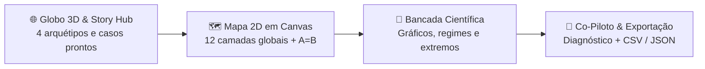
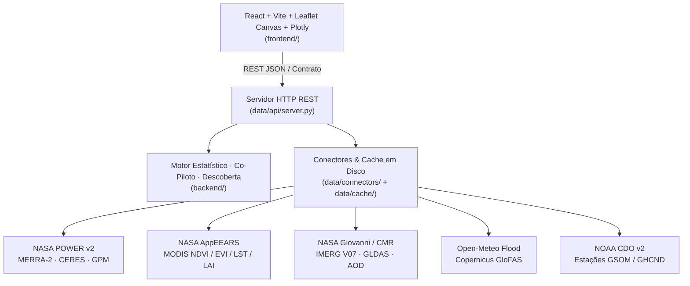

<div align="center">


# 🌍 Earth System Trend Detective
### **Project FlipFlop-34** · *NASA International Space Apps Challenge 2026*

**Descubra o que realmente está mudando no planeta — sem cair em armadilhas estatísticas.**  
Transforme décadas de dados de satélites da NASA, NOAA e Copernicus em diagnósticos visuais, comparações regionais e respostas auditadas em segundos.

[](https://earth-system-detective-fliflop-34.vercel.app/)
[](https://www.spaceappschallenge.org/)
[](#modo-100-offline-e-contingência)
[](#testes-auditoria-e-cicd)

[🚀 Acessar Aplicação](https://earth-system-detective-fliflop-34.vercel.app/) · [🧭 Como Funciona](#-a-jornada-do-detetive) · [🛰️ Dados da NASA](#%EF%B8%8F-fontes-de-dados--arquitetura) · [💻 Rodar Localmente](#-como-executar-localmente) · [📐 Rigor Estatístico](#-rigor-estatístico--auditoria-técnica)

</div>

---

## 🎯 Por que este projeto importa?

Séries climáticas da Terra escondem armadilhas que enganam até análises experientes:
- **Um único ano de El Niño** pode criar a ilusão de uma tendência de aquecimento ou seca que não existe.
- **Comparar apenas o início e o fim de uma série** descarta décadas de trajetória real.
- **O mesmo fenômeno global** pode esquentar uma região enquanto esfria outra — ou subir em 40 anos enquanto oscila em sentido oposto ano a ano.

O **Earth System Trend Detective** resolve isso entregando uma plataforma interativa em que qualquer pesquisador, estudante ou cidadão explora o globo, compara duas regiões ou variáveis lado a lado e recebe respostas claras, visuais e matematicamente blindadas contra falsos alarmes.

> [!TIP]
> **4 Perguntas. 1 Clique. Zero Achismo.**  
> Para qualquer ponto ou área selecionada no planeta, a plataforma responde imediatamente: **O que** está mudando, **Onde** está mudando, **Quanto** mudou por década e **Se a mudança é estatisticamente real** — e não apenas ruído natural.

---

## 🧭 A Jornada do Detetive



### ✨ Destaques da Experiência

| Módulo | O que entrega na prática |
| :--- | :--- |
| 🌐 **Story Hub & Globo 3D** | Entrada imersiva com globo interativo (`Blue Marble`), 4 arquétipos científicos e **Tutorial HUD guiado em 8 passos** direto sobre a interface. |
| 🗺️ **Mapa 2D em Canvas** | **12 grades globais pré-processadas** (`144` pontos cada, `1981–2025`), seleção livre por arraste de até **25 células (`5×5`)** e modo **Mesmo Local (`A=B`)** com *re-snap* automático entre sensores diferentes (`MERRA-2` ↔ `CERES`). |
| 🔬 **Bancada Científica** | Gráficos Plotly com alternância instantânea entre **Anomalia Climatológica**, **Série Bruta** e **Z-Score ($\sigma$)**, escala **Linear / Symlog**, dispersão $X \times Y$ e exportação pronta em **CSV** e **JSON**. |
| 🤖 **Co-Piloto Estatístico** | Assistente conectado diretamente às ferramentas determinísticas do motor científico: responde perguntas em linguagem natural sem jamais inventar números fora dos dados reais. |
| 📡 **Descoberta Dinâmica** | Motor `< 50 ms` que varre teleconexões parciais, quebras estruturais de regime e atribuição de extremos climáticos para qualquer área escolhida no mapa. |

---

## 🔥 Casos Prontos para Testar em 1 Clique

Logo na tela inicial, o usuário pode abrir investigações reais pré-configuradas para ver o sistema em ação:

| Caso de Investigação | Regiões & Variáveis | O que revela |
| :--- | :--- | :--- |
| 🌾 **Cerrado × Amazônia** | Triângulo Mineiro (MG) × Amazônia Central · `GWETTOP` | Contraste espacial de umidade do solo superficial entre dois biomas vizinhos. |
| 🌡️ **Ondas de Calor em MG** | Norte de Minas Gerais (`A=B`) · `GWETTOP` × `T2M_MAX` | Acoplamento local entre picos de temperatura máxima e ressecamento do solo no mesmo lugar. |
| ☀️ **Sol na Amazônia × Chuva no Sul** | Amazônia Equatorial × Bacia do Paraná · `ALLSKY_SFC_SW_DWN` × `PRECTOTCORR` | Teleconexão cruzada combinando radiação solar (`CERES`) e precipitação (`MERRA-2`). |
| 🧊 **Ártico × Trópicos** | Svalbard (78°N) × Atlântico Tropical · `T2M` | Amplificação polar comparando a velocidade de aquecimento entre latitudes extremas. |

---

## 🛰️ Fontes de Dados & Arquitetura

O sistema integra **5 APIs científicas** organizadas em **7 Famílias Ambientais (42 códigos operacionais)**, mantendo frontend e backend desacoplados por um contrato JSON estrito:



> 📖 Veja resoluções espaciais, regras de máscara oceânica (`-999` → `NaN`), tratamento de precipitação (`mm/mês`) e citações oficiais em **[DATA_SOURCES.md](DATA_SOURCES.md)**.

---

## 💻 Como Executar Localmente

### Pré-requisitos
- **Python 3.10+** (`venv` e `pip`)
- **Node.js 22+** e **npm**

### 1. Subir o Backend (`http://127.0.0.1:8000`)

```bash
python3 -m venv .venv
source .venv/bin/activate          # Windows PowerShell: .venv\Scripts\Activate.ps1
pip install -r backend/requirements.txt

# Opcional: chaves para Co-Piloto (Gemini/OpenRouter) e conectores autenticados
cp data/.env.example data/.env

PYTHONPATH=. python3 -m data.api.server --host 127.0.0.1 --port 8000
```

### 2. Subir o Frontend (`http://127.0.0.1:5173`)

```bash
cd frontend
npm ci
npm run dev -- --host 127.0.0.1 --port 5173
```

### Modo 100% Offline e Contingência

Precisa demonstrar sem internet ou sem backend Python? A aplicação possui mapa vetorial embarcado, catálogo local, `mock_analysis.json` e as 12 grades globais em `frontend/public/data/`. Basta configurar `VITE_DATA_MODE=offline` em `frontend/.env.local`:

```bash
cd frontend
npm run build
npm run verify:offline
npm run preview
```

---

## 📂 Estrutura do Repositório

```text
├── frontend/                   # React + TS + Vite + Mantine + Leaflet Canvas + Plotly + E2E Playwright
├── backend/                    # Motor estatístico, Co-Piloto agêntico e Motor de Descoberta (<50 ms)
├── data/                       # Catálogo (42 variáveis), conectores multi-API, cache e servidor REST
├── context/                    # Base científica, especificações de APIs, mapas e estratégia
├── .github/workflows/ci.yml    # Esteira automatizada (Python + Typecheck + Vitest + Offline + Playwright)
├── CONTRATO_DE_DADOS.md        # Contrato JSON oficial (RegionAnalysisRequest -> RegionAnalysisResponse)
├── DATA_SOURCES.md             # Inventário oficial de datasets NASA, NOAA e Copernicus
├── DECISOES.md                 # Log de decisões arquiteturais
└── 00_MASTER_CONTEXT_AND_ROUTER.md
```

---

## 📐 Rigor Estatístico & Auditoria Técnica

> [!IMPORTANT]
> Para garantir integridade científica em todas as telas, gráficos, exportações e respostas do Co-Piloto, o motor estatístico segue **7 invariantes invioláveis**:

<details>
<summary><strong>🔎 Ver os 7 Invariantes Estatísticos e métodos aplicados</strong></summary>

| # | Invariante / Regra | Implementação no Motor (`backend/stats_engine.py`) |
| :-: | :--- | :--- |
| **1** | **Proibido usar $Y_{\text{fim}} - Y_{\text{início}}$** | Tendências calculadas sobre toda a nuvem mensal via **Theil–Sen** robusto (IC 95%) e **OLS** por década. |
| **2** | **Remoção prévia de sazonalidade** | Regressões rodam sobre **anomalias climatológicas mensais** (Princípio Henrietta Leavitt) com interseção temporal alinhada. |
| **3** | **Respeito à escala da variável** | Variáveis intervalares ($^\circ\text{C}$, $\text{kPa}$, etc.) têm variação percentual (`%`) estritamente bloqueada. |
| **4** | **Inclinação $\neq$ Acoplamento** | Exibição separada entre taxa física ($B$) e força da relação ($r$ de Pearson, $\tau$ de Kendall, $R^2$). |
| **5** | **Paradoxo Multiescala** | Separação entre correlação secular de longo prazo ($r_{\text{global}}$) e oscilação residual de curto prazo ($r_{\text{detrended}}$). |
| **6** | **Curvas não-lineares suaves** | Ajuste por **GAM / Smoothing Spline (GCV)** e derivadas forenses no lugar de polinômios livres de grau alto. |
| **7** | **Extremos & Significância Espacial** | Elipse de **Mahalanobis ($D_M > 2{,}5$)** sem descarte de picos + correção **$\text{AR}(1)$** ($N_{\text{efetivo}}$) e **Benjamini–Hochberg FDR ($q < 0{,}05$)**. |

</details>

<details>
<summary><strong>🧪 Comandos de Testes, Auditoria Offline e CI/CD</strong></summary>

**Frontend (`frontend/`):**
```bash
npm run typecheck         # Checagem estrita TypeScript (tsc --noEmit)
npm run validate:grids    # Homologação estrutural e estatística das 12 grades globais
npm run build             # Build de produção em dist/
npm test                  # Suíte unitária (Vitest; inclui auditoria de dist/)
npm run verify:offline    # Garantia de 0 CDNs externas e integridade offline em dist/
npm run test:e2e          # Suíte Playwright em navegador real contra vite preview
```
*(Em Linux/CI, na primeira execução do Playwright: `npx playwright install --with-deps chromium`.)*

**Backend (`backend/` e `data/`):**
```bash
PYTHONPATH=. python3 -B -m unittest discover -s backend -p "test_*.py" -v
PYTHONPATH=. python3 -B -m unittest discover -s data/tests -p "test_*.py" -v
```

**Endpoints principais do servidor REST (`data.api.server`):**
`GET /api/health` · `GET /api/catalog` · `POST /api/analyze` · `POST /api/copilot` · `POST /api/discover` · `POST /api/location/fetch` · `POST /api/compare`

</details>

---

<div align="center">

📖 Documentação complementar: [DATA_SOURCES.md](DATA_SOURCES.md) · [CONTRATO_DE_DADOS.md](CONTRATO_DE_DADOS.md) · [DECISOES.md](DECISOES.md) · [CI Workflow](.github/workflows/ci.yml)

</div>
