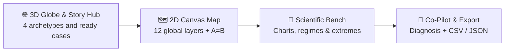
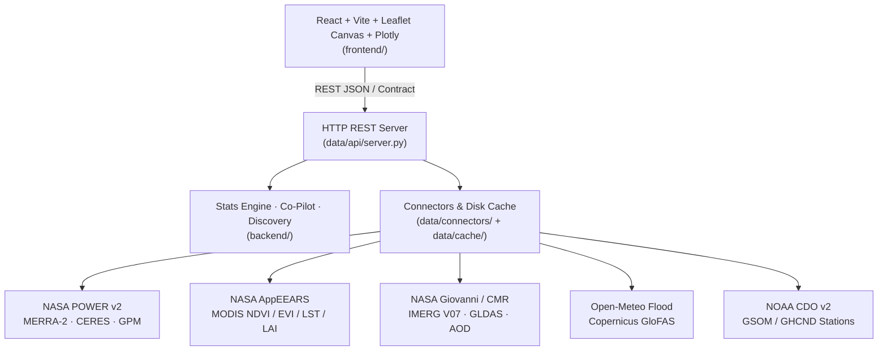

<div align="center">


# 🌍 Earth System Trend Detective
### **Project FlipFlop-34** · *NASA International Space Apps Challenge 2026*

**Uncover what is truly changing on our planet — without falling into statistical traps.**  
Turn decades of NASA, NOAA, and Copernicus satellite records into visual diagnostics, side-by-side regional comparisons, and scientifically audited answers in seconds.

[](https://earth-system-detective-fliflop-34.vercel.app/)
[](https://www.spaceappschallenge.org/)
[](#100-offline-mode--fallback)
[](#testing-auditing--cicd)

[🚀 Launch App](https://earth-system-detective-fliflop-34.vercel.app/) · [🧭 How It Works](#-the-detectives-journey) · [🛰️ NASA Data & Architecture](#%EF%B8%8F-data-sources--architecture) · [💻 Run Locally](#-running-locally) · [📐 Statistical Rigor](#-statistical-rigor--technical-audit)

</div>

---

## 🎯 Why This Project Matters

Earth's climate time series hide pitfalls that mislead even experienced analyses:
- **A single El Niño year** can create the illusion of a warming or drying trend that does not exist.
- **Comparing only the start and end points** throws away decades of intermediate physical trajectory.
- **The same global driver** can heat up one region while cooling another — or climb over 40 years while oscillating in opposite phase year-to-year.

**Earth System Trend Detective** solves this by giving researchers, students, and decision-makers an interactive platform to explore the globe, compare any two regions or variables side by side, and receive clear, visual answers mathematically shielded against false alarms.

> [!TIP]
> **4 Questions. 1 Click. Zero Guesswork.**  
> For any selected point or region on Earth, the platform immediately answers: **What** is changing, **Where** it is changing, **How much** it changed per decade, and **Whether the change is statistically real** — rather than natural noise.

---

## 🧭 The Detective's Journey



### ✨ Experience Highlights

| Module | What It Delivers |
| :--- | :--- |
| 🌐 **Story Hub & 3D Globe** | Immersive entry with an interactive globe (`Blue Marble`), 4 scientific archetypes, and an **8-step guided HUD Tutorial** directly over the live controls. |
| 🗺️ **2D Canvas Map** | **12 precomputed global grids** (`144` points each, `1981–2025`), free box-drag selection up to **25 cells (`5×5`)**, and **Same Location (`A=B`)** mode with automatic *re-snap* across different sensor grids (`MERRA-2` ↔ `CERES`). |
| 🔬 **Scientific Bench** | Interactive Plotly charts with instant switching between **Climatological Anomaly**, **Raw Series**, and **Z-Score ($\sigma$)**, **Linear / Symlog** scale, $X \times Y$ scatter plot, and one-click **CSV** / **JSON** export. |
| 🤖 **Statistical Co-Pilot** | Agentic assistant wired directly to deterministic statistical engine tools: answers natural-language questions without ever inventing numbers outside the real data. |
| 📡 **Dynamic Discovery** | Sub-50 ms algebraic engine scanning partial teleconnections, structural regime breaks, and climate extreme attribution for any user-selected map region. |

---

## 🔥 Ready-to-Test Investigation Cases (1 Click)

Right from the landing screen, users can launch curated real-world investigations to see the system in action:

| Investigation Case | Regions & Variables | What It Reveals |
| :--- | :--- | :--- |
| 🌾 **Cerrado vs. Amazon** | Triângulo Mineiro (MG) × Central Amazon · `GWETTOP` | Spatial contrast in surface soil moisture between two neighboring biomes. |
| 🌡️ **Heatwaves in Minas Gerais** | Northern Minas Gerais (`A=B`) · `GWETTOP` × `T2M_MAX` | Local coupling between peak daily maximum temperatures and soil drying at the exact same site. |
| ☀️ **Amazon Sun vs. Southern Rain** | Equatorial Amazon × Paraná Basin · `ALLSKY_SFC_SW_DWN` × `PRECTOTCORR` | Cross-variable teleconnection combining solar radiation (`CERES`) and precipitation (`MERRA-2`). |
| 🧊 **Arctic vs. Tropics** | Svalbard (78°N) × Tropical Atlantic · `T2M` | Polar amplification comparing warming rates across extreme latitudes. |

---

## 🛰️ Data Sources & Architecture

The platform integrates **5 scientific APIs** organized into **7 Environmental Families (42 operational codes)**, keeping frontend and backend decoupled through a strict JSON contract:



> 📖 See spatial resolutions, ocean mask rules (`-999` → `NaN`), monthly precipitation scaling (`mm/month`), and official citations in **[DATA_SOURCES.md](DATA_SOURCES.md)**.

---

## 💻 Running Locally

### Prerequisites
- **Python 3.10+** (`venv` and `pip`)
- **Node.js 22+** and **npm**

### 1. Start the Backend (`http://127.0.0.1:8000`)

From the repository root:

```bash
python3 -m venv .venv
source .venv/bin/activate          # Windows PowerShell: .venv\Scripts\Activate.ps1
pip install -r backend/requirements.txt

# Optional: configure keys for Co-Pilot (Gemini/OpenRouter) and authenticated connectors
cp data/.env.example data/.env

PYTHONPATH=. python3 -m data.api.server --host 127.0.0.1 --port 8000
```

### 2. Start the Frontend (`http://127.0.0.1:5173`)

In a second terminal:

```bash
cd frontend
npm ci
npm run dev -- --host 127.0.0.1 --port 5173
```

### 100% Offline Mode & Fallback

Need to demo without internet access or a Python backend? The app ships with an embedded vector basemap, local variable catalog, `mock_analysis.json`, and all 12 global grids in `frontend/public/data/`. Set `VITE_DATA_MODE=offline` in `frontend/.env.local`:

```bash
cd frontend
npm run build
npm run verify:offline
npm run preview
```

---

## 📂 Repository Structure

```text
├── frontend/                   # React + TS + Vite + Mantine + Leaflet Canvas + Plotly + Playwright E2E
├── backend/                    # Statistical engine, agentic Co-Pilot, and <50 ms Discovery Engine
├── data/                       # Catalog (42 variables), multi-API connectors, disk cache, and REST server
├── context/                    # Scientific knowledge base, API specs, map contracts, and strategy
├── .github/workflows/ci.yml    # Automated CI pipeline (Python + Typecheck + Vitest + Offline + Playwright)
├── CONTRATO_DE_DADOS.md        # Frozen JSON contract (RegionAnalysisRequest -> RegionAnalysisResponse)
├── DATA_SOURCES.md             # Official inventory of NASA, NOAA, and Copernicus datasets
├── DECISOES.md                 # Chronological log of architectural decisions
└── 00_MASTER_CONTEXT_AND_ROUTER.md
```

---

## 📐 Statistical Rigor & Technical Audit

> [!IMPORTANT]
> To guarantee scientific integrity across every chart, export, and Co-Pilot response, the statistical engine enforces **7 non-negotiable invariants**:

<details>
<summary><strong>🔎 View the 7 Statistical Invariants and implemented methods</strong></summary>

| # | Invariant / Rule | Engine Implementation (`backend/stats_engine.py`) |
| :-: | :--- | :--- |
| **1** | **Never use $Y_{\text{end}} - Y_{\text{start}}$** | Trends are computed across the entire monthly cloud via robust **Theil–Sen** (95% CI) and **OLS** per decade. |
| **2** | **Prior seasonality removal** | Regressions run exclusively on **monthly climatological anomalies** (Henrietta Leavitt Principle) with aligned time windows. |
| **3** | **Strict scale discipline** | Interval-scale variables ($^\circ\text{C}$, $\text{kPa}$, etc.) strictly block percentage (`%`) change displays. |
| **4** | **Slope $\neq$ Coupling** | Separate reporting for physical rate ($B$) and coupling strength (Pearson $r$, Kendall $\tau$, $R^2$). |
| **5** | **Multiscale Paradox** | Explicit separation between long-term secular coupling ($r_{\text{global}}$) and short-term detrended coupling ($r_{\text{detrended}}$). |
| **6** | **Smooth nonlinear modeling** | **GAM / Smoothing Spline (GCV)** and forensic derivative checks instead of unconstrained high-degree polynomials. |
| **7** | **Extremes & Spatial Significance** | **Mahalanobis distance ($D_M > 2.5$)** outlier flagging without trimming + **$\text{AR}(1)$** ($N_{\text{effective}}$) and **Benjamini–Hochberg FDR ($q < 0.05$)**. |

</details>

<details>
<summary><strong>🧪 Testing, Offline Audit & CI/CD Commands</strong></summary>

**Frontend (`frontend/`):**
```bash
npm run typecheck         # Strict TypeScript check (tsc --noEmit)
npm run validate:grids    # Structural and statistical validation of all 12 global grids
npm run build             # Production build into dist/
npm test                  # Unit test suite (Vitest; includes dist/ offline audit)
npm run verify:offline    # Enforces zero external CDNs and offline integrity in dist/
npm run test:e2e          # Real-browser Playwright E2E suite against vite preview
```
*(On Linux/CI, install browser dependencies on first run with `npx playwright install --with-deps chromium`.)*

**Backend (`backend/` and `data/`):**
```bash
PYTHONPATH=. python3 -B -m unittest discover -s backend -p "test_*.py" -v
PYTHONPATH=. python3 -B -m unittest discover -s data/tests -p "test_*.py" -v
```

**Primary REST Server Endpoints (`data.api.server`):**
`GET /api/health` · `GET /api/catalog` · `POST /api/analyze` · `POST /api/copilot` · `POST /api/discover` · `POST /api/location/fetch` · `POST /api/compare`

</details>

---

<div align="center">

📖 Additional documentation: [DATA_SOURCES.md](DATA_SOURCES.md) · [CONTRATO_DE_DADOS.md](CONTRATO_DE_DADOS.md) · [DECISOES.md](DECISOES.md) · [CI Workflow](.github/workflows/ci.yml)

</div>
