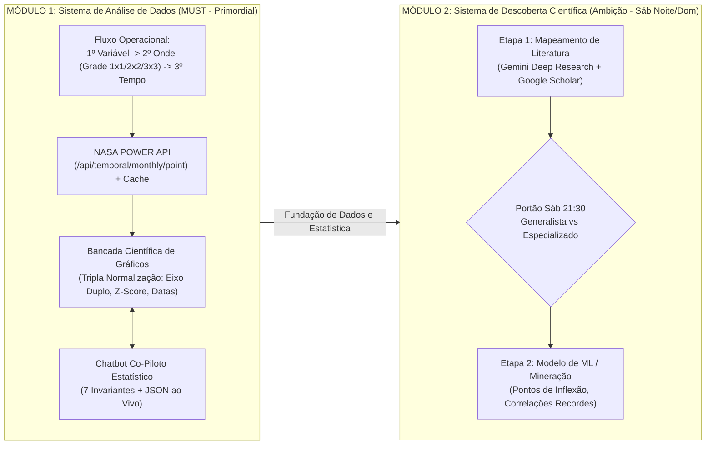
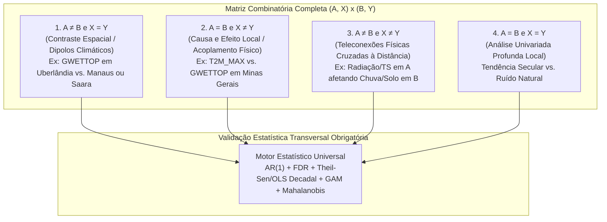
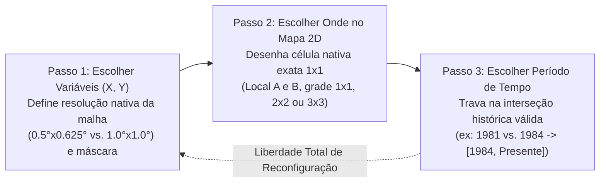
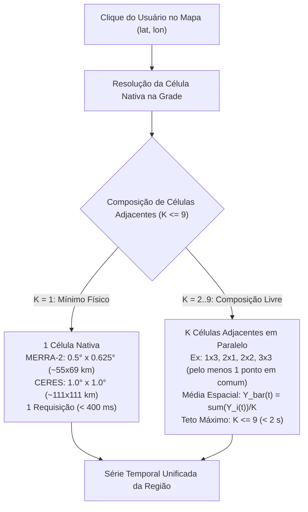
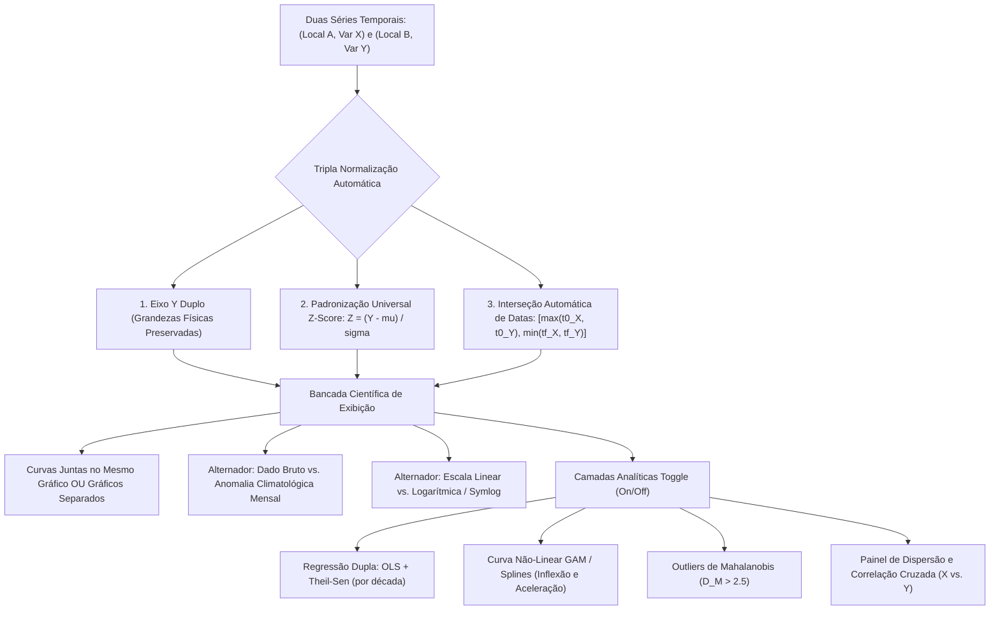

# Plano Diretor Operacional — "Be An Earth System Trend Detective!" (NASA Space Apps 2026)

> **Status do Documento:** Doutrina Operacional de Execução Oficial (Versão Refatorada e Auditada pela Equipe).  
> **Janela Real de Operação:** Sábado 09:00 $\to$ Domingo 24:00 (**39h corridas / ~30h produtivas por pessoa**, descontando 6h30m de sono obrigatório e pausas).  
> **Arquitetura Oficial de Dados:** Consumo em Tempo Real via **NASA POWER API** (`/api/temporal/monthly/point`) com **Cache Local Resiliente** (IndexedDB / Memória / Proxy local), eliminando dependência de downloads pesados de NetCDF4 e garantindo respostas em $< 2\text{ s}$ no uso livre e $< 50\text{ ms}$ no pitch.  
> **Arquitetura de Produto:** **Dois Sistemas Integrados** — Módulo 1 (Sistema de Análise de Dados Generalista — `MUST`) e Módulo 2 (Sistema de Descoberta Científica via ML / Mineração — Sábado à Noite e Domingo).

---

## 1. Missão, Arquitetura Dual e Critério de Aceitação

### 1.1 O Problema Científico e o Centro de Gravidade (*Schwerpunkt*)
O planeta Terra opera como um sistema acoplado e dinâmico (atmosfera, hidrosfera, biosfera, criosfera e radiação solar). Variáveis ambientais monitoradas por satélites e modelos reanalisados da NASA evoluem ao longo das décadas sob forçantes globais complexos. No entanto, cientistas enfrentam frequentemente três desafios analíticos fundamentais:
1. **Divergência Espacial:** O mesmo fenômeno global produz tendências de alta severa em uma região e de queda acentuada em outra (ex.: o aquecimento global provocando dessecação extrema no Cerrado enquanto expande o volume de chuva no Sudeste da América do Sul).
2. **Paradoxo Multiescala:** Séries temporais podem exibir forte tendência de alta secular em 30–40 anos ($r_{\text{global}} > 0$), enquanto operam em oposição sistemática de fase em oscilações interanuais de 12 a 36 meses ($r_{\text{detrended}} < 0$, devido a eventos cíclicos como El Niño/Oscilação Sul).
3. **Acoplamento Físico de Causa e Efeito ($X \neq Y$):** Variáveis de diferentes domínios interagem localmente ou à distância com atrasos e retroalimentações (ex.: ondas de calor com aumento de temperatura máxima acelerando o esgotamento da água no solo superficial, ou anomalias térmicas oceânicas alterando o regime de chuvas continental).

- **Centro de Gravidade (*Schwerpunkt*) do Produto e do Pitch:** Tornar a **divergência espacial**, as **correlações físicas de causa e efeito** e a **validação estatística contra o ruído natural** imediatamente visíveis, comparáveis em tempo real e blindadas contra erros clássicos de análise climática.

---

### 1.2 Os Dois Sistemas Oficiais da Plataforma

A plataforma é estruturada oficialmente em **dois módulos complementares**:



#### Módulo 1 — Sistema de Análise de Dados (Primordial / `MUST` — Generalista)
- **Objetivo:** Funcionar como uma estação de trabalho para **qualquer cientista**, independentemente da sua área de especialização (climatologia, hidrologia, agronomia, geologia, energia solar ou meteorologia).
- **Flexibilidade Irrestrita:** O pesquisador clica livremente em qualquer coordenada da Terra, seleciona duas áreas e duas variáveis quaisquer do catálogo de 12 variáveis da NASA, define a escala espacial de agregação e obtém diagnósticos estatísticos completos instantaneamente.
- **Co-Piloto Estatístico Integrado:** Um agente conversacional inteligente alimentado diretamente com o payload JSON dos cálculos estatísticos em tempo real e com as diretrizes dos 7 Invariantes Estatísticos, auxiliando o cientista a validar hipóteses e evitar conclusões precipitadas.

#### Módulo 2 — Sistema de Descoberta Científica (Ambição / Grande Adicional — Sábado à Noite e Domingo)
- **Objetivo:** Ir além de uma ferramenta analítica passiva e atuar como um **motor ativo de descoberta científica**, capaz de minerar e sintetizar achados com densidade e originalidade suficientes para fundamentar um artigo científico (*paper*).
- **Etapa 1 — Mapeamento de Literatura de Vanguarda (Sábado à Noite):** Utilização do *Gemini Deep Research* combinado com o *Google Scholar* para mapear os temas, lacunas e hipóteses mais aquecidos e debatidos na comunidade científica recente em ciências da Terra e clima.
- **Etapa 2 — Modelo de Machine Learning & Mineração de Inovações:** Construído diretamente sobre a infraestrutura e o motor estatístico do Módulo 1. Aplica algoritmos de mineração estatística e ML para varrer séries históricas da NASA POWER, buscando correlações excepcionais, quebras estruturais, anomalias multivariadas e pontos de inflexão não documentados.
- **Decisão Arquitetural em Aberto (Portão de Sábado 21:30):** A equipe decide no checkpoint se o Módulo 2 operará em modo **Generalista** (permitindo a qualquer cientista aplicar o minerador de ML em qualquer região/variável) ou **Especializado** (verticalizado no tema de maior impacto selecionado pelo *Gemini Deep Research*).

---

### 1.3 A Matriz Combinatória Completa $(A, X) \times (B, Y)$, Liberdade Total e o Fluxo Operacional

#### Liberdade Total do Pesquisador (Sem Perguntas Engessadas)
Fica categoricamente estabelecido (para que nem desenvolvedores, nem IAs e nem usuários se confundam) que **NÃO existe uma pergunta inicial engessada** na interface obrigando o cientista a escolher previamente entre opções pré-moldadas. 

A plataforma oferece **liberdade combinatória total** sobre a matriz $(A, X) \times (B, Y)$, cobrindo todas as **4 combinações físicas e espaciais possíveis**:



1. **$A \neq B$ e $X = Y$ (Mesma variável em lugares diferentes — Contraste Espacial / Dipolos Climáticos):**
   - *Exemplo Real:* Umidade do Solo Superficial (`GWETTOP`) comparando Uberlândia (Cerrado brasileiro, dessecação acelerada) contra Manaus (Amazônia central) ou o Deserto do Saara nas últimas 4 décadas.
   - *Objetivo Científico:* Identificar divergências espaciais e assimetrias regionais sob o mesmo forçante secular.
2. **$A = B$ e $X \neq Y$ (Variáveis diferentes no mesmo lugar — Causa e Efeito Local / Acoplamento Físico):**
   - *Exemplo Real:* Cruzar Temperatura Máxima (`T2M_MAX`) com Umidade do Solo (`GWETTOP`) na mesma célula geográfica (ex.: Norte de Minas Gerais).
   - *Objetivo Científico:* Quantificar como picos térmicos aceleram a evapotranspiração e drenam a água superficial.
3. **$A \neq B$ e $X \neq Y$ (Variáveis diferentes em lugares diferentes — Teleconexões Físicas Cruzadas):**
   - *Exemplo Real:* Temperatura da Superfície (`TS`) ou Radiação Solar (`ALLSKY_SFC_SW_DWN`) em uma região geradora $A$ (ex.: Atlântico Tropical ou Pacífico Equatorial) cruzada com a Precipitação (`PRECTOTCORR`) ou Umidade do Solo em uma bacia agrícola distante $B$.
   - *Objetivo Científico:* Rastrear ondas planetárias, teleconexões de grande escala e transferências de calor e umidade entre regiões oceânicas/continentais remotas.
4. **$A = B$ e $X = Y$ (Mesma variável no mesmo lugar — Análise Univariada Profunda):**
   - *Exemplo Real:* Série histórica isolada de Temperatura Média (`T2M`) ou Precipitação (`PRECTOTCORR`) em uma única região geográfica.
   - *Objetivo Científico:* Avaliar a magnitude da tendência decadal secular ($B_{\text{Sen}}$), identificar o regime físico via GAM (linear, aceleração ou platô) e determinar se o sinal supera o ruído estocástico local.

> [!IMPORTANT]
> **Natureza Transversal da Validação Estatística:** O teste de **Tendência Real vs. Ruído Natural** via autocorrelação $\text{AR}(1)$ ($N_{\text{efetivo}}$ de Santer/Hamed-Rao) e controle de taxa de falsas descobertas (FDR de Benjamini-Hochberg, $p_{\text{adj}} < 0{,}05$) **não é um modo separado**, mas uma camada matemática aplicada transversal e compulsoriamente a **qualquer uma das 4 combinações** da matriz. Os "3 Casos Clássicos" frequentemente citados no projeto representam destaques científicos e *Story Presets* (atalhos de demonstração rápida) configurados para o pitch de 240 segundos, e nunca uma restrição de produto.

---

#### Ordem Oficial de Interação na Interface (`1º Variável -> 2º Onde -> 3º Período de Tempo`)
Para garantir uma experiência de usuário infalível, livre de inconsistências físicas e com validação imediata na malha computacional da NASA, o fluxo de configuração inicial na interface segue estritamente a seguinte ordem técnica:



1. **Passo 1 — Escolher as Variáveis ($X$ e $Y$, podendo ser iguais ou diferentes):**
   - *Justificativa Técnica Inegociável:* Vem obrigatoriamente primeiro porque **a área mínima física da NASA depende da variável selecionada**. Variáveis meteorológicas e hidrológicas do modelo **MERRA-2** possuem grade nativa de $0{,}5^\circ \text{ lat} \times 0{,}625^\circ \text{ lon}$ ($\approx 55\times 69\text{ km}$ no equador), enquanto variáveis de radiação solar e nuvens do satélite **CERES SYN1deg** possuem grade nativa de $1{,}0^\circ \text{ lat} \times 1{,}0^\circ \text{ lon}$ ($\approx 111\times 111\text{ km}$). Além disso, variáveis de umidade de solo (`GWETTOP`, `GWETROOT`) possuem máscara continental (só existem em terra firme). Definir a variável primeiro garante que o mapa opere com a geometria correta desde o início.
2. **Passo 2 — Escolher Onde no Mapa 2D (Local $A$ e Local $B$, com composição flexível de células adjacentes):**
   - *Justificativa Técnica Inegociável:* Como as variáveis já foram selecionadas no Passo 1, ao clicar no mapa 2D a interface desenha imediatamente o retângulo ou quadrado $1\times 1$ com as dimensões geográficas nativas exatas da respectiva variável. Em seguida, permite ao cientista compor livremente a área adicionando células **adjacentes** (que tenham pelo menos um ponto/vértice em comum, ex.: $1\times 3$, $2\times 1$, $2\times 2$, até o teto de 9 células), podendo escolher uma geometria para $X$ (ex.: $1\times 3$) e outra distinta para $Y$ (ex.: $2\times 1$).
3. **Passo 3 — Escolher o Período de Tempo ($[t_0, t_f]$):**
   - *Justificativa Técnica Inegociável:* Vem em 3º lugar porque a disponibilidade histórica dos registros depende das variáveis escolhidas no Passo 1 (`1981–Presente` para MERRA-2 vs. `1984–Presente` para CERES). O componente de seleção de datas já abre travado e delimitado no intervalo comum $[\max(t_{0,X}, t_{0,Y}), \min(t_{f,X}, t_{f,Y})]$, eliminando consultas inválidas e erros 400 da API da NASA.
   - *Regra de Flexibilidade:* Após a configuração inicial dos 3 passos, o usuário tem **liberdade total para alterar qualquer parâmetro** (trocar de ponto no mapa, mudar de variável, alterar a janela temporal ou chavear a escala de grade) a qualquer instante, disparando atualizações reativas automáticas na bancada gráfica.

---

### 1.4 Critério de Aceitação (Definição de Pronto — DoD)

O MVP do Sistema de Análise de Dados está concluído quando, para quaisquer coordenadas selecionadas e quaisquer variáveis do catálogo, o usuário recebe em **menos de 2 segundos** as **5 Respostas do Detetive**:
1. **O QUE muda?** (*What is changing?* — Variável física expressa em unidades corretas, alternância entre Série Bruta e Anomalia Climatológica Mensal sem sazonalidade, classificação de regime físico via GAM — *linear, acelerando ou saturando* — e identificação de extremos pela Elipse de Mahalanobis $D_M > 2{,}5$).
2. **ONDE muda?** (*Where is it changing?* — Mapa 2D com a área mínima da grade NASA desenhada no local do clique e composição livre de células adjacentes (ex.: $1\times 3$, $2\times 1$, $2\times 2$, até 9 células), com exibição de Local A e Local B conectados visualmente).
3. **QUANDO muda?** (*When is it changing?* — Janela temporal $[t_0, t_f]$ ajustável, com interseção automática de períodos comuns quando $X \neq Y$).
4. **QUANTO muda?** (*How much is it changing?* — Taxa de variação decadal calculada sobre **toda a nuvem de pontos** via Declive Mediano Robusto de Theil-Sen ($B_{\text{Sen}}$) e Mínimos Quadrados ($B_{\text{OLS}}$), com proibição estrita de usar $Y_{\text{fim}} - Y_{\text{início}}$ ou porcentagens ($\%$) em escalas intervalares como $^\circ\text{C}$).
5. **É ESTATISTICAMENTE SIGNIFICATIVO?** (*Is it statistically significant?* — $p\text{-valor}$ rigorosamente corrigido para persistência climática $\text{AR}(1)$ ($N_{\text{efetivo}}$), taxa de falsas descobertas $p_{\text{adj}}$ (FDR) e acoplamento via correlação de Pearson $r$, $\tau$ de Kendall e separação multiescala $r_{\text{global}}$ vs. $r_{\text{detrended}}$).

---

### 1.5 Alinhamento aos 4 Critérios dos Jurados da NASA (25% cada)

| Critério Oficial (25%) | Como Nossa Nova Arquitetura Maximiza a Nota |
| :--- | :--- |
| **1. Impacto Galáctico** | Entrega uma ferramenta generalista que capacita cientistas de qualquer domínio a investigar o sistema Terra e inclui um Módulo de Descoberta com potencial de gerar artigos científicos inéditos. |
| **2. Uso de Dados da NASA** | Integração direta e dinâmica com a NASA POWER API, consumindo dados calibrados de satélites e modelos de reanálise de ponta (**MERRA-2** e **CERES**), com metadados e DOIs documentados. |
| **3. Protótipo MVP** | Aplicação interativa em tempo real com mapas, grade física real da NASA ($1\times 1 \to 2\times 2 \to 3\times 3$), gráficos de dupla escala, regressões robustas e Cache Local que torna a experiência instantânea. |
| **4. Pitch & Storytelling (240s)** | Apresentação conduzida por uma descoberta científica tangível minerada pela própria plataforma e validada pelos 7 Invariantes Estatísticos. |

---

## 2. Especificação Técnica da NASA POWER API, Grade Espacial e Bancada de Gráficos

### 2.1 Consumo de Dados em Tempo Real via NASA POWER API

A **NASA POWER API** (Prediction Of Worldwide Energy Resources) é a espinha dorsal de dados do projeto. Ela sintetiza terabytes de dados brutos de satélites e reanálises climáticas em endpoints REST de alta performance, devolvendo tabelas limpas e estruturadas em JSON:

- **Endpoint Oficial Utilizado:** `/api/temporal/monthly/point`
- **URL Base:**  
  `https://power.larc.nasa.gov/api/temporal/monthly/point?parameters={PARAMS}&community=AG&longitude={LON}&latitude={LAT}&start={START_YEAR}&end={END_YEAR}&format=JSON`
- **Autenticação:** Aberta ao público, **não exige chave de API privada**. Requer apenas cabeçalho `User-Agent` informativo (ex.: `User-Agent: TrendDetective-NASASpaceApps/1.0`).
- **Formato da Resposta:** JSON com estrutura `properties.parameter.{VAR_NAME}.{YYYYMM}`, onde os valores mensais vêm associados à chave cronológica (ex.: `198101: 24.32`).
- **Camada de Resiliência e Cache Local:**
  - Toda requisição bem-sucedida é gravada imediatamente em armazenamento local do navegador (**IndexedDB** ou **localStorage**) e no cache em disco do backend/proxy local.
  - Se o usuário selecionar novamente a mesma célula da grade ou se houver instabilidade momentânea na conexão de internet durante a apresentação aos jurados, a consulta retorna em **$< 50\text{ ms}$**, garantindo risco zero no pitch ao vivo.

---

### 2.2 Lógica Espacial de Composição da Grade NASA (Células Adjacentes até $K \le 9$) e Resoluções Nativas

Em vez de polígonos arbitrários ou apenas quadrados fixos, o Trend Detective adota a **geometria física nativa dos modelos da NASA** com **composição flexível de células adjacentes**:



1. **A Menor Área Física Possível da NASA (Célula $1\times 1$):**
   - Ao clicar no mapa 2D, o sistema calcula a célula mínima de grade correspondente à coordenada geográfica:
     - **Variáveis do MERRA-2 (Meteorologia, Água e Solo):** A grade nativa é de **$0{,}5^\circ \text{ latitude} \times 0{,}625^\circ \text{ longitude}$** ($\approx 55\text{ km} \times 69\text{ km}$ no equador). O mapa desenha exatamente esse retângulo delimitador sobre a superfície.
     - **Variáveis do CERES (Radiação Solar e Nuvens):** A grade nativa é de **$1{,}0^\circ \text{ latitude} \times 1{,}0^\circ \text{ longitude}$** ($\approx 111\text{ km} \times 111\text{ km}$). O mapa desenha esse quadrado de resolução solar.
2. **Composição Livre de Células Adjacentes ($1\times 3$, $2\times 1$, $2\times 2$, etc.):**
   - O cientista pode acompanhar um rio, faixa costeira, bacia ou região escolhendo qualquer composição de $K$ células **adjacentes** (regra: cada nova célula precisa ter **pelo menos um ponto/vértice em comum** com o conjunto já selecionado, i.e., $\max(|\Delta i|, |\Delta j|) \le 1$ na grade discreta).
   - **Independência entre $X$ e $Y$:** O cientista pode selecionar, por exemplo, uma área **$1\times 3$** para o dado $X$ e outra área **$2\times 1$** para o dado $Y$.
   - **Agregação Espacial:** O sistema dispara $K$ requisições pontuais em paralelo (`Promise.all`) e calcula a média aritmética mensal dos $K$ pontos:
     $$Y_{\text{área}}(t) = \frac{1}{K} \sum_{i=1}^{K} Y_i(t)$$
   - **Limite Estrito de Segurança:** O teto máximo é **$K \le 9$ células por região** (equivalente a no máximo $3\times 3$). Esse limite garante tempo de agregação $< 2\text{ s}$, protege a aplicação contra bloqueios por excesso de chamadas e mantém a interface ultra-responsiva.

---

### 2.3 Catálogo das 12 Variáveis Ambientais Integradas

O catálogo abrange os domínios essenciais das Ciências do Sistema Terra, alimentado por **MERRA-2** e **CERES SYN1deg**:

| # | Código da API | Domínio Científico | Nome da Variável Física | Modelo / Fonte | Resolução Nativa ($1\times 1$) | Unidade Oficial | Marco Inicial |
| :-: | :--- | :--- | :--- | :--- | :---: | :---: | :---: |
| **1** | `T2M` | Atmosfera | Temperatura Média do Ar a 2m | MERRA-2 | $0{,}5^\circ \times 0{,}625^\circ$ | $^\circ\text{C}$ | 1981 |
| **2** | `T2M_MAX` | Climatologia / Extremos | Temperatura Máxima Diária a 2m | MERRA-2 | $0{,}5^\circ \times 0{,}625^\circ$ | $^\circ\text{C}$ | 1981 |
| **3** | `T2M_MIN` | Climatologia / Extremos | Temperatura Mínima Diária a 2m | MERRA-2 | $0{,}5^\circ \times 0{,}625^\circ$ | $^\circ\text{C}$ | 1981 |
| **4** | `PRECTOTCORR` | Hidrologia / Chuva | Precipitação Total Corrigida | MERRA-2 | $0{,}5^\circ \times 0{,}625^\circ$ | $\text{mm/mês}$ | 1981 |
| **5** | `GWETTOP` | Hidrologia / Agronomia | Umidade do Solo Superficial ($0\text{--}5\text{ cm}$) | MERRA-2 | $0{,}5^\circ \times 0{,}625^\circ$ | $0\text{ a }1$ (fração) | 1981 |
| **6** | `GWETROOT` | Hidrologia / Geologia | Umidade do Solo Radicular ($0\text{--}100\text{ cm}$) | MERRA-2 | $0{,}5^\circ \times 0{,}625^\circ$ | $0\text{ a }1$ (fração) | 1981 |
| **7** | `RH2M` | Meteorologia | Umidade Relativa do Ar a 2m | MERRA-2 | $0{,}5^\circ \times 0{,}625^\circ$ | $\%$ | 1981 |
| **8** | `WS10M` | Dinâmica Atmosférica | Velocidade do Vento a 10m | MERRA-2 | $0{,}5^\circ \times 0{,}625^\circ$ | $\text{m/s}$ | 1981 |
| **9** | `PS` | Dinâmica Atmosférica | Pressão de Superfície | MERRA-2 | $0{,}5^\circ \times 0{,}625^\circ$ | $\text{kPa}$ | 1981 |
| **10** | `ALLSKY_SFC_SW_DWN` | Energia / Radiação Solar | Irradiância Solar de Onda Curta Descendente | CERES SYN1deg | $1{,}0^\circ \times 1{,}0^\circ$ | $\text{MJ/m}^2/\text{dia}$ | 1984 |
| **11** | `CLDTOT` | Atmosfera / Nuvens | Cobertura Total de Nuvens | CERES SYN1deg | $1{,}0^\circ \times 1{,}0^\circ$ | $\%$ | 1984 |
| **12** | `ALLSKY_SFC_LW_DWN` | Balanço Energético | Irradiância Térmica de Onda Longa Descendente | CERES SYN1deg | $1{,}0^\circ \times 1{,}0^\circ$ | $\text{MJ/m}^2/\text{dia}$ | 1984 |

---

### 2.4 Bancada Científica de Gráficos Super-Robusta e Tripla Normalização

Para atender aos mais elevados padrões da pesquisa científica e permitir a comparação entre grandezas heterogêneas ($X \neq Y$), a bancada de gráficos incorpora:



#### A Tripla Normalização Universal ($X \neq Y$)
1. **Eixo Y Duplo Coordenado:** O gráfico renderiza a escala física de $X$ à esquerda e a de $Y$ à direita, com códigos de cores idênticos às curvas das séries para evitar confusão de leitura.
2. **Padronização Universal em $Z\text{-Score}$ ($\sigma$):** O usuário pode converter instantaneamente ambas as curvas para desvios adimensionais:
   $$Z(t) = \frac{Y(t) - \mu_Y}{\sigma_Y}$$
   Isso permite avaliar se um pulso de $+2{,}5\sigma$ na temperatura corresponde a uma queda de $-2{,}8\sigma$ na umidade do solo, tornando variáveis com grandezas físicas distintas diretamente comparáveis na mesma amplitude geométrica.
3. **Interseção Automática de Datas:** Quando se comparam variáveis com datas iniciais distintas (ex.: `T2M` do MERRA-2 a partir de 1981 vs. `ALLSKY_SFC_SW_DWN` do CERES a partir de 1984), o motor trunca automaticamente a janela temporal para a intersecção comum $[1984, t_f]$, impedindo distorções no cálculo de correlações e regressões.

#### Camadas Analíticas Ativáveis
- **Dado Bruto vs. Anomalia Climatológica Mensal:** Alternador de 1 clique que subtrai o ciclo anual médio ($Y'_{a,m} = Y_{a,m} - \bar{Y}_m$), eliminando a contaminação sazonal verão/inverno (Princípio Henrietta Leavitt).
- **Escala Linear vs. Symlog:** Permite visualizar variáveis com comportamento exponencial ou de múltiplos regimes (ex.: precipitação em eventos extremos) sem colapsar os valores basais.
- **Regressão Linear Dupla (OLS + Theil-Sen):** Exibe a reta de Mínimos Quadrados ($B_{\text{OLS}}$) e a reta mediana robusta de Theil-Sen ($B_{\text{Sen}}$), com valores expressos rigorosamente em variação por década ($10 \times B$).
- **Curva Suave GAM (Generalized Additive Model):** Modelação não-linear por *splines* penalizadas para classificar se a tendência é estritamente linear, se está acelerando ou se atingiu platô de saturação física.
- **Elipse de Mahalanobis ($D_M > 2{,}5$):** Destaca graficamente os pontos anômalos bivariados que violam a covariância histórica do sistema, preservando-os na visualização como eventos climáticos extremos reais (ex.: super El Niño de 1997/98 ou 2015/16).
- **Painel de Dispersão e Correlação Cruzada ($X \text{ vs. } Y$):** Quando $A = B$ e $X \neq Y$, o painel exibe o gráfico de dispersão com reta de regressão bivariada, coeficientes de Pearson ($r$), $\tau$ de Kendall e a decomposição em correlação secular ($r_{\text{global}}$) versus correlação de curto prazo dessazonalizada ($r_{\text{detrended}}$).

---

### 2.5 Chatbot Co-Piloto Estatístico Integrado

A bancada integra um **Co-Piloto Estatístico** projetado para apoiar o raciocínio investigativo do cientista:
- **Alimentação por Contexto JSON:** Em cada interação ou alteração de parâmetros na bancada, o chatbot recebe o payload estruturado contendo as coordenadas, as variáveis, os coeficientes $B_{\text{Sen}}$, $B_{\text{OLS}}$, $r$, $\tau$, os $p\text{-valores}$ com correção $\text{AR}(1)$, o status FDR e os pontos de Mahalanobis detectados.
- **Guardião dos 7 Invariantes Estatísticos:** O assistente atua ativamente para impedir erros clássicos de interpretação:
  - Alerta se o usuário tentar interpretar variações percentuais em variáveis de escala intervalar (como $^\circ\text{C}$);
  - Adverte contra a ilusão de calcular tendência por $Y_{\text{fim}} - Y_{\text{início}}$;
  - Auxilia a diferenciar correlação espúria de acoplamento físico real;
  - Explica as implicações físicas das derivadas e inflexões reveladas pela curva GAM.
- **Implementação do Módulo:** A escolha do provedor de LLM, endpoints e engenharia de prompts é de responsabilidade técnica de `DADOS-2` (Rhyan, Fred), respeitando a integração via JSON padronizado.

---

## 3. Divisão de Força e Governança Multi-Cargo (5 Membros em 6 Frentes)

### 3.1 Governança Real de 5 Integrantes com Múltiplas Funções

Para maximizar a eficiência em uma maratona de 39 horas sem gerar sobrecargas isoladas ou pontos únicos de falha (*Single Points of Failure — SPOF*), a distribuição oficial da equipe é organizada em **duas visões complementares**:

#### Tabela 3.1.A — Visão por Integrante (5 Membros Multi-Cargo)

| Integrante | Cargos e Frentes Acumuladas | Foco Principal de Atuação | Responsabilidades no Hackathon |
| :--- | :--- | :--- | :--- |
| **Rhyan** | `COORD`, `DADOS-2`, `NARR` | Coordenação Geral, Estatística & Storytelling | Repositório Git, CI/CD, Contrato JSON unificado, `stats_engine.py`, validação dos 7 Invariantes, Co-Piloto Estatístico, ML de Descoberta e roteiro/direção do pitch. |
| **Kaio** | `DADOS-1`, `PROD-2` | Engenharia de Dados & Bancada de Gráficos | Cliente em tempo real da NASA POWER API, Agregador Espacial ($1\times 1 \to 3\times 3$), Cache Local (IndexedDB) e Bancada Científica de Gráficos (Tripla Normalização, alternadores e camadas analíticas). |
| **Renan** | `DADOS-1`, `PROD-1` | Engenharia de Dados & Frontend Geoespacial | Ingestão e validação da API, Mapa 2D interativo com grade física adaptativa da NASA, fluxo `1º Variável -> 2º Onde -> 3º Tempo` e responsividade visual. |
| **Felipe** | `COORD`, `DADOS-1`, `NARR` | Governança, Dados & Narrativa do Pitch | Co-coordenação técnica, deploy contínuo, apoio na ingestão de dados e cache, pesquisa profunda no Gemini Deep Research + Google Scholar, edição e legendagem do pitch (240s). |
| **Fred** | `DADOS-2`, `PROD-1` | Estatística, Machine Learning & Frontend | Implementação matemática de `stats_engine.py`, modelo de ML do Sistema de Descoberta Científica, prompts da LLM do Co-Piloto, e apoio no mapa 2D e interface de seleção. |

---

#### Tabela 3.1.B — Visão por Frente Funcional (6 Cargos e Responsabilidades Exclusivas)

| Frente Funcional | Integrantes Responsáveis | Escopo Técnico e Responsabilidades Exclusivas | Entregáveis Críticos |
| :--- | :--- | :--- | :--- |
| **`COORD`** | **Rhyan, Felipe** | Coordenação geral de equipe, governança do repositório Git (branches, PRs, merge), congelamento e versionamento do Contrato JSON unificado, aplicação estrita dos portões de qualidade, sincronia na rede local e preenchimento/submissão oficial no portal da NASA. | Repositório estruturado, CI/CD, `DECISOES.md`, aprovação de PRs e submissão final às 22:30. |
| **`DADOS-1`** | **Kaio, Renan, Felipe** | Desenvolvimento do cliente em tempo real da NASA POWER API (`/api/temporal/monthly/point`), agregador espacial de quadrados $1\times 1$ (1 dado nativo), $2\times 2$ (média de 4 dados) e $3\times 3$ (média de 9 dados), alinhamento temporal e implementação do Cache Local resiliente (IndexedDB / memória / disco). | Módulo de ingestão, funções de agregação regional e camada de cache offline com resposta $< 50\text{ ms}$. |
| **`DADOS-2`** | **Rhyan, Fred** | Desenvolvimento do Motor Estatístico (`stats_engine.py`: anomalias mensais dessazonalizadas, OLS e Theil-Sen por década, curva não-linear GAM, distância de Mahalanobis $D_M > 2{,}5$, correção serial $\text{AR}(1)$ com $N_{\text{efetivo}}$, $p_{\text{adj}}$ por FDR, correlações e regressões $X \text{ vs. } Y$), Chatbot Co-Piloto Estatístico (definição de LLM + prompt) e modelo de Machine Learning do *Sistema de Descoberta Científica*. | `stats_engine.py` testado, agente conversacional do Co-Piloto e algoritmo de mineração do Módulo 2. |
| **`PROD-1`** | **Renan, Fred** | Construção do Mapa 2D interativo (Leaflet/MapLibre), renderização da grade adaptativa no clique ($0{,}5^\circ \times 0{,}625^\circ$ vs. $1{,}0^\circ \times 1{,}0^\circ$), controle de seleção Local A / Local B e implementação da ordem oficial de interação: `1º Variável -> 2º Onde (Local A/B + quadrados 1x1, 2x2, 3x3 adaptados à resolução da variável) -> 3º Tempo`. | Componente de mapa interativo, renderizador de malha física da NASA e painel de seleção geoespacial. |
| **`PROD-2`** | **Kaio** *(com apoio de PROD-1)* | Construção da Bancada Científica de Gráficos (curvas juntas ou separadas, Tripla Normalização com Eixo Y Duplo e $Z\text{-Score}$, Dado Bruto vs. Anomalia, escala Linear vs. Logarítmica/Symlog, camadas OLS/Sen/GAM/Mahalanobis, dispersão $X \text{ vs. } Y$ e interface visual do Chatbot Co-Piloto). | Bancada de séries temporais reativa, componentes de alternância (toggles) e painel bivariado. |
| **`NARR`** | **Rhyan, Felipe** | Condução da pesquisa no *Gemini Deep Research* e *Google Scholar* para guiar o *Sistema de Descoberta Científica*, mapeamento de lacunas da literatura, preparação dos casos reais de demonstração (Story Presets), redação do roteiro, captação de áudio, gravação de tela, edição e legendagem do vídeo de pitch (240s). | Dossiê de literatura, roteiro cronometrado, vídeo MP4 1080p final e textos de submissão. |

---

### 3.2 Fluxo de Paralelismo e Convergência (Caminho Crítico das 39 Horas)

```mermaid
flowchart TD
    subgraph F1["Fase 1: Alinhamento de Contrato & Setup Base (Sáb 09:00 - 10:30)"]
        direction TB
        K1["09:00-09:30 (Plenária - Todos os 5):\nKickoff, Regras Oficiais NASA, Validação do Fluxo\n(1º Variável -> 2º Onde/Grade -> 3º Tempo) e 12 Variáveis"]
        K2["09:30-10:30 (Fechamento do Contrato JSON, Mock e Setup):\n• COORD (Rhyan, Felipe): Git, CI/CD, DECISOES.md\n• DADOS-1 (Kaio, Renan, Felipe): Teste da API POWER + Resoluções\n• DADOS-2 (Rhyan, Fred): Especificação dos Campos Estatísticos\n• PROD-1 (Renan, Fred): Parâmetros do Fluxo + Boilerplate UI\n• PROD-2 (Kaio): Estrutura de Séries + Geração de mock_analysis.json\n• NARR (Rhyan, Felipe): Disparo Deep Research + Requisitos NASA"]
        K1 --> K2
    end

    K2 --> M0{"Marco 0 (10:30): Contrato JSON Congelado + mock_analysis.json Disponível"}

    subgraph F2["Fase 2: Execução Desacoplada sobre o Mock (Sáb 10:30 - 12:30)"]
        direction TB
        D1["DADOS-1 (Kaio, Renan, Felipe):\nCliente NASA POWER + Agregador 1x1/2x2/3x3 + Cache"]
        D2["DADOS-2 (Rhyan, Fred):\nstats_engine.py (Anomalias, OLS/Sen, GAM, Mahalanobis, AR1+FDR)"]
        P1["PROD-1 (Renan, Fred):\nMapa 2D c/ Grade Adaptativa + Fluxo Variável->Onde->Tempo"]
        P2["PROD-2 (Kaio c/ apoio de PROD-1):\nBancada de Gráficos (Tripla Normalização, Camadas, Toggle)"]
        NARR0["NARR (Rhyan, Felipe):\nSíntese Preliminar Deep Research + Coordenadas Casos Pitch"]
        COORD0["COORD (Rhyan, Felipe):\n1º Deploy Público c/ Mock + Infraestrutura"]
    end

    M0 --> D1 & D2 & P1 & P2 & NARR0 & COORD0

    D1 & D2 & P1 & P2 & NARR0 & COORD0 --> G1{"Portão 1 (12:30): API NASA Funcional + stats_engine OK + UI Mock Ativa + 1º Deploy no Ar"}

    subgraph F3["Fase 3: Walking Skeleton Ponta a Ponta (Sáb 12:30 - 16:00)"]
        WS["Fusão Real: Clique no Mapa -> NASA POWER API ao Vivo -> stats_engine -> Gráficos com Tripla Normalização no Ar"]
    end

    G1 --> WS
    WS --> G2{"Portão 2 (16:00): Walking Skeleton do Módulo 1 Rodando na Web"}

    subgraph F4["Fase 4: Bancada Completa + Pesquisa de Literatura (Sáb 16:00 - 21:30)"]
        direction TB
        M1_Full["DADOS-1 + PROD-1 + PROD-2 (Kaio, Renan, Fred, Felipe):\nMatriz 2x2 Completa + Grid 1x1/2x2/3x3 + Painel X vs Y + Presets"]
        M2_Res["DADOS-2 + NARR (Rhyan, Fred, Felipe):\nAnálise Deep Research + ML de Mineração + Co-Piloto"]
    end

    G2 --> M1_Full & M2_Res

    subgraph F5["Fase 5: Portão Módulo 2 & Colheita Científica (Sáb 21:30 - 23:30)"]
        G_M2{"Portão Módulo 2 (21:30)\nGeneralista vs Especializado?"}
        Colheita["Mineração ML + Co-Piloto Ativo + Validação das Descobertas com 7 Invariantes"]
        G_M2 --> Colheita
    end

    M1_Full & M2_Res --> G_M2
    Colheita --> Sono["Sono Obrigatório Sincronizado (Sáb 23:30 - Dom 06:30)"]

    subgraph Domingo["Domingo: Finalização ML, Pitch & Submissão Blindada (Dom 06:30 - 22:30)"]
        Sono --> F6["Fase 6 (06:30 - 13:00): Integração ML, Polimento UI, Cache Offline, Auditoria"]
        F6 --> G3{"Portão 3 (13:00): Feature Freeze Absoluto"}
        G3 --> F7["Fase 7 (13:30 - 19:00): Gravação, Narração, Edição e Legendagem do Pitch"]
        F7 --> G4{"Portão 4 (19:00): Vídeo Final Exportado e Auditado"}
        G4 --> F8["Fase 8 (19:00 - 22:30): Submissão Quatro Olhos + Testes Cegos 4G"]
        F8 --> G5{"Portão 5 (22:30): Submissão Concluída (Buffer 90 min)"]
    end
```

---

## 4. Cronograma Operacional Detalhado (Fases 1 a 8)

### Fase 1 — Alinhamento de Contrato, Regras NASA, Mock e Setup Base
**Sábado 09:00 – 10:30 (1h30)**

- **09:00 – 09:30 (Plenária com Todos os 5 Membros):**
  - Leitura detalhada das regras oficiais do desafio *Be An Earth System Trend Detective!*;
  - Validação coletiva da ordem oficial de interação na interface: `1º Variável -> 2º Onde (Local A/B + Grade 1x1/2x2/3x3) -> 3º Período de Tempo`;
  - Confirmação do catálogo das 12 variáveis da NASA POWER (MERRA-2 e CERES SYN1deg) e das regras de resolução espacial ($0{,}5^\circ \times 0{,}625^\circ$ vs. $1{,}0^\circ \times 1{,}0^\circ$).
- **09:30 – 10:30 (Fechamento do Contrato JSON, Mock e Setup Base por Frente):**
  - `COORD` (Rhyan, Felipe): Estruturar o repositório Git, branches protegidas, pastas `/backend` e `/frontend`, esteira de CI/CD (Vercel / GitHub Actions) e inicializar o arquivo de decisões arquiteturais (`DECISOES.md`).
  - `DADOS-1` (Kaio, Renan, Felipe): Testar chamada real ao endpoint `/api/temporal/monthly/point` da NASA POWER API via script/curl, mapear a estrutura exata do JSON retornado e formalizar os metadados de resolução ($0{,}5^\circ\times 0{,}625^\circ$ vs. $1{,}0^\circ\times 1{,}0^\circ$) e limites históricos para o Contrato.
  - `DADOS-2` (Rhyan, Fred): Definir no Contrato JSON a especificação exata de todos os campos estatísticos (vetores de anomalias mensais, OLS e Theil-Sen por década, curva GAM/Splines, outliers de Mahalanobis $D_M > 2{,}5$, testes $\text{AR}(1)$ com $N_{\text{efetivo}}$, $p_{\text{adj}}$ por FDR e correlação bivariada).
  - `PROD-1` (Renan, Fred): Definir no Contrato JSON os parâmetros de estado do fluxo `1º Variável -> 2º Onde/Grade -> 3º Tempo` e inicializar o boilerplate do Frontend (React/Vite/Next, Leaflet/MapLibre), preparando os componentes vazios.
  - `PROD-2` (Kaio): Definir no Contrato JSON a estrutura das séries para a Bancada de Gráficos (séries brutas, anomalias, eixos duplos e arrays $Z\text{-Score}$) e gerar o arquivo `mock_analysis.json` completo e validado para destravar a Fase 2.
  - `NARR` (Rhyan, Felipe): Disparar os primeiros prompts estruturados de pesquisa profunda no **Gemini Deep Research** e **Google Scholar** para mapear temas de vanguarda na literatura e extrair os requisitos obrigatórios do formulário da NASA.
- **Marco 0 (Sábado 10:30):** Contrato JSON congelado e arquivo `mock_analysis.json` disponível no repositório. Nenhuma linha de UI final é codificada antes deste marco!

---

### Fase 2 — Ingestão NASA POWER, Motor Estatístico e UI sobre Mock
**Sábado 10:30 – 12:30 (2h00)**

- **`DADOS-1` (Kaio, Renan, Felipe — Ingestão NASA POWER & Agregador):**
  - Implementar o cliente de consulta ao endpoint `/api/temporal/monthly/point` com suporte a múltiplas variáveis e intervalo de datas;
  - Desenvolver o mecanismo de **Cache Local** (IndexedDB / memória) e a rotina de paralelismo para requisições de grade $2\times 2$ (4 pontos) e $3\times 3$ (9 pontos) com média espacial;
  - Implementar o alinhamento temporal e teste de fallback para contingência de rede.
- **`DADOS-2` (Rhyan, Fred — Motor Estatístico `stats_engine.py`):**
  - Implementar a biblioteca matemática completa:
    1. Anomalia Climatológica Mensal dessazonalizada ($Y'_{a,m} = Y_{a,m} - \bar{Y}_m$);
    2. Regressão linear OLS e Declive Robusto de Theil-Sen com taxa expressa por década ($10 \times B$);
    3. Ajuste não-linear via GAM / Splines com classificação de regime (*linear, acelerado, saturando*);
    4. Detecção bivariada de outliers via Distância de Mahalanobis ($D_M > 2{,}5$);
    5. Teste de significância com correção para autocorrelação $\text{AR}(1)$ ($N_{\text{efetivo}}$) e $p_{\text{adj}}$ (FDR);
    6. Módulo bivariado de correlação de Pearson ($r$), $\tau$ de Kendall e separação multiescala ($r_{\text{global}}$ vs. $r_{\text{detrended}}$).
- **`PROD-1` (Renan, Fred — Mapa 2D & Fluxo Adaptativo sobre Mock):**
  - Criar o mapa interativo renderizando o retângulo de grade nativo no local clicado ($0{,}5^\circ \times 0{,}625^\circ$ para MERRA-2 ou $1{,}0^\circ \times 1{,}0^\circ$ para CERES);
  - Implementar os seletores da ordem oficial de interação: `1º Variável -> 2º Onde (Local A/B + grade 1x1, 2x2, 3x3) -> 3º Tempo`.
- **`PROD-2` (Kaio, com apoio de PROD-1 — Bancada de Gráficos sobre Mock):**
  - Construir a bancada gráfica conectada ao `mock_analysis.json`: Eixo Y Duplo, padronização em $Z\text{-Score}$ universal ($\sigma$), alternador Série Bruta vs. Anomalia e Linear vs. Symlog;
  - Integrar camadas analíticas (toggles): retas OLS e Theil-Sen por década, curva GAM e elipse de Mahalanobis.
- **`NARR` (Rhyan, Felipe — Literatura e Casos do Pitch):**
  - Sintetizar os primeiros achados do *Gemini Deep Research* e *Google Scholar*, levantando as coordenadas exatas dos casos de alto impacto (ex.: Cerrado vs. Amazônia/Saara, ondas térmicas em Minas Gerais, teleconexões) para alimentar os Story Presets.
- **`COORD` (Rhyan, Felipe — Governança e 1º Deploy):**
  - Publicar o 1º deploy público da aplicação exibindo a casca visual funcional conectada ao Mock em URL acessível via internet (Vercel/GitHub Pages).
- **Portão 1 (Sábado 12:30 — Hard Gate):**
  - *Critérios:* (1) Chamada real à NASA POWER API retornando JSON em $< 1\text{ s}$; (2) `stats_engine.py` executando sem erros com testes unitários; (3) Mapa e Bancada operando integrados ao Mock; (4) 1º Deploy público no ar.

---

### Fase 3 — Walking Skeleton Ponta a Ponta (Módulo 1 Base)
**Sábado 12:30 – 16:00 (3h30)**

- **Integração Ponta a Ponta:**
  - O usuário seleciona a variável $\to$ Clica no mapa $\to$ O sistema resolve a célula na grade nativa da NASA $\to$ Dispara chamada à NASA POWER API (com Cache Local) $\to$ Alimenta o `stats_engine.py` $\to$ Plota a série temporal real com regressão decadal, anomalias e significância $\text{AR}(1)$ no navegador.
- **Validação de Performance:** Garantir que o ciclo completo de clique, consulta à API, cálculo estatístico e renderização ocorra em menos de 2 segundos.
- **Portão 2 (Sábado 16:00 — Hard Gate):**
  - *Critério Inegociável:* O protótipo online permite clicar em qualquer ponto do mapa, buscar dados reais da NASA em tempo real e visualizar a série temporal com anomalia e regressão decadal calculadas.

---

### Fase 4 — Bancada Completa, Matriz $(A, X) \times (B, Y)$ e Pesquisa Deep Research
**Sábado 16:00 – 21:30 (5h30)**

- **Frente Módulo 1 (Kaio, Renan, Fred, Felipe):**
  - Finalizar a **Matriz Combinatória Completa $(A, X) \times (B, Y)$**: permitir selecionar Local A (com Variável X) e Local B (com Variável Y) cobrindo os 4 modos combinatórios;
  - Implementar a **Tripla Normalização** (Eixo Y Duplo, $Z\text{-Score}$ e corte automático de datas coincidentes);
  - Integrar os botões de atalho (*Story Presets*) para os casos de demonstração do pitch;
  - Conectar a interface do **Chatbot Co-Piloto Estatístico** na bancada de gráficos.
- **Frente Módulo 2 & Chatbot (Rhyan, Fred, Felipe):**
  - Conduzir o levantamento com *Gemini Deep Research* e *Google Scholar* sobre os campos e debates mais em voga na literatura climática recente;
  - Estruturar o modelo de Machine Learning / Mineração para varredura de quebras estruturais, anomalias multivariadas e correlações nas séries da NASA POWER;
  - Configurar a engenharia de prompts e a conexão da LLM do Chatbot Co-Piloto com os 7 Invariantes Estatísticos.

---

### Fase 5 — Portão de Decisão do Módulo 2 e Colheita Científica
**Sábado 21:30 – 23:30 (2h00)**

- **21:30 – 22:00 (Reunião de Alinhamento e Portão de Decisão do Módulo 2):**
  - Avaliar o status do Módulo 1 (se estiver 100% estável, o Módulo 2 é liberado com força total);
  - **Decisão Arquitetural do Módulo 2:** Optar entre:
    - *Opção A (Generalista):* O minerador de ML permite a qualquer cientista rodar a varredura automática em qualquer região;
    - *Opção B (Especializado):* O minerador foca verticalmente no tema de maior impacto selecionado pelo *Gemini Deep Research*, gerando aprofundamento máximo para o pitch e um esboço de artigo científico.
- **22:00 – 23:30 (Colheita e Auditoria com os 7 Invariantes):**
  - Rodar o sistema para extrair as 2 a 3 descobertas reais definitivas do vídeo de pitch;
  - Aplicar a auditoria estatística rigorosa: conferir se nenhuma taxa está usando início-fim, se não há porcentagem em $^\circ\text{C}$, se o teste $\text{AR}(1)$ foi aplicado e se os extremos foram checados por Mahalanobis.

---

### Pausa Obrigatória — Sono Sincronizado e Handoff Escrito
**Sábado 23:30 – Domingo 06:30 (7h00 de janela / ~6h30 de sono real)**

- **Protocolo de Passagem de Bastão (23:15 – 23:30):** Cada integrante publica no canal de comunicação da equipe: *(1) Último commit integrado na `main`; (2) Pendências exatas; (3) Primeira ação programada para as 06:30*.
- **Regra Anticolapso:** Todos dormem no mesmo horário. Fica proibido codificar de madrugada para evitar fadiga cognitiva e erros conceituais no domingo.

---

### Fase 6 — Finalização do ML, Chatbot, Refino e Feature Freeze
**Domingo 06:30 – 13:00 (6h30)**

- **06:30 – 07:00:** Café e alinhamento ágil das prioridades da manhã conduzido por `COORD`.
- **07:00 – 13:00 (Execução Focada):**
  - `DADOS-2` (Rhyan, Fred) + `PROD-2` (Kaio): Finalizar a integração visual do Módulo 2 (Descoberta Científica via ML) e calibrar as respostas do Chatbot Co-Piloto;
  - `PROD-1` (Renan, Fred) + `PROD-2` (Kaio): Polimento de interface, contraste visual para captura de vídeo em 1080p, inclusão de tooltips e botões de atalho dos Story Presets;
  - `DADOS-1` (Kaio, Renan, Felipe): Assegurar que os dados pré-consultados estejam gravados no Cache Local (IndexedDB) para navegação offline sem qualquer latência;
  - `COORD` + `NARR` (Rhyan, Felipe): Redação final do roteiro de 240 segundos do vídeo de pitch e elaboração dos textos de submissão da NASA.
- **Portão 3 (Domingo 13:00 — Feature Freeze Absoluto):**
  - **Código totalmente congelado.** A partir das 13:00, nenhuma linha de código nova entra na `main` — apenas correções emergenciais autorizadas por `COORD`.

---

### Fase 7 — Produção Focada do Vídeo de Pitch
**Domingo 13:30 – 19:00 (5h30)**

- **Isolamento de Foco (*Deep Work*):** Reuniões e interrupções são suspensas para permitir gravação de áudio em ambiente silencioso e edição contínua conduzida por `NARR` (Rhyan, Felipe).
- **Roteiro Estruturado do Pitch (240 segundos):**
  1. **00:00 – 00:30 | Gancho de Alto Impacto:** A complexidade do sistema Terra e o perigo de decisões baseadas em médias globais ou cálculos ingênuos de tendência.
  2. **00:30 – 01:45 | Demonstração ao Vivo do Módulo 1 (Sistema de Análise de Dados):**
     - O cientista escolhe variáveis, clica no mapa com grade NASA ($1\times 1 \to 3\times 3$) e define o período;
     - Apresentação da comparação de Umidade de Solo (`GWETTOP`) em ecossistemas opostos e do cruzamento com Temperatura Máxima (`T2M_MAX`);
     - Uso da Tripla Normalização, do alternador de Anomalias e da validação pelo Chatbot Co-Piloto.
  3. **01:45 – 02:45 | Demonstração do Módulo 2 (Sistema de Descoberta Científica):**
     - Apresentação da descoberta minerada por Machine Learning a partir do levantamento no *Gemini Deep Research*;
     - Exibição de pontos de inflexão não-lineares (GAM) e anomalias de Mahalanobis comprovadas com significância $\text{AR}(1)$ + FDR.
  4. **02:45 – 03:30 | Rigor Estatístico (Os 7 Invariantes):** O diferencial metodológico do Trend Detective contra falsos alarmes e ruído climático.
  5. **03:30 – 04:00 | Impacto, Uso de Dados da NASA e Conclusão:** Citação dos modelos MERRA-2 e CERES da NASA POWER, código aberto e link para os jurados testarem online.
- **Portão 4 (Domingo 19:00 — Hard Gate):** Vídeo exportado em MP4 1080p com legendas embutidas (*burned-in*), hospedado no YouTube (não-listado/público) e revisado a frio por dois integrantes da equipe.

---

### Fase 8 — Submissão "Quatro Olhos" e Bancada de Testes Cegos 4G
**Domingo 19:00 – 22:30 (Margem de Segurança: 22:30 – 24:00)**

- **19:00 – 21:00 (Preenchimento Quatro Olhos):** `COORD` e `NARR` (Rhyan, Felipe) preenchem e revisam todos os campos obrigatórios na plataforma oficial da NASA Space Apps (resumo, descrição técnica, links de vídeo, demo e repositório GitHub público).
- **21:00 – 22:30 (Testes Cegos Externos):**
  - Toda a equipe acessa a aplicação e o vídeo a partir de **smartphones e redes móveis 4G/5G em abas anônimas** (fora da rede local);
  - Verificação: A aplicação carrega em $< 2\text{ s}$? As 12 variáveis respondem? O vídeo roda sem solicitar login? O GitHub está como repositório público com `README.md` completo?
- **Portão 5 (Domingo 22:30):** Submissão final enviada e confirmada com **90 minutos de folga** antes do encerramento oficial dos servidores da NASA às 24:00.

---

## 5. Matriz Consolidada de Fases, Portões e Regras de Corte (`IF/THEN`)

| Horário Previsto | Fase Operacional | Portão / Marco Crítico | Regra Determinística de Contingência (`IF/THEN`) |
| :--- | :--- | :--- | :--- |
| **Sáb 09:00–10:30** | 1. Contrato, Mock & Setup Base | **Marco 0 (10:30):** Contrato JSON congelado + `mock_analysis.json` no repo | **IF** houver discordância no schema até 10:15 $\to$ **THEN** `COORD` congela o contrato padrão e inicia a codificação imediatamente. |
| **Sáb 10:30–12:30** | 2. Ingestão, Motor & UI s/ Mock | **Portão 1 (12:30):** API POWER respondendo + `stats_engine` OK + 1º Deploy | **IF** endpoint da API demorar $> 3\text{ s}$ $\to$ **THEN** limitar requisições simultâneas e ativar Cache Local agressivo desde a primeira chamada. |
| **Sáb 12:30–16:00** | 3. Walking Skeleton | **Portão 2 (16:00):** Fluxo real integrado e publicado na web | **IF** integração atrasar além das 16:00 $\to$ **THEN** focar 100% da equipe no fechamento do Walking Skeleton até no máximo 17:00. |
| **Sáb 16:00–21:30** | 4. Bancada & Deep Research | — | **IF** levantamento do Deep Research não convergir até 20:30 $\to$ **THEN** fixar o tema no clássico "Desidratação do Solo por Estresse Térmico no Cerrado/Amazônia". |
| **Sáb 21:30–23:30** | 5. Portão Módulo 2 & Colheita | **Portão Módulo 2 (21:30):** Decisão Generalista vs Especializado | **IF** Módulo 1 apresentar qualquer instabilidade $\to$ **THEN** implementar Módulo 2 estritamente como Especializado no caso de maior impacto. |
| **Sáb 23:30–06:30** | Pausa Obrigatória | Sono Sincronizado (~6h30) | **IF** membro insistir em varar a madrugada $\to$ **THEN** `COORD` bloqueia commits na `main` para preservar a lucidez da equipe no domingo. |
| **Dom 06:30–13:00** | 6. Finalização & Feature Freeze | **Portão 3 (13:00):** *Feature Freeze* Absoluto | **IF** funcionalidade secundária estiver incompleta às 13:00 $\to$ **THEN** ocultar imediatamente da interface (`git stash`/flag) e congelar o código. |
| **Dom 13:30–19:00** | 7. Vídeo de Pitch | **Portão 4 (19:00):** Vídeo exportado e legendado | **IF** gravação passar das 17:00 $\to$ **THEN** usar os botões de *Story Preset* para gravar a demonstração em tomadas diretas sem erro de clique. |
| **Dom 19:00–22:30** | 8. Submissão & Testes Cegos | **Portão 5 (22:30):** Submissão salva e auditada em 4G | **IF** portal da NASA apresentar lentidão após as 21:00 $\to$ **THEN** submeter dados básicos de imediato e refinar apenas links até 22:30. |

---

## 6. Escopo Blindado (MoSCoW Alinhado à Nova Arquitetura)

### MUST (Inviolável — Requisitos Centrais do Produto Vencedor)
- **Módulo 1 — Sistema de Análise de Dados Completo:** Funcional para qualquer cientista em qualquer coordenada do globo.
- **Ordem de Interação Oficial:** `1º Variável -> 2º Onde (Local A/B + Grade 1x1/2x2/3x3) -> 3º Período de Tempo`.
- **Consumo em Tempo Real da NASA POWER API (`/api/temporal/monthly/point`):** Integração dinâmica com cabeçalho `User-Agent` válido e **Cache Local Resiliente** (IndexedDB / memória / disco).
- **Lógica de Grade Espacial da NASA:** Desenho da menor área física ($1\times 1$: $0{,}5^\circ \times 0{,}625^\circ$ para MERRA-2 e $1{,}0^\circ \times 1{,}0^\circ$ para CERES) e expansão para $2\times 2$ e $3\times 3$ com média espacial.
- **Catálogo Unificado de 12 Variáveis:** Cobrindo atmosfera, temperatura, precipitação, umidade de solo (superficial e radicular), ventos, pressão e radiação solar.
- **Matriz Combinatória Completa $(A, X) \times (B, Y)$:** Suporte pleno a todas as 4 combinações ($A \neq B, X = Y$; $A = B, X \neq Y$; $A \neq B, X \neq Y$; $A = B, X = Y$).
- **Validação Estatística Transversal com os 7 Invariantes:** Regressão decadal ($B_{\text{Sen}}$ e $B_{\text{OLS}}$), GAM, Mahalanobis ($D_M > 2{,}5$), correção $\text{AR}(1)$ ($N_{\text{efetivo}}$) e controle FDR ($p_{\text{adj}} < 0{,}05$).
- **Bancada Científica de Gráficos Super-Robusta:** Curvas juntas ou separadas, **Tripla Normalização** (Eixo Y Duplo, $Z\text{-Score}$ universal $\sigma$, interseção de datas), alternador Série Bruta vs. Anomalia e Linear vs. Symlog.
- **Chatbot Co-Piloto Estatístico Integrado:** Contextualizado com o JSON de métricas em tempo real e os 7 Invariantes.
- **Deploy Público Ativo + Pacote com Cache Offline + Vídeo de Pitch Legendado (240s) + Submissão Quatro Olhos até 22:30.**

### SHOULD (Desejável se os Portões 1 e 2 passarem com folga)
- **Módulo 2 — Sistema de Descoberta Científica via ML:** Mineração automática de pontos de inflexão e correlações excepcionais a partir do mapeamento no *Gemini Deep Research*.
- **Botões de "Story Presets" no Topo da UI:** Carregamento em 1 clique dos casos reais do vídeo de pitch.
- **Exportação Direta de Dados:** Download da análise em CSV e captura do gráfico em PNG de alta resolução para relatórios.

### COULD (Apenas se sobrar tempo no domingo de manhã)
- Projeção de cenários de curto prazo com base na continuidade da taxa decadal de Theil-Sen;
- Ajuste manual interativo do parâmetro de suavização (*penalty factor*) do GAM.

### WON'T (Terminantemente Proibido — Armadilhas de Tempo)
- Baixar ou processar arquivos brutos gigantes NetCDF4/HDF5 offline durante o hackathon.
- Utilizar regiões fixas arbitrárias sem base na grade física real da NASA.
- Impor perguntas engessadas que limitem o cientista a modos pré-moldados.
- Tratar comparação entre variáveis diferentes ($X \neq Y$) ou teleconexões como opcionais.
- Calcular tendências por diferença simples inicial-final ($Y_{\text{fim}} - Y_{\text{início}}$) ou exibir porcentagens ($\%$) em escalas intervalares ($^\circ\text{C}$).
- Construir sistemas complexos de autenticação, login de usuários ou bancos de dados relacionais pesados.

---

## 7. Matriz de Riscos Operacionais R1–R7 Atualizada

| # | Risco Crítico | Sinal de Alerta / Gatilho | Resposta Operacional Imediata |
| :--- | :--- | :--- | :--- |
| **R1** | **Instabilidade ou Lentidão na NASA POWER API** | Chamada pontual demorando $> 3\text{ s}$ ou timeout | O **Cache Local** assume instantaneamente; requisições repetidas retornam em $< 50\text{ ms}$; manter pré-carregados os dados dos casos do pitch. |
| **R2** | **Sobrecarga de Chamadas na Expansão $3\times 3$** | 9 requisições paralelas bloqueadas por *rate limit* | Implementar fila com delay de $50\text{ ms}$ entre requisições ou reutilizar pontos de grade sobrepostos já armazenados no cache local. |
| **R3** | **Distorção Visual ao Comparar Variáveis com Unidades Distintas ($X \neq Y$)** | Curva de temperatura ($^\circ\text{C}$) achatando a curva de umidade de solo ($0\text{--}1$) | Aplicar imediatamente a **Tripla Normalização**: Eixo Y Duplo independente e alternador para $Z\text{-Score}$ universal ($\sigma$). |
| **R4** | **Incompatibilidade Temporal de Datas Iniciais (ex.: 1981 vs. 1984)** | Regressão falhando por tamanhos de vetores divergentes | A rotina de **Interseção Automática de Datas** trunca as duas séries para a janela temporal comum antes de alimentar o motor estatístico. |
| **R5** | **Erro Conceitual Estatístico no Código ou no Pitch** | Código gerando taxa por $Y_{\text{fim}} - Y_{\text{início}}$ ou porcentagem em $^\circ\text{C}$ | `DADOS-2` mantém travas estritas no código (`allow_percentage: false`) e o Chatbot Co-Piloto emite alerta explícito se detectar violação dos 7 Invariantes. |
| **R6** | **Complexidade Excessiva no Módulo 2 de Descoberta Científica** | Modelo de ML não convergindo até as 22:30 de sábado | Aplicar a regra do **Portão de Sábado 21:30**: fixar o Módulo 2 como **Especializado**, focando na descoberta de maior impacto do levantamento da literatura. |
| **R7** | **Atraso na Gravação e Edição do Vídeo no Domingo** | Captura de tela não concluída até as 16:30 de domingo | Gravar a demonstração da bancada utilizando os **Botões de Story Preset**, capturando tomadas contínuas de 30 segundos sem navegação manual arrastada. |

---

## 8. Rituais de Coordenação e Comando (`COORD`)

1. **Sincronizações Ágeis de Equipe (Sábado às 10:30, 12:30, 16:00 e 21:30 — Duração Máxima: 7 minutos):**
   - Cada um dos 5 membros responde estritamente a três perguntas em 45 segundos:  
     *(1) O que foi concluído no último bloco?*  
     *(2) Qual é a meta exata até o próximo marco?*  
     *(3) Há algum bloqueio impedindo o avanço?*
2. **Domingo sem Reuniões de Grupo (Foco Pleno na Fase 7):**
   - Durante a gravação e edição do vídeo (13:30 – 19:00), sincronizações coletivas ficam suspensas. `COORD` faz acompanhamento individual silencioso para preservar o foco de quem está gravando e narrando.
3. **Regra de Decisão Rápida em 5 Minutos:**
   - Qualquer debate técnico ou arquitetural que permaneça sem consenso por mais de **5 minutos** é arbitrado de forma definitiva por `COORD`, ouvindo o líder da respectiva frente e priorizando a entrega do MVP.
4. **Disciplina de Branch e Deploy Contínuo:**
   - A branch `main` é sagrada e deve permanecer 100% executável a cada merge. Todo pull request é revisado rapidamente pelo par de backup correspondente antes de ser integrado.

---

## 9. Checklist Final de Auditoria Pré-Submissão (Domingo 21:00)

- [ ] **Módulo 1 Operacional:** A aplicação permite selecionar livremente qualquer variável do catálogo, clicar em qualquer ponto do mapa 2D, escolher Local A e Local B em grade $1\times 1$, $2\times 2$ ou $3\times 3$ e visualizar as 5 Respostas do Detetive?
- [ ] **Ordem Oficial de Interação:** O fluxo `1º Variável -> 2º Onde -> 3º Período de Tempo` opera de forma suave, delimitando a grade física e a janela temporal sem erros?
- [ ] **Matriz $2\times 2$ Completa:** O sistema suporta as 4 combinações ($A \neq B, X = Y$; $A = B, X \neq Y$; $A \neq B, X \neq Y$; $A = B, X = Y$)?
- [ ] **Lógica de Grade NASA:** Os retângulos de grade mínima ($0{,}5^\circ \times 0{,}625^\circ$ do MERRA-2 e $1{,}0^\circ \times 1{,}0^\circ$ do CERES) e as opções $2\times 2$ e $3\times 3$ com média espacial funcionam perfeitamente?
- [ ] **NASA POWER API e Cache:** As requisições ocorrem dinamicamente via `/api/temporal/monthly/point` com `User-Agent` adequado e o Cache Local garante resposta instantânea para consultas já realizadas?
- [ ] **Bancada e Tripla Normalização:** O Eixo Y Duplo, o alternador de $Z\text{-Score}$ universal e a intersecção automática de datas equalizam perfeitamente a comparação de grandezas físicas heterogêneas?
- [ ] **Blindagem dos 7 Invariantes Estatísticos:**
  - Zero uso de $Y_{\text{fim}} - Y_{\text{início}}$;
  - Zero porcentagem ($\%$) em escalas intervalares ($^\circ\text{C}$);
  - Regressões calculadas sobre anomalias climatológicas dessazonalizadas;
  - Reta OLS, Theil-Sen decadal e curva GAM visíveis;
  - Outliers bivariados identificados por Mahalanobis ($D_M > 2{,}5$);
  - Significância corrigida para persistência $\text{AR}(1)$ ($N_{\text{efetivo}}$) e FDR ($p_{\text{adj}} < 0{,}05$).
- [ ] **Chatbot Co-Piloto Integrado:** O assistente consome o JSON estatístico em tempo real e responde às perguntas do cientista com clareza e rigor metodológico?
- [ ] **Módulo 2 de Descoberta Científica:** A descoberta minerada pelo modelo com embasamento no *Gemini Deep Research* está claramente demonstrada e contextualizada?
- [ ] **Story Presets Ativos:** Os botões de atalho na interface carregam imediatamente os casos canônicos do pitch?
- [ ] **Atribuição Formal à NASA:** Os modelos e missões (MERRA-2, CERES SYN1deg, NASA POWER) estão formalmente creditados na interface e na documentação do projeto?
- [ ] **Testes Cegos 4G:** A página web pública abre em menos de 2 segundos no celular/rede móvel e o vídeo de pitch roda em 1080p com legendas claras e áudio limpo?
- [ ] **Submissão Enviada até 22:30:** Formulário oficial da NASA Space Apps submetido e validado com 90 minutos de antecedência em relação ao prazo final das 24:00.
