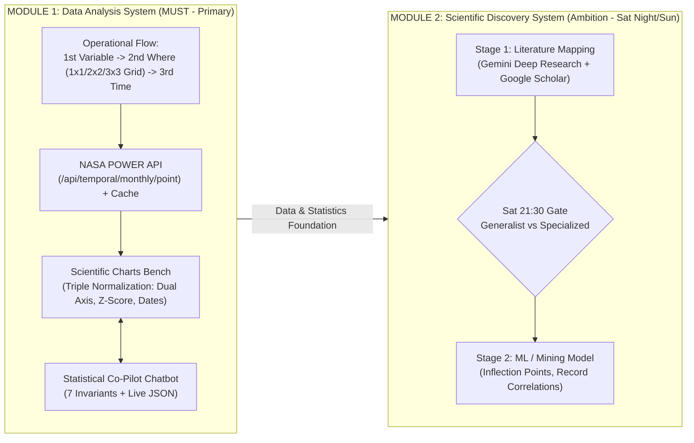
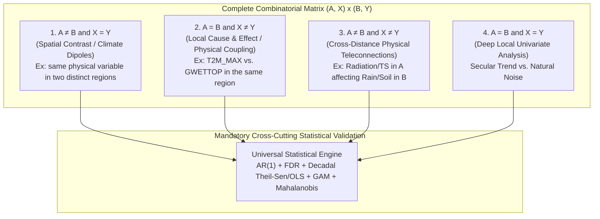
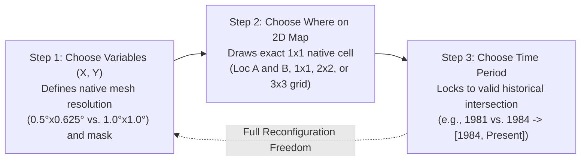
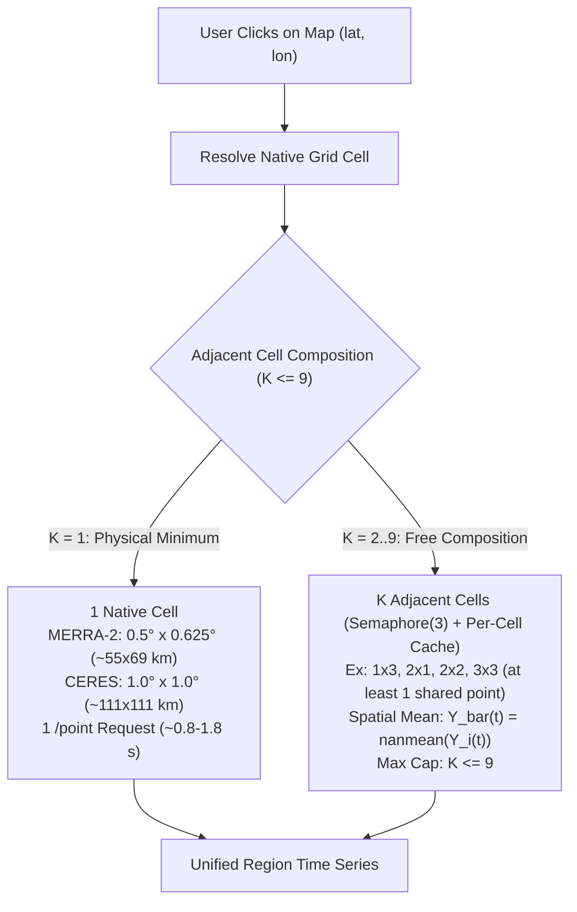
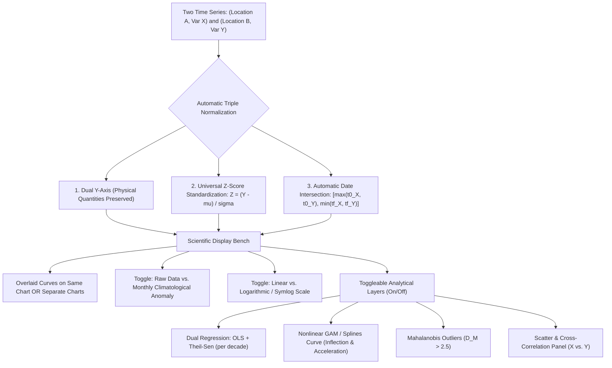
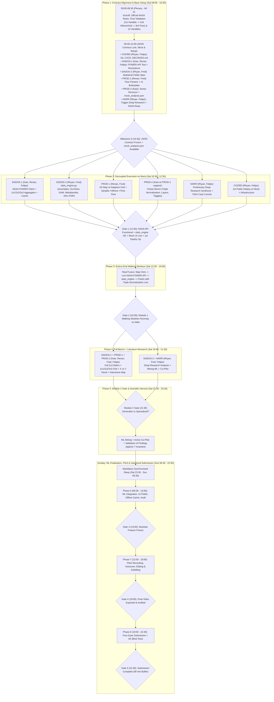

# Operational Master Plan — "Be An Earth System Trend Detective!" (NASA Space Apps 2026)

> **Document Status:** Official Operational Execution Doctrine (Team-Refactored and Audited Version).
> **Real Operating Window:** Saturday 09:00 $\to$ Sunday 24:00 (**39 consecutive hours / ~30 productive hours per person**, subtracting 6h30m mandatory sleep and breaks).
> **Official Data Architecture:** Real-Time Consumption via **NASA POWER API** (`/api/temporal/monthly/point`) with **Resilient Local Cache** (IndexedDB / Memory / Local Proxy), eliminating heavy NetCDF4 downloads and guaranteeing responses in $< 2\text{ s}$ during free exploration and $< 50\text{ ms}$ during the pitch.
> **Product Architecture:** **Two Integrated Systems** — Module 1 (Generalist Data Analysis System — `MUST`) and Module 2 (ML / Mining Scientific Discovery System — Saturday Night & Sunday).

---

## 1. Mission, Dual Architecture, and Acceptance Criteria

### 1.1 The Scientific Problem and Center of Gravity (*Schwerpunkt*)
Planet Earth operates as a coupled dynamic system (atmosphere, hydrosphere, biosphere, cryosphere, and solar radiation). Environmental variables monitored by NASA satellites and reanalysis models evolve over decades under complex global forcings. However, scientists frequently face three fundamental analytical challenges:
1. **Spatial Divergence:** The same global phenomenon produces steep upward trends in one region and sharp declines in another (e.g., global warming driving extreme desiccation in the Cerrado while expanding rainfall volume in Southeastern South America).
2. **Multiscale Paradox:** Time series can exhibit a strong secular upward trend over 30–40 years ($r_{\text{global}} > 0$) while operating in systematic phase opposition across 12-to-36-month interannual oscillations ($r_{\text{detrended}} < 0$, due to cyclical events such as El Niño/Southern Oscillation).
3. **Physical Cause-and-Effect Coupling ($X \neq Y$):** Variables from different domains interact locally or remotely with lags and feedbacks (e.g., heatwaves with rising maximum temperature accelerating surface soil-water depletion, or ocean thermal anomalies altering continental rainfall regimes).

- **Product and Pitch Center of Gravity (*Schwerpunkt*):** Make **spatial divergence**, **physical cause-and-effect correlations**, and **statistical validation against natural noise** immediately visible, comparable in real time, and shielded against classic climate-analysis errors.

---

## 1.2 The Platform's Two Official Systems

The platform is officially structured into **two complementary modules**:



#### Module 1 — Data Analysis System (Primary / `MUST` — Generalist)
- **Objective:** Function as a workstation for **any scientist**, regardless of specialization (climatology, hydrology, agronomy, geology, solar energy, or meteorology).
- **Unrestricted Flexibility:** The researcher clicks freely on any coordinate on Earth, selects any two areas and any two variables from the 12-variable NASA catalog, sets the spatial aggregation scale, and obtains complete statistical diagnostics instantaneously.
- **Integrated Statistical Co-Pilot:** An intelligent conversational agent fed directly with the real-time JSON payload of statistical calculations and the 7 Statistical Invariants guidelines, helping the scientist validate hypotheses and avoid hasty conclusions.

#### Module 2 — Scientific Discovery System (Ambition / Major Add-On — Saturday Night & Sunday)
- **Objective:** Go beyond a passive analytical tool and act as an **active scientific discovery engine**, capable of mining and synthesizing findings with enough density and originality to underpin a scientific paper.
- **Stage 1 — Cutting-Edge Literature Mapping (Saturday Night):** Use *Gemini Deep Research* combined with *Google Scholar* to map the hottest, most debated topics, gaps, and hypotheses in recent Earth and climate science literature.
- **Stage 2 — Machine Learning & Innovation Mining Model:** Built directly atop Module 1's infrastructure and statistical engine. Applies statistical mining and ML algorithms to sweep NASA POWER historical series, searching for exceptional correlations, structural breaks, multivariate anomalies, and undocumented inflection points.
- **Open Architectural Decision (Saturday 21:30 Gate):** The team decides at the checkpoint whether Module 2 will operate in **Generalist** mode (allowing any scientist to run the ML miner on any region/variable) or **Specialized** mode (verticalized on the highest-impact topic selected by *Gemini Deep Research*).

---

### 1.3 The Complete Combinatorial Matrix $(A, X) \times (B, Y)$, Total Freedom, and Operational Flow

#### Total Researcher Freedom (No Rigid Prompts)
It is categorically established (so neither developers, AIs, nor users get confused) that **there is NO rigid initial question** in the interface forcing the scientist to pick beforehand from pre-baked options.

The platform offers **full combinatorial freedom** over the $(A, X) \times (B, Y)$ matrix, covering all **4 possible physical and spatial combinations**:



1. **$A \neq B$ and $X = Y$ (Same variable in different places — Spatial Contrast / Climate Dipoles):**
   - *Application Example:* Compare Surface Soil Wetness (`GWETTOP`) or Temperature (`T2M`) between two distinct basins or biomes freely selected on the map over the last 4 decades.
   - *Scientific Goal:* Identify spatial divergences and regional asymmetries under the same secular forcing.
2. **$A = B$ and $X \neq Y$ (Different variables in the same place — Local Cause & Effect / Physical Coupling):**
   - *Application Example:* Cross Maximum Temperature (`T2M_MAX`) with Soil Wetness (`GWETTOP`) on the same geographic cell or block selected on the map.
   - *Scientific Goal:* Quantify how thermal peaks accelerate evapotranspiration and drain surface water.
3. **$A \neq B$ and $X \neq Y$ (Different variables in different places — Crossed Physical Teleconnections):**
   - *Real Example:* Surface Skin Temperature (`TS`) or Solar Radiation (`ALLSKY_SFC_SW_DWN`) in a driver region $A$ (e.g., Tropical Atlantic or Equatorial Pacific) crossed with Precipitation (`PRECTOTCORR`) or Soil Wetness in a distant agricultural basin $B$.
   - *Scientific Goal:* Track planetary waves, large-scale teleconnections, and heat/moisture transfers between remote oceanic/continental regions.
4. **$A = B$ and $X = Y$ (Same variable in the same place — Deep Univariate Analysis):**
   - *Real Example:* Isolated historical series of Mean Temperature (`T2M`) or Precipitation (`PRECTOTCORR`) in a single geographic region.
   - *Scientific Goal:* Assess the magnitude of the secular decadal trend ($B_{\text{Sen}}$), identify the physical regime via GAM (linear, accelerating, or plateau), and determine whether the signal exceeds local stochastic noise.

> [!IMPORTANT]
> **Cross-Cutting Nature of Statistical Validation:** Testing **Real Trend vs. Natural Noise** via $\text{AR}(1)$ autocorrelation (Santer/Hamed-Rao $N_{\text{effective}}$) and False Discovery Rate control (Benjamini–Hochberg FDR, $p_{\text{adj}} < 0.05$) **is not a separate mode**, but a mathematical layer applied cross-cuttingly and mandatorily to **any of the 4 combinations** of the matrix during free exploration on the interactive map or in the scientific discovery (ML) pipeline.

> [!NOTE]
> **MVP Scope for the Walking Skeleton (Phases 1–3):** To simplify end-to-end delivery of the *Walking Skeleton*, the **MVP (Phases 1–3) starts with 1 variable per area (`variable_x` / `variable_y`)**, enabling fast, deterministic tests of univariate ($X=Y$) and bivariate ($X \neq Y$) contrast. Expansion to multiple variables per area (grouped by environmental family or free multivariate selection) will occur in post-MVP cycles.

---

#### Official UI Interaction Order (`1st Variable -> 2nd Where -> 3rd Time Period`)
To guarantee a foolproof user experience free of physical inconsistencies and with immediate validation against NASA's computational mesh, initial configuration in the UI strictly follows this technical order:



1. **Step 1 — Choose Variables ($X$ and $Y$, same or different):**
   - *MVP Scope Note (Phases 1–3):* The **MVP (Phases 1–3) starts with 1 variable per area (`variable_x` / `variable_y`)** to simplify the *Walking Skeleton*, with later expansion to multiple variables per area (by environmental family or free choice).
   - *Non-Negotiable Technical Rationale:* Must come first because **NASA's minimum physical area depends on the selected variable**. Meteorological and hydrological variables from the **MERRA-2** model have a native grid of $0.5^\circ \text{ lat} \times 0.625^\circ \text{ lon}$ ($\approx 55\times 69\text{ km}$ at the equator), whereas solar radiation and cloud variables from **CERES SYN1deg** have a native grid of $1.0^\circ \text{ lat} \times 1.0^\circ \text{ lon}$ ($\approx 111\times 111\text{ km}$). Moreover, soil moisture variables (`GWETTOP`, `GWETROOT`) carry a land-only mask (existing only over land). Defining the variable first ensures the map operates with the right geometry from the start.
2. **Step 2 — Choose Where on the 2D Map (Location $A$ and Location $B$, with flexible adjacent-cell composition):**
   - *Non-Negotiable Technical Rationale:* Since variables were already selected in Step 1, clicking the 2D map immediately draws the $1\times 1$ rectangle or square with the exact native geographic dimensions of the respective variable. It then lets the scientist freely compose the area by adding **adjacent** cells (sharing at least one point/vertex, e.g., $1\times 3$, $2\times 1$, $2\times 2$, up to 9 cells), with freedom to pick one geometry for $X$ (e.g., $1\times 3$) and a distinct one for $Y$ (e.g., $2\times 1$).
3. **Step 3 — Choose Time Period ($[t_0, t_f]$):**
   - *Non-Negotiable Technical Rationale:* Comes 3rd because historical record availability depends on the variables chosen in Step 1 (`1981–Present` for MERRA-2 vs. `1984–Present` for CERES). The date-picker component opens already clamped and bounded to the common interval $[\max(t_{0,X}, t_{0,Y}), \min(t_{f,X}, t_{f,Y})]$, eliminating invalid queries and NASA API 400 errors.
   - *Flexibility Rule:* After initial 3-step configuration, the user has **total freedom to change any parameter** (switch map point, change variable, adjust time window, or switch grid scale) at any time, triggering automatic reactive updates in the chart bench.

---

### 1.4 Acceptance Criteria (Definition of Done — DoD)

The Data Analysis System MVP is complete when, for any selected coordinates and any catalog variables, the user receives in **under 2 seconds** the **5 Detective Answers**:
1. **WHAT is changing?** (Physical variable expressed in proper units, toggle between Raw Series and Monthly Climatological Anomaly without seasonality, physical regime classification via GAM — *linear, accelerating, or saturating* — and extreme detection via Mahalanobis Ellipse $D_M > 2.5$).
2. **WHERE is it changing?** (2D map with NASA's minimum grid area drawn at the click location and free composition of adjacent cells (e.g., $1\times 3$, $2\times 1$, $2\times 2$, up to 9 cells), showing visually connected Location A and Location B).
3. **WHEN is it changing?** (Adjustable time window $[t_0, t_f]$, with automatic common-period intersection when $X \neq Y$).
4. **HOW MUCH is it changing?** (Decadal rate of change computed over **the entire point cloud** via Theil–Sen Robust Median Slope ($B_{\text{Sen}}$) and Ordinary Least Squares ($B_{\text{OLS}}$), strictly forbidding $Y_{\text{end}} - Y_{\text{start}}$ or percentages ($\%$) on interval scales like $^\circ\text{C}$).
5. **IS IT STATISTICALLY SIGNIFICANT?** ($p\text{-value}$ rigorously corrected for $\text{AR}(1)$ climate persistence ($N_{\text{effective}}$), false discovery rate $p_{\text{adj}}$ (FDR), and coupling via Pearson $r$, Kendall $\tau$, and multiscale separation $r_{\text{global}}$ vs. $r_{\text{detrended}}$).

---

### 1.5 Alignment with the 4 NASA Judging Criteria (25% Each)

| Official Criterion (25%) | How Our New Architecture Maximizes the Score |
| :--- | :--- |
| **1. Galactic Impact** | Delivers a generalist tool empowering scientists of any domain to investigate the Earth system and includes a Discovery Module capable of generating original scientific papers. |
| **2. Use of NASA Data** | Direct, dynamic integration with the NASA POWER API, consuming calibrated satellite and state-of-the-art reanalysis models (**MERRA-2** and **CERES**), with documented metadata and DOIs. |
| **3. MVP Prototype** | Real-time interactive application with maps, true NASA physical grid ($1\times 1 \to 2\times 2 \to 3\times 3$), dual-scale charts, robust regressions, and Local Cache making the experience instantaneous. |
| **4. Pitch & Storytelling (240s)** | Presentation driven by a tangible scientific discovery mined by the platform itself and validated by the 7 Statistical Invariants. |

---

## 2. Technical Specification of NASA POWER API, Spatial Grid, and Charts Bench

### 2.1 Real-Time Data Consumption via NASA POWER API

The **NASA POWER API v2** (Prediction Of Worldwide Energy Resources) is the project's data backbone. It distills terabytes of raw satellite and climate reanalysis data into high-performance REST endpoints returning clean, structured JSON tables:

- **Official Endpoints:**
  - `/api/temporal/monthly/point` (1 coordinate, accepts up to **20 parameters** in the same call; latency $\approx 0.8\text{--}1.8\text{ s}$).
  - `/api/temporal/monthly/regional` (`bbox` rectangle with minimum size **$2^\circ \times 2^\circ$** and synchronous maximum **$10^\circ \times 10^\circ$**; accepts only **1 parameter per request**, otherwise returns `422 Unprocessable Entity`; latency $\approx 1.5\text{--}3.5\text{ s}$).
- **Base URL (`/point`):**
  `https://power.larc.nasa.gov/api/temporal/monthly/point?parameters={PARAMS}&community=AG&longitude={LON}&latitude={LAT}&start={START_YEAR}&end={END_YEAR}&format=JSON`
- **Authentication:** Publicly open, **requires no private API key**. Only requires an informative `User-Agent` header (e.g., `User-Agent: TrendDetective-NASASpaceApps/1.0`).
- **Response Format and Mandatory Backend Cleaning:**
  - Structure `properties.parameter.{VAR_NAME}.{YYYYMM}` (e.g., `198101: 24.32`).
  - **`YYYY13` Filter:** NASA POWER includes the annual key `YYYY13` alongside months `01..12`; the backend **must discard `YYYY13`** before any calculation.
  - **Missing Values and Ocean Mask (`-999`):** The API's default *fill value* is **`-999`** (or `-999.0`), including when `GWETTOP`/`GWETROOT` (MERRA-2 Land) fall over the ocean. The backend must convert `-999` to `np.nan` (`df.replace(-999, np.nan)`) and use `np.nanmean()` in coastal/regional spatial aggregation.
  - **`PRECTOTCORR` Conversion (`mm/day` $\to$ `mm/month`):** In the `AG` community, `PRECTOTCORR` arrives as a daily mean rate (`"units": "mm/day"`). To display monthly accumulated volume (`mm/month`), multiply by the number of days in each month (`calendar.monthrange(year, month)[1]`, handling leap years).
- **Rate Limits and Resilience / Local Cache Layer:**
  - Official limit of **30 requests/minute per IP** and tolerance for short bursts of **3 to 5 concurrent calls** (firing 9 calls at once causes `429 Too Many Requests`).
  - The backend controls concurrency with **`asyncio.Semaphore(3)`** + exponential *backoff* and writes each `(lat, lon, var)` cell to local cache (disk/SQLite/memory on backend and **IndexedDB** in browser), returning repeated queries in **$< 50\text{ ms}$**.

---

### 2.2 Spatial Logic of NASA Grid Composition (Adjacent Cells up to $K \le 9$) and Native Resolutions

Instead of arbitrary polygons or fixed squares only, Trend Detective adopts the **native physical geometry of NASA's models** with **flexible adjacent-cell composition**:



1. **NASA's Smallest Possible Physical Area ($1\times 1$ Cell):**
   - When clicking on the 2D map, the system computes the minimum grid cell corresponding to the geographic coordinate:
     - **MERRA-2 Variables (Meteorology, Water, and Soil):** Native grid is **$0.5^\circ \text{ latitude} \times 0.625^\circ \text{ longitude}$** ($\approx 55\text{ km} \times 69\text{ km}$ at the equator). The map draws that exact bounding rectangle over the surface.
     - **CERES Variables (Solar Radiation and Clouds):** Native grid is **$1.0^\circ \text{ latitude} \times 1.0^\circ \text{ longitude}$** ($\approx 111\text{ km} \times 111\text{ km}$). The map draws that solar-resolution square.
2. **Free Composition of Adjacent Cells ($1\times 3$, $2\times 1$, $2\times 2$, etc.):**
   - The scientist can follow a river, coastline, basin, or region by choosing any composition of $K$ **adjacent** cells (rule: each new cell must share **at least one point/vertex** with the already selected set, i.e., $\max(|\Delta i|, |\Delta j|) \le 1$ on the discrete grid).
   - **Independence Between $X$ and $Y$:** The scientist can select, for example, a **$1\times 3$** area for variable $X$ and another **$2\times 1$** area for variable $Y$.
   - **Safe Spatial Aggregation (`Semaphore(3)` + `nanmean`):** Since compositions up to $3\times 3$ on MERRA-2 ($1.5^\circ \times 1.875^\circ$) are smaller than the $2^\circ \times 2^\circ$ minimum required by `/regional`, the backend queries uncached cells via `/point` using **`asyncio.Semaphore(3)`** (or uses `/regional` when the box reaches $\ge 2^\circ \times 2^\circ$ with 1 variable) and computes the spatial mean ignoring ocean cells (`-999` $\to$ `NaN`):
     $$Y_{\text{area}}(t) = \operatorname{nanmean}_{i=1..K}\big(Y_i(t)\big)$$
   - **Strict Safety Cap:** The maximum cap is **$K \le 9$ cells per region**, protecting against `429 Too Many Requests` (30 req/min limit).
3. **Official Frontend Stack and Map Output Payload (`PROD-1`):**
   - **Locked Official Stack:** **Leaflet with Canvas renderer + React + TypeScript + Vite** (pure client-side, no SSR, 100% offline build), ensuring maximum fluidity and deterministic rendering when manipulating NASA geographic grids.
   - **Map Output Payload:** The map component emits the following output payload to flow state and the analysis pipeline:
     ```typescript
     {
       variable_x: string;
       variable_y?: string;
       grid_resolution: { dlat: number; dlon: number };
       cells_a: [number, number][]; // 1 <= cells_a.length <= 9, [lat, lon] coordinates
       cells_b?: [number, number][]; // 1 <= cells_b.length <= 9, [lat, lon] coordinates
       start_year: number;
       end_year: number;
     }
     ```
     - Validation rules:
       - `variable_x`: required variable for Area A;
       - `variable_y?`: optional variable for Area B (present in bivariate comparisons);
       - `grid_resolution: { dlat, dlon }`: native resolution corresponding to the selected variable ($0.5^\circ \times 0.625^\circ$ for MERRA-2 or $1.0^\circ \times 1.0^\circ$ for CERES);
       - `cells_a`: array of $1 \le \text{cells.length} \le 9$ with `[lat, lon]` coordinates;
       - `cells_b?`: optional array of $1 \le \text{cells.length} \le 9$ with `[lat, lon]` coordinates;
       - `start_year`, `end_year`: temporal slice bounded by the common historical interval.

---

### 2.3 Catalog of the 12 Integrated Environmental Variables

The catalog spans essential Earth System Science domains, powered by **MERRA-2** and **CERES SYN1deg**:

| # | API Code | Scientific Domain | Physical Variable Name | Model / Source | Native Resolution ($1\times 1$) | Official Unit | Start Year |
| :-: | :--- | :--- | :--- | :--- | :---: | :---: | :---: |
| **1** | `T2M` | Atmosphere | 2m Mean Air Temperature | MERRA-2 | $0.5^\circ \times 0.625^\circ$ | $^\circ\text{C}$ | 1981 |
| **2** | `T2M_MAX` | Climatology / Extremes | 2m Daily Maximum Temperature | MERRA-2 | $0.5^\circ \times 0.625^\circ$ | $^\circ\text{C}$ | 1981 |
| **3** | `T2M_MIN` | Climatology / Extremes | 2m Daily Minimum Temperature | MERRA-2 | $0.5^\circ \times 0.625^\circ$ | $^\circ\text{C}$ | 1981 |
| **4** | `PRECTOTCORR` | Hydrology / Rain | Bias-Corrected Total Precipitation | MERRA-2 | $0.5^\circ \times 0.625^\circ$ | $\text{mm/month}$ *(API: `mm/day` $\times$ days in month)* | 1981 |
| **5** | `GWETTOP` | Hydrology / Agronomy | Surface Soil Wetness ($0\text{--}5\text{ cm}$) | MERRA-2 | $0.5^\circ \times 0.625^\circ$ | $0\text{ to }1$ (fraction; ocean = `-999`) | 1981 |
| **6** | `GWETROOT` | Hydrology / Geology | Root-Zone Soil Wetness ($0\text{--}100\text{ cm}$) | MERRA-2 | $0.5^\circ \times 0.625^\circ$ | $0\text{ to }1$ (fraction; ocean = `-999`) | 1981 |
| **7** | `RH2M` | Meteorology | 2m Relative Humidity | MERRA-2 | $0.5^\circ \times 0.625^\circ$ | $\%$ | 1981 |
| **8** | `WS10M` | Atmospheric Dynamics | 10m Wind Speed | MERRA-2 | $0.5^\circ \times 0.625^\circ$ | $\text{m/s}$ | 1981 |
| **9** | `PS` | Atmospheric Dynamics | Surface Pressure | MERRA-2 | $0.5^\circ \times 0.625^\circ$ | $\text{kPa}$ | 1981 |
| **10** | `ALLSKY_SFC_SW_DWN` | Energy / Solar Radiation | All-Sky Surface Shortwave Downward Irradiance | CERES SYN1deg | $1.0^\circ \times 1.0^\circ$ | $\text{MJ/m}^2/\text{day}$ | 1984 |
| **11** | `CLDTOT` | Atmosphere / Clouds | Total Cloud Cover | CERES SYN1deg | $1.0^\circ \times 1.0^\circ$ | $\%$ | 1984 |
| **12** | `ALLSKY_SFC_LW_DWN` | Energy Balance | All-Sky Surface Longwave Downward Irradiance | CERES SYN1deg | $1.0^\circ \times 1.0^\circ$ | $\text{MJ/m}^2/\text{day}$ | 1984 |

---

### 2.4 Ultra-Robust Scientific Charts Bench and Triple Normalization

To meet the highest standards of scientific research and enable comparisons across heterogeneous quantities ($X \neq Y$), the charts bench incorporates:



#### Universal Triple Normalization ($X \neq Y$)
1. **Coordinated Dual Y-Axis:** The chart renders $X$'s physical scale on the left and $Y$'s on the right, using identical color codes to the series curves to prevent reading confusion.
2. **Universal $Z\text{-Score}$ Standardization ($\sigma$):** The user can instantaneously convert both curves into dimensionless standard deviations:
   $$Z(t) = \frac{Y(t) - \mu_Y}{\sigma_Y}$$
   This allows assessing whether a $+2.5\sigma$ temperature pulse corresponds to a $-2.8\sigma$ drop in soil moisture, making variables with distinct physical quantities directly comparable on the same geometric amplitude.
3. **Automatic Date Intersection:** When comparing variables with different start dates (e.g., MERRA-2 `T2M` starting in 1981 vs. CERES `ALLSKY_SFC_SW_DWN` starting in 1984), the engine automatically truncates the time window to the common intersection $[1984, t_f]$, preventing distortions in correlation and regression calculations.

#### Toggleable Analytical Layers
- **Raw Data vs. Monthly Climatological Anomaly:** One-click toggle that subtracts the mean annual cycle ($Y'_{y,m} = Y_{y,m} - \bar{Y}_m$), eliminating summer/winter seasonal contamination (Henrietta Leavitt Principle).
- **Linear vs. Symlog Scale:** Enables visualizing variables with exponential or multi-regime behavior (e.g., precipitation during extreme events) without collapsing baseline values.
- **Dual Linear Regression (OLS + Theil–Sen):** Displays the Ordinary Least Squares line ($B_{\text{OLS}}$) and the robust Theil–Sen median line ($B_{\text{Sen}}$), with values strictly expressed as change per decade ($10 \times B$).
- **Smooth GAM Curve (Generalized Additive Model):** Nonlinear modeling via penalized *splines* to classify whether the trend is strictly linear, accelerating, or has reached a physical saturation plateau.
- **Mahalanobis Ellipse ($D_M > 2.5$):** Graphically highlights bivariate anomalous points that violate the system's historical covariance, preserving them in the view as real extreme climate events (e.g., 1997/98 or 2015/16 super El Niño).
- **Scatter & Cross-Correlation Panel ($X \text{ vs. } Y$):** When $A = B$ and $X \neq Y$, the panel displays the scatter plot with bivariate regression line, Pearson ($r$) and Kendall ($\tau$) coefficients, and decomposition into secular correlation ($r_{\text{global}}$) versus detrended short-term correlation ($r_{\text{detrended}}$).

---

### 2.5 Integrated Statistical Co-Pilot Chatbot

The bench integrates a **Statistical Co-Pilot** designed to support the scientist's investigative reasoning:
- **JSON Context Feed:** On every interaction or parameter change on the bench, the chatbot receives the structured payload containing coordinates, variables, $B_{\text{Sen}}$, $B_{\text{OLS}}$, $r$, $\tau$, $\text{AR}(1)$-corrected $p\text{-values}$, FDR status, and detected Mahalanobis points.
- **Guardian of the 7 Statistical Invariants:** The assistant actively prevents classic interpretation errors:
  - Alerts if the user tries to interpret percentage changes on interval-scale variables (such as $^\circ\text{C}$);
  - Warns against the illusion of computing trends via $Y_{\text{end}} - Y_{\text{start}}$;
  - Helps distinguish spurious correlation from real physical coupling;
  - Explains the physical implications of derivatives and inflections revealed by the GAM curve.
- **Module Implementation:** Choice of LLM provider, endpoints, and prompt engineering are the technical responsibility of `DADOS-2` (Rhyan, Fred), adhering to standardized JSON integration.

---

## 3. Workforce Split and Multi-Role Governance (5 Members Across 6 Tracks)

### 3.1 Real Governance of 5 Multi-Role Members

To maximize efficiency across a 39-hour marathon without creating isolated bottlenecks or *Single Points of Failure (SPOF)*, the official team distribution is organized into **two complementary views**:

#### Table 3.1.A — Per-Member View (5 Multi-Role Members)

| Member | Accumulated Roles & Tracks | Primary Focus | Hackathon Responsibilities |
| :--- | :--- | :--- | :--- |
| **Rhyan** | `COORD`, `DADOS-2`, `NARR` | General Coordination, Statistics & Storytelling | Git repository, CI/CD, unified JSON Contract, `stats_engine.py`, validation of the 7 Invariants, Statistical Co-Pilot, Discovery ML, and pitch script/direction. |
| **Kaio** | `DADOS-1`, `PROD-2` | Data Engineering & Charts Bench | Real-time NASA POWER API client, Spatial Aggregator ($1\times 1 \to 3\times 3$), Local Cache (IndexedDB), and Scientific Charts Bench (Triple Normalization, toggles, and analytical layers). |
| **Renan** | `DADOS-1`, `PROD-1` | Data Engineering & Geospatial Frontend | API ingestion and validation, interactive 2D Map with NASA adaptive physical grid, `1st Variable -> 2nd Where -> 3rd Time` flow, and visual responsiveness. |
| **Felipe** | `COORD`, `DADOS-1`, `NARR` | Governance, Data & Pitch Narrative | Technical co-coordination, continuous deployment, data ingestion and cache support, deep research in Gemini Deep Research + Google Scholar, pitch editing and subtitling (240s). |
| **Fred** | `DADOS-2`, `PROD-1` | Statistics, Machine Learning & Frontend | Mathematical implementation of `stats_engine.py`, Scientific Discovery System ML model, Co-Pilot LLM prompts, and support on the 2D map and selection UI. |

---

#### Table 3.1.B — Per-Track View (6 Roles and Exclusive Responsibilities)

| Functional Track | Responsible Members | Technical Scope and Exclusive Responsibilities | Critical Deliverables |
| :--- | :--- | :--- | :--- |
| **`COORD`** | **Rhyan, Felipe** | Overall team coordination, Git repository governance (branches, PRs, merges), freezing and versioning of the unified JSON Contract, strict enforcement of quality gates, local network sync, and official submission on the NASA portal. | Structured repository, CI/CD, `DECISOES.md`, PR approvals, and final submission by 22:30. |
| **`DADOS-1`** | **Kaio, Renan, Felipe** | Development of the real-time NASA POWER API client (`/api/temporal/monthly/point`), spatial aggregator for $1\times 1$ (1 native cell), $2\times 2$ (mean of 4), and $3\times 3$ (mean of 9) squares, temporal alignment, and resilient Local Cache (IndexedDB / memory / disk). | Ingestion module, regional aggregation functions, and offline cache layer with $< 50\text{ ms}$ response. |
| **`DADOS-2`** | **Rhyan, Fred** | Development of the Statistical Engine (`stats_engine.py`: deseasonalized monthly anomalies, decadal OLS and Theil–Sen, nonlinear GAM curve, Mahalanobis distance $D_M > 2.5$, $\text{AR}(1)$ serial correction with $N_{\text{effective}}$, FDR $p_{\text{adj}}$, $X \text{ vs. } Y$ correlations and regressions), Statistical Co-Pilot Chatbot (LLM + prompt design), and *Scientific Discovery System* ML model. | Tested `stats_engine.py`, Co-Pilot conversational agent, and Module 2 mining algorithm. |
| **`PROD-1`** | **Renan, Fred** | Building the interactive 2D Map (Leaflet Canvas + React + TypeScript + Vite), click-time adaptive grid rendering ($0.5^\circ \times 0.625^\circ$ vs. $1.0^\circ \times 1.0^\circ$), Location A / Location B selection controls, and official interaction order: `1st Variable -> 2nd Where (Loc A/B + 1x1, 2x2, 3x3 grids adapted to variable resolution) -> 3rd Time`. | Interactive map component, NASA physical mesh renderer, and geospatial selection panel. |
| **`PROD-2`** | **Kaio** *(with PROD-1 support)* | Building the Scientific Charts Bench (overlaid or separated curves, Triple Normalization with Dual Y-Axis and $Z\text{-Score}$, Raw vs. Anomaly Data, Linear vs. Logarithmic/Symlog scale, OLS/Sen/GAM/Mahalanobis layers, $X \text{ vs. } Y$ scatter, and Statistical Co-Pilot Chatbot UI). | Reactive time-series bench, toggle components, and bivariate panel. |
| **`NARR`** | **Rhyan, Felipe** | Conducting research in *Gemini Deep Research* and *Google Scholar* to guide the *Scientific Discovery System*, mapping literature gaps, curating findings mined by the ML pipeline for demo, script writing, voiceover, screen recording, editing, and subtitling of the pitch video (240s). | Literature dossier, timed script, final 1080p MP4 video, and submission copy. |

---

### 3.2 Parallelism and Convergence Flow (39-Hour Critical Path)



---

## 4. Detailed Operational Schedule (Phases 1 to 8)

### Phase 1 — Contract Alignment, NASA Rules, Mock, and Base Setup
**Saturday 09:00 – 10:30 (1h30)**

- **09:00 – 09:30 (Plenary with All 5 Members):**
  - Detailed reading of the official rules for *Be An Earth System Trend Detective!*;
  - Collective validation of the official UI interaction order: `1st Variable -> 2nd Where (Loc A/B + 1x1/2x2/3x3 Grid) -> 3rd Time Period`;
  - Confirmation of the 12-variable NASA POWER catalog (MERRA-2 and CERES SYN1deg) and spatial resolution rules ($0.5^\circ \times 0.625^\circ$ vs. $1.0^\circ \times 1.0^\circ$).
- **09:30 – 10:30 (JSON Contract Lock, Mock, and Per-Track Base Setup):**
  - `COORD` (Rhyan, Felipe): Structure the Git repository, protected branches, `/backend` and `/frontend` folders, CI/CD pipeline (Vercel / GitHub Actions), and initialize the architectural decisions log (`DECISOES.md`).
  - `DADOS-1` (Kaio, Renan, Felipe): Test a real call to NASA POWER API's `/api/temporal/monthly/point` endpoint via script/curl, map the exact returned JSON structure, and formalize resolution metadata ($0.5^\circ\times 0.625^\circ$ vs. $1.0^\circ\times 1.0^\circ$) and historical bounds for the Contract.
  - `DADOS-2` (Rhyan, Fred): Define in the JSON Contract the exact specification of all statistical fields (monthly anomaly vectors, decadal OLS and Theil–Sen, GAM/Splines curve, Mahalanobis outliers $D_M > 2.5$, $\text{AR}(1)$ tests with $N_{\text{effective}}$, FDR $p_{\text{adj}}$, and bivariate correlation).
  - `PROD-1` (Renan, Fred): Formally lock the official Frontend stack (**Leaflet with Canvas renderer + React + TypeScript + Vite**, pure client-side, no SSR, 100% offline build), define in the JSON Contract the state parameters of the `1st Variable -> 2nd Where/Grid -> 3rd Time` flow and the **Map Output Payload**: `{ variable_x, variable_y?, grid_resolution: { dlat, dlon }, cells_a, cells_b?, start_year, end_year }` ($1 \le \text{cells.length} \le 9$, `[lat, lon]` coordinates), and initialize Frontend boilerplate preparing empty components.
  - `PROD-2` (Kaio): Define in the JSON Contract the series structure for the Charts Bench (raw series, anomalies, dual axes, and $Z\text{-Score}$ arrays) and generate the complete, validated `mock_analysis.json` file to unblock Phase 2.
  - `NARR` (Rhyan, Felipe): Launch the first structured deep-research prompts in **Gemini Deep Research** and **Google Scholar** to map cutting-edge literature topics and extract mandatory NASA submission form requirements.
- **Milestone 0 (Saturday 10:30):** JSON Contract frozen and `mock_analysis.json` available in the repository. No final UI line is coded before this milestone!

---

### Phase 2 — NASA POWER Ingestion, Statistical Engine, and UI on Mock
**Saturday 10:30 – 12:30 (2h00)**

- **`DADOS-1` (Kaio, Renan, Felipe — NASA POWER Ingestion & $K \le 9$ Aggregator):**
  - Implement the `/api/temporal/monthly/point` query client (supports up to 20 variables per call; fine MERRA-2 $0.5^\circ \times 0.625^\circ$ mesh as default) with the 3 mandatory cleaning rules: (1) convert `-999` to `np.nan` and use `np.nanmean()` (ocean mask for `GWETTOP`/`GWETROOT`), (2) discard the annual `YYYY13` key, and (3) convert `PRECTOTCORR` from `mm/day` to `mm/month` (`calendar.monthrange`);
  - Build the spatial aggregator for **free composition of $1 \le K \le 9$ adjacent cells** (`cells: [{lat, lon}, ...]`) controlling concurrency with **`asyncio.Semaphore(3)`** + exponential *backoff* (respecting the 30 req/min limit, no `Promise.all` of 9 calls) and **Local Cache in JSON/SQLite** indexed per individual cell `(lat, lon, var)` and per region (Parquet discarded in Module 1);
  - Implement backend temporal alignment (`1981` MERRA-2 vs. `1984` CERES) and network-contingency fallback *(note: on the frontend, `idbCache.ts` and `getCommonStartYear` were already delivered on branch `frontend`)*.
- **`DADOS-2` (Rhyan, Fred — Statistical Engine `stats_engine.py`):**
  - Implement the full mathematical library adhering to `CONTRATO_DE_DADOS.md`:
    1. Deseasonalized Monthly Climatological Anomaly ($Y'_{y,m} = Y_{y,m} - \bar{Y}_m$);
    2. OLS linear regression and Theil–Sen Robust Slope expressed per decade ($10 \times B_{\text{year}}$ or $120 \times B_{\text{month}}$);
    3. Nonlinear fit via GAM / Splines with regime classification (*linear, accelerating, saturating*);
    4. Bivariate outlier detection via Mahalanobis Distance ($D_M > 2.5$);
    5. Significance test corrected for $\text{AR}(1)$ autocorrelation ($N_{\text{effective}}$) and $p_{\text{adj}}$ (FDR);
    6. Bivariate Pearson correlation ($r$), Kendall $\tau$, and multiscale separation ($r_{\text{global}}$ vs. $r_{\text{detrended}}$).
- **`PROD-1` (Renan, Fred — 2D Leaflet Canvas Map & Adaptive Flow on Mock):**
  - Render the `<MapView />` visual component in **Leaflet (Canvas renderer)** consuming `gridGeometry.ts` (native snap + 8-neighbor connectivity for free composition of $1 \le K \le 9$ adjacent cells, e.g., $1\times 1, 1\times 3, 2\times 1, 2\times 2, 3\times 3$, already implemented and tested on branch `frontend`);
  - Implement the official interaction-order selectors within MVP scope (**1 variable per area**: `variable_a` for Region A and `variable_b` for Region B): `1st Variable -> 2nd Where (Loc A/B + free composition K <= 9) -> 3rd Time`.
- **`PROD-2` (Kaio, with PROD-1 support — Charts Bench on Mock):**
  - Build the charts bench connected to `mock_analysis.json`: Dual Y-Axis, universal $Z\text{-Score}$ ($\sigma$) standardization, Raw vs. Anomaly Series toggle, and Linear vs. Symlog toggle;
  - Integrate analytical layers (toggles): decadal OLS and Theil–Sen lines, GAM curve, and Mahalanobis ellipse.
- **`NARR` (Rhyan, Felipe — Literature and Scientific Discovery):**
  - Synthesize initial findings from *Gemini Deep Research* and *Google Scholar*, raising climate hypotheses and candidate regions to validate the scientific discovery (ML) pipeline and free exploration on the interactive map.
- **`COORD` (Rhyan, Felipe — Governance and 1st Deploy):**
  - Publish the 1st public deployment showing the functional visual shell connected to the Mock at an internet-accessible URL (Vercel/GitHub Pages).
- **Gate 1 (Saturday 12:30 — Hard Gate):**
  - *Criteria:* (1) Real NASA POWER API call returning clean JSON (`-999`/`YYYY13` handled); (2) `stats_engine.py` running error-free with unit tests; (3) Map and Bench operating integrated with Mock; (4) 1st public Deploy live.

---

### Phase 3 — End-to-End Walking Skeleton (Base Module 1)
**Saturday 12:30 – 16:00 (3h30)**

- **End-to-End Integration:**
  - User selects variable $\to$ Clicks map $\to$ System resolves cell on NASA's native grid $\to$ Fires NASA POWER API call (with Local Cache) $\to$ Feeds `stats_engine.py` $\to$ Plots real time series with decadal regression, anomalies, and $\text{AR}(1)$ significance in the browser.
- **Performance Validation:** Ensure the full cycle of click, API query, statistical calculation, and rendering completes in under 2 seconds.
- **Gate 2 (Saturday 16:00 — Hard Gate):**
  - *Non-Negotiable Criterion:* The online prototype allows clicking any point on the map, fetching real NASA data in real time, and viewing the time series with computed anomaly and decadal regression.

---

### Phase 4 — Full Bench, $(A, X) \times (B, Y)$ Matrix, and Deep Research
**Saturday 16:00 – 21:30 (5h30)**

- **Module 1 Track (Kaio, Renan, Fred, Felipe):**
  - Complete the **Full Combinatorial Matrix $(A, X) \times (B, Y)$**: allow selecting Location A (with Variable X) and Location B (with Variable Y) covering all 4 combinatorial modes;
  - Implement **Triple Normalization** (Dual Y-Axis, $Z\text{-Score}$, and automatic common-date slicing);
  - Ensure smooth free exploration on the interactive map integrated with the scientific discovery (ML) panel;
  - Connect the **Statistical Co-Pilot Chatbot** UI to the charts bench.
- **Module 2 & Chatbot Track (Rhyan, Fred, Felipe):**
  - Conduct the *Gemini Deep Research* and *Google Scholar* survey on the hottest fields and debates in recent climate literature;
  - Structure the Machine Learning / Mining model to sweep structural breaks, multivariate anomalies, and correlations across NASA POWER series;
  - Configure prompt engineering and LLM connection for the Co-Pilot Chatbot anchored to the 7 Statistical Invariants.

---

### Phase 5 — Module 2 Decision Gate and Scientific Harvest
**Saturday 21:30 – 23:30 (2h00)**

- **21:30 – 22:00 (Alignment Meeting and Module 2 Decision Gate):**
  - Evaluate Module 1's status (if 100% stable, Module 2 is unleashed at full strength);
  - **Module 2 Architectural Decision:** Choose between:
    - *Option A (Generalist):* The ML miner lets any scientist run the automatic sweep on any region;
    - *Option B (Specialized):* The miner focuses vertically on the highest-impact topic selected by *Gemini Deep Research*, generating maximum depth for the pitch and a draft scientific paper.
- **22:00 – 23:30 (Harvest and Audit Against the 7 Invariants):**
  - Run the system to extract the 2 to 3 definitive real discoveries for the pitch video;
  - Apply rigorous statistical auditing: verify no rate uses start-to-end difference, no percentage appears on $^\circ\text{C}$, the $\text{AR}(1)$ test was applied, and extremes were checked via Mahalanobis.

---

### Mandatory Break — Synchronized Sleep and Written Handoff
**Saturday 23:30 – Sunday 06:30 (7h00 window / ~6h30 real sleep)**

- **Baton-Pass Protocol (23:15 – 23:30):** Each member posts in the team communication channel: *(1) Latest commit integrated into `main`; (2) Exact pending items; (3) First action scheduled for 06:30*.
- **Anti-Collapse Rule:** Everyone sleeps at the same time. Coding overnight is forbidden to prevent cognitive fatigue and conceptual errors on Sunday.

---

### Phase 6 — ML Finalization, Chatbot, Polish, and Feature Freeze
**Sunday 06:30 – 13:00 (6h30)**

- **06:30 – 07:00:** Coffee and agile alignment of morning priorities led by `COORD`.
- **07:00 – 13:00 (Focused Execution):**
  - `DADOS-2` (Rhyan, Fred) + `PROD-2` (Kaio): Finalize visual integration of Module 2 (ML Scientific Discovery) and calibrate Co-Pilot Chatbot responses;
  - `PROD-1` (Renan, Fred) + `PROD-2` (Kaio): UI polish, visual contrast for 1080p video capture, tooltip additions, and refinement of free map exploration;
  - `DADOS-1` (Kaio, Renan, Felipe): Ensure pre-queried data are stored in Local Cache (IndexedDB) for zero-latency offline navigation;
  - `COORD` + `NARR` (Rhyan, Felipe): Finalize the 240-second pitch video script and draft the NASA submission texts.
- **Gate 3 (Sunday 13:00 — Absolute Feature Freeze):**
  - **Code completely frozen.** After 13:00, no new feature lines enter `main` — only emergency fixes authorized by `COORD`.

---

### Phase 7 — Focused Pitch Video Production
**Sunday 13:30 – 19:00 (5h30)**

- **Focus Isolation (*Deep Work*):** Meetings and interruptions are suspended to allow quiet audio recording and continuous editing led by `NARR` (Rhyan, Felipe).
- **Structured Pitch Script (240 seconds):**
  1. **00:00 – 00:30 | High-Impact Hook:** The complexity of the Earth system and the danger of decisions based on global averages or naive trend calculations.
  2. **00:30 – 01:45 | Live Demo of Module 1 (Data Analysis System):**
     - The scientist picks variables, clicks the map with the NASA grid ($1\times 1 \to 3\times 3$), and sets the period;
     - Presentation of Soil Moisture (`GWETTOP`) comparison across opposing ecosystems and cross-analysis with Maximum Temperature (`T2M_MAX`);
     - Use of Triple Normalization, Anomaly toggle, and Co-Pilot Chatbot validation.
  3. **01:45 – 02:45 | Demo of Module 2 (Scientific Discovery System):**
     - Presentation of the ML-mined discovery grounded in the *Gemini Deep Research* survey;
     - Display of nonlinear inflection points (GAM) and Mahalanobis anomalies proven with $\text{AR}(1)$ + FDR significance.
  4. **02:45 – 03:30 | Statistical Rigor (The 7 Invariants):** Trend Detective's methodological edge against false alarms and climate noise.
  5. **03:30 – 04:00 | Impact, Use of NASA Data & Conclusion:** Citation of NASA POWER's MERRA-2 and CERES models, open-source code, and live link for judges to test online.
- **Gate 4 (Sunday 19:00 — Hard Gate):** Video exported in 1080p MP4 with burned-in subtitles, hosted on YouTube (unlisted/public), and cold-reviewed by two team members.

---

### Phase 8 — "Four-Eyes" Submission and 4G Blind Test Bench
**Sunday 19:00 – 22:30 (Safety Margin: 22:30 – 24:00)**

- **19:00 – 21:00 (Four-Eyes Completion):** `COORD` and `NARR` (Rhyan, Felipe) fill out and review all mandatory fields on the official NASA Space Apps platform (abstract, technical description, video links, live demo, and public GitHub repository).
- **21:00 – 22:30 (External Blind Tests):**
  - The entire team accesses the application and video from **smartphones and 4G/5G mobile networks in incognito tabs** (outside the local network);
  - Checklist: Does the app load in $< 2\text{ s}$? Do all 12 variables respond? Does the video play without requiring login? Is GitHub a public repository with a complete `README.md`?
- **Gate 5 (Sunday 22:30):** Final submission sent and confirmed with **90 minutes to spare** before NASA's official server cutoff at 24:00.

---

## 5. Consolidated Matrix of Phases, Gates, and Cut Rules (`IF/THEN`)

| Planned Time | Operational Phase | Gate / Critical Milestone | Deterministic Contingency Rule (`IF/THEN`) |
| :--- | :--- | :--- | :--- |
| **Sat 09:00–10:30** | 1. Contract, Mock & Base Setup | **Milestone 0 (10:30):** JSON Contract frozen + `mock_analysis.json` in repo | **IF** schema disagreement persists by 10:15 $\to$ **THEN** `COORD` freezes the default contract and starts coding immediately. |
| **Sat 10:30–12:30** | 2. Ingestion, Engine & UI on Mock | **Gate 1 (12:30):** POWER API responding + `stats_engine` OK + 1st Deploy | **IF** API endpoint takes $> 3\text{ s}$ $\to$ **THEN** limit concurrent requests and enable aggressive Local Cache from the very first call. |
| **Sat 12:30–16:00** | 3. Walking Skeleton | **Gate 2 (16:00):** Real flow integrated and published on web | **IF** integration slips past 16:00 $\to$ **THEN** focus 100% of the team on closing the Walking Skeleton by 17:00 at latest. |
| **Sat 16:00–21:30** | 4. Bench & Deep Research | — | **IF** Deep Research survey fails to converge by 20:30 $\to$ **THEN** lock the topic onto the classic "Soil Desiccation by Thermal Stress in Cerrado/Amazon." |
| **Sat 21:30–23:30** | 5. Module 2 Gate & Harvest | **Module 2 Gate (21:30):** Generalist vs Specialized Decision | **IF** Module 1 shows any instability $\to$ **THEN** implement Module 2 strictly as Specialized on the highest-impact case. |
| **Sat 23:30–06:30** | Mandatory Break | Synchronized Sleep (~6h30) | **IF** a member insists on pulling an all-nighter $\to$ **THEN** `COORD` blocks commits to `main` to preserve team lucidity on Sunday. |
| **Sun 06:30–13:00** | 6. Finalization & Feature Freeze | **Gate 3 (13:00):** Absolute *Feature Freeze* | **IF** a secondary feature is incomplete at 13:00 $\to$ **THEN** hide it from the UI immediately (`git stash`/flag) and freeze the code. |
| **Sun 13:30–19:00** | 7. Pitch Video | **Gate 4 (19:00):** Video exported and subtitled | **IF** recording slips past 17:00 $\to$ **THEN** record the bench demo directly over free exploration on the interactive map and the ML discovery pipeline in continuous takes with zero click errors. |
| **Sun 19:00–22:30** | 8. Submission & Blind Tests | **Gate 5 (22:30):** Submission saved and audited on 4G | **IF** NASA portal slows down after 21:00 $\to$ **THEN** submit baseline data immediately and refine links only until 22:30. |

---

## 6. Hardened Scope (MoSCoW Aligned with the New Architecture)

### MUST (Inviolable — Core Requirements of a Winning Product)
- **Module 1 — Complete Data Analysis System:** Functional for any scientist at any coordinate on the globe.
- **Official Interaction Order:** `1st Variable -> 2nd Where (Loc A/B + 1x1/2x2/3x3 Grid) -> 3rd Time Period`.
- **Real-Time Consumption of NASA POWER API (`/api/temporal/monthly/point`):** Dynamic integration with a valid `User-Agent` header and **Resilient Local Cache** (IndexedDB / memory / disk).
- **NASA Spatial Grid Logic:** Drawing the smallest physical area ($1\times 1$: $0.5^\circ \times 0.625^\circ$ for MERRA-2 and $1.0^\circ \times 1.0^\circ$ for CERES) and expanding to $2\times 2$ and $3\times 3$ with spatial mean.
- **Unified 12-Variable Catalog:** Covering atmosphere, temperature, precipitation, soil moisture (surface and root-zone), winds, pressure, and solar radiation.
- **Full Combinatorial Matrix $(A, X) \times (B, Y)$:** Full support for all 4 combinations ($A \neq B, X = Y$; $A = B, X \neq Y$; $A \neq B, X \neq Y$; $A = B, X = Y$).
- **Cross-Cutting Statistical Validation with the 7 Invariants:** Decadal regression ($B_{\text{Sen}}$ and $B_{\text{OLS}}$), GAM, Mahalanobis ($D_M > 2.5$), $\text{AR}(1)$ correction ($N_{\text{effective}}$), and FDR control ($p_{\text{adj}} < 0.05$).
- **Ultra-Robust Scientific Charts Bench:** Overlaid or separated curves, **Triple Normalization** (Dual Y-Axis, universal $Z\text{-Score}$ $\sigma$, date intersection), Raw vs. Anomaly toggle, and Linear vs. Symlog toggle.
- **Integrated Statistical Co-Pilot Chatbot:** Contextualized with the real-time metrics JSON and the 7 Invariants.
- **Live Public Deploy + Offline-Cached Bundle + Subtitled Pitch Video (240s) + Four-Eyes Submission by 22:30.**

### SHOULD (Desirable if Gates 1 and 2 Pass Comfortably)
- **Module 2 — ML Scientific Discovery System:** Automatic mining of inflection points and exceptional correlations grounded in the *Gemini Deep Research* survey.
- **Free Map Exploration + Scientific Discovery (ML) Panel:** Direct region selection on the interactive map integrated with findings mined by the ML pipeline.
- **Direct Data Export:** Analysis download in CSV and high-resolution PNG chart capture for reports.

### COULD (Only if Time Remains on Sunday Morning)
- Short-term scenario projection based on continuation of the Theil–Sen decadal rate;
- Interactive manual adjustment of the GAM smoothing parameter (*penalty factor*).

### WON'T (Strictly Forbidden — Time Traps)
- Downloading or processing giant raw NetCDF4/HDF5 files offline during the hackathon.
- Using arbitrary fixed regions not grounded in NASA's actual physical grid.
- Imposing rigid questions that restrict the scientist to pre-baked modes.
- Treating cross-variable comparison ($X \neq Y$) or teleconnections as optional.
- Computing trends via simple start-to-end difference ($Y_{\text{end}} - Y_{\text{start}}$) or displaying percentages ($\%$) on interval scales ($^\circ\text{C}$).
- Building complex authentication systems, user logins, or heavy relational databases.

---

## 7. Updated Operational Risk Matrix R1–R7

| # | Critical Risk | Warning Sign / Trigger | Immediate Operational Response |
| :--- | :--- | :--- | :--- |
| **R1** | **NASA POWER API Instability or Slowness** | Point call taking $> 3\text{ s}$ or timing out | **Local Cache** takes over instantaneously; repeated queries return in $< 50\text{ ms}$; keep pitch-case data preloaded. |
| **R2** | **Rate Limit (`429`) on Multi-Cell Composition ($K \le 9$)** | More than 3–5 concurrent `/point` calls or $> 30\text{ req/min}$ | Use `asyncio.Semaphore(3)` with exponential *backoff*, cache each `(lat, lon, var)` cell individually, and use `/regional` when box is $\ge 2^\circ \times 2^\circ$ (1 variable). |
| **R3** | **Visual Distortion When Comparing Variables with Distinct Units ($X \neq Y$)** | Temperature curve ($^\circ\text{C}$) flattening soil moisture curve ($0\text{--}1$) | Immediately apply **Triple Normalization**: independent Dual Y-Axis and toggle to universal $Z\text{-Score}$ ($\sigma$). |
| **R4** | **Temporal Mismatch of Start Dates (e.g., 1981 vs. 1984)** | Regression failing due to mismatched vector lengths | The **Automatic Date Intersection** routine truncates both series to the common temporal window before feeding the statistical engine. |
| **R5** | **Statistical Conceptual Error in Code or Pitch** | Code outputting $Y_{\text{end}} - Y_{\text{start}}$ rate or percentage on $^\circ\text{C}$ | `DADOS-2` keeps strict guards in code (`allow_percentage: false`) and the Co-Pilot Chatbot emits an explicit alert if it detects a violation of the 7 Invariants. |
| **R6** | **Excessive Complexity in Module 2 Scientific Discovery** | ML model failing to converge by Saturday 22:30 | Apply the **Saturday 21:30 Gate** rule: lock Module 2 as **Specialized**, focusing on the highest-impact discovery from the literature survey. |
| **R7** | **Delay in Sunday Video Recording and Editing** | Screen capture incomplete by Sunday 16:30 | Record the bench demo directly over free exploration on the **interactive map** and the **scientific discovery (ML) pipeline**, capturing continuous 30-second takes. |

---

## 8. Coordination and Command Rituals (`COORD`)

1. **Agile Team Syncs (Saturday at 10:30, 12:30, 16:00, and 21:30 — Max Duration: 7 minutes):**
   - Each of the 5 members strictly answers three questions in 45 seconds:
     *(1) What was completed in the last block?*
     *(2) What is the exact goal until the next milestone?*
     *(3) Is any blocker preventing progress?*
2. **Sunday with Zero Group Meetings (Full Focus on Phase 7):**
   - During video recording and editing (13:30 – 19:00), group syncs are suspended. `COORD` does silent 1-on-1 check-ins to preserve focus for those recording and narrating.
3. **5-Minute Rapid Decision Rule:**
   - Any technical or architectural debate remaining without consensus for over **5 minutes** is definitively arbitrated by `COORD`, listening to the respective track lead and prioritizing MVP delivery.
4. **Branch Discipline and Continuous Deploy:**
   - The `main` branch is sacred and must stay 100% runnable on every merge. Every pull request is quickly reviewed by the corresponding backup pair before integration.

---

## 9. Final Pre-Submission Audit Checklist (Sunday 21:00)

- [ ] **Module 1 Operational:** Does the app allow freely selecting any catalog variable, clicking any point on the 2D map, choosing Location A and Location B in $1\times 1$, $2\times 2$, or $3\times 3$ grids, and viewing the 5 Detective Answers?
- [ ] **Official Interaction Order:** Does the `1st Variable -> 2nd Where -> 3rd Time Period` flow run smoothly, bounding the physical grid and time window without errors?
- [ ] **Complete $2\times 2$ Matrix:** Does the system support all 4 combinations ($A \neq B, X = Y$; $A = B, X \neq Y$; $A \neq B, X \neq Y$; $A = B, X = Y$)?
- [ ] **NASA Grid Logic:** Do the minimum grid rectangles (MERRA-2's $0.5^\circ \times 0.625^\circ$ and CERES's $1.0^\circ \times 1.0^\circ$) and the $2\times 2$ and $3\times 3$ options with spatial mean work seamlessly?
- [ ] **NASA POWER API & Cache:** Do requests run dynamically via `/api/temporal/monthly/point` with a proper `User-Agent`, and does Local Cache ensure instant responses for repeated queries?
- [ ] **Bench & Triple Normalization:** Do the Dual Y-Axis, universal $Z\text{-Score}$ toggle, and automatic date intersection cleanly equalize comparisons across heterogeneous physical quantities?
- [ ] **Hardening of the 7 Statistical Invariants:**
  - Zero use of $Y_{\text{end}} - Y_{\text{start}}$;
  - Zero percentage ($\%$) on interval scales ($^\circ\text{C}$);
  - Regressions computed on deseasonalized climatological anomalies;
  - OLS line, decadal Theil–Sen, and GAM curve visible;
  - Bivariate outliers identified via Mahalanobis ($D_M > 2.5$);
  - Significance corrected for $\text{AR}(1)$ persistence ($N_{\text{effective}}$) and FDR ($p_{\text{adj}} < 0.05$).
- [ ] **Integrated Co-Pilot Chatbot:** Does the assistant consume the real-time statistical JSON and answer the scientist's questions with clarity and methodological rigor?
- [ ] **Module 2 Scientific Discovery:** Is the model-mined discovery grounded in *Gemini Deep Research* clearly demonstrated and contextualized?
- [ ] **Free Exploration & ML Discovery:** Do free selection on the interactive map and ML discovery pipeline results load and respond immediately on the bench?
- [ ] **Formal NASA Attribution:** Are the models and missions (MERRA-2, CERES SYN1deg, NASA POWER) formally credited in the UI and project documentation?
- [ ] **4G Blind Tests:** Does the public web page open in under 2 seconds on mobile/cellular networks, and does the pitch video play in 1080p with clear subtitles and clean audio?
- [ ] **Submission Sent by 22:30:** Official NASA Space Apps form submitted and validated 90 minutes ahead of the 24:00 final deadline.
