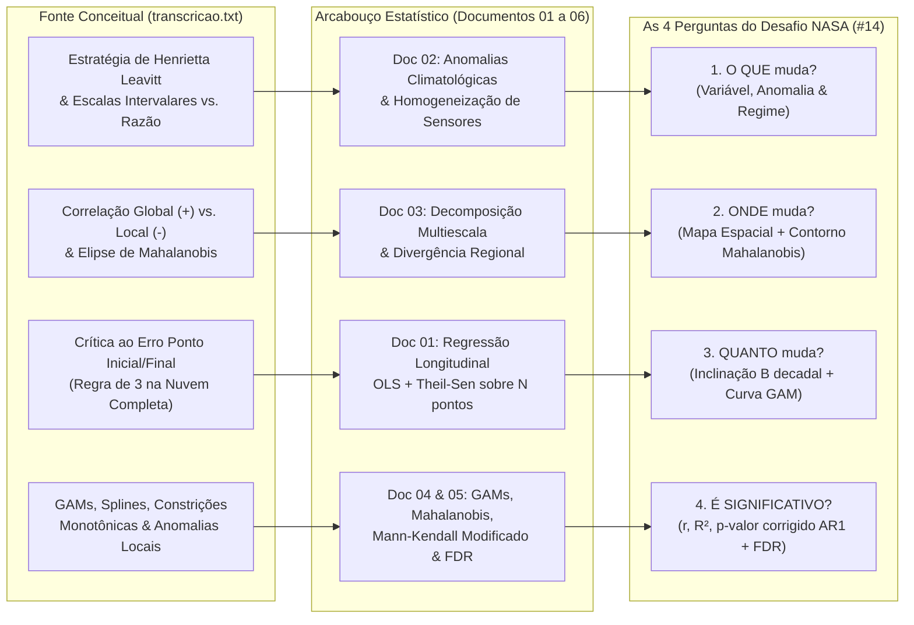

# Índice Geral & Arquitetura do Arcabouço Estatístico — *Be An Earth System Trend Detective!*

> **Propósito deste Diretório (`knowledge_base_estatistica/`):**
> Este conjunto de documentos constitui a **base de conhecimento e protocolo obrigatório de modelagem estatística** para todas as IAs e desenvolvedores que atuarão no desafio **"Be An Earth System Trend Detective!"** do NASA Space Apps Challenge.
>
> O conteúdo aqui consolidado extrai, formaliza e traduz para a ciência de dados climáticos da NASA os fundamentos rigorosos de **Regressão e Correlação** expostos por Hindemburg Melão Jr. (em [`transcricao.txt`](file:///home/zrhyan/Principal/Computation/Space%20Apps/transcricao.txt)), integrando-os com a estratégia operacional de [`ESTRATEGIA_TREND_DETECTIVE.md`](file:///home/zrhyan/Principal/Computation/Space%20Apps/general_strategy/ESTRATEGIA_TREND_DETECTIVE.md) e com o estado da arte em climatologia estatística.

---

## 🧭 Mapa de Leitura Obrigatória para Agentes de IA

Quando uma IA for acionada durante o hackathon para projetar o backend de dados (`DADOS-1`), o motor estatístico (`DADOS-2`), a visualização (`PROD-1`/`PROD-2`) ou o roteiro científico (`NARR`), ela **DEVE** consultar os documentos abaixo conforme a sua tarefa:

| Documento                                                                                                                                                                                                | Foco Técnico e Conceitual                                                                                                                                                                                                                                                                                                                                                                                                            | Agentes-Alvo                                                    |
| :------------------------------------------------------------------------------------------------------------------------------------------------------------------------------------------------------- | :----------------------------------------------------------------------------------------------------------------------------------------------------------------------------------------------------------------------------------------------------------------------------------------------------------------------------------------------------------------------------------------------------------------------------------- | :-------------------------------------------------------------- |
| **[`01_FUNDAMENTOS_E_ERROS_CLASSICOS_DE_REGRESSAO.md`](file:///home/zrhyan/Principal/Computation/Space%20Apps/knowledge_base_estatistica/01_FUNDAMENTOS_E_ERROS_CLASSICOS_DE_REGRESSAO.md)**             | A natureza da regressão como "regra de três generalizada sobre toda a nuvem de pontos". O **Erro Primário do Ponto Inicial vs. Ponto Final** ($T_{\text{final}} - T_{\text{inicial}}$), por que 99,9% dos cálculos tradicionais falham ao ignorar a trajetória intermediária, e a anatomia dos parâmetros $Y = A + BX$ em variáveis físicas.                                                                                         | `DADOS-2`, `NARR`, `PROD-2`                                     |
| **[`02_ESCALAS_CONTROLE_DE_VARIAVEIS_E_ANOMALIAS.md`](file:///home/zrhyan/Principal/Computation/Space%20Apps/knowledge_base_estatistica/02_ESCALAS_CONTROLE_DE_VARIAVEIS_E_ANOMALIAS.md)**               | Tipologia de escalas (Razão vs. Intervalar vs. Ordinal/Logarítmica). Por que variáveis sem zero absoluto ou com offset exigem tratamento diferencial. A estratégia de **Henrietta Leavitt** (controle de variáveis confundidoras na Nuvem de Magalhães) aplicada ao espaço-tempo climático: remoção de sazonalidade, anomalias climatológicas e controle de descontinuidades de sensores (MODIS/VIIRS/GRACE).                        | `DADOS-1`, `DADOS-2`                                            |
| **[`03_CORRELACAO_MULTIESCALA_E_DIVERGENCIA_ESPACIAL.md`](file:///home/zrhyan/Principal/Computation/Space%20Apps/knowledge_base_estatistica/03_CORRELACAO_MULTIESCALA_E_DIVERGENCIA_ESPACIAL.md)**       | Diferença rigorosa entre **Correlação** (grau de acoplamento/preditividade, contorno da elipse) e **Regressão** (taxa funcional de variação). O **Paradoxo Multiescala**: como duas variáveis ou duas regiões apresentam correlação positiva de longo prazo e correlação sistematicamente negativa a curto prazo (ex.: ENSO/El Niño vs. tendência secular). Taxonomia hierárquica de métodos (Pearson, Spearman, $\tau$ de Kendall). | `DADOS-2`, `PROD-1`, `PROD-2`, `NARR`                           |
| **[`04_MODELAGEM_NAO_LINEAR_GAMS_E_CONSTRICOES_FISICAS.md`](file:///home/zrhyan/Principal/Computation/Space%20Apps/knowledge_base_estatistica/04_MODELAGEM_NAO_LINEAR_GAMS_E_CONSTRICOES_FISICAS.md)**   | Quando a reta falha: dissipação física, saturação e pontos de inflexão (*tipping points*). Uso de **GAMs (Generalized Additive Models)**, *Splines* e regressões com **constrição de monotonicidade** vs. polinômios instáveis. Diagnóstico de desvios locais sistemáticos ("corcovas" de regime ou artefatos instrumentais) pela análise das derivadas $f'(x)$ e $f''(x)$.                                                          | `DADOS-2`, `PROD-2`                                             |
| **[`05_OUTLIERS_ROBUSTEZ_E_SIGNIFICANCIA_ESPACIAL.md`](file:///home/zrhyan/Principal/Computation/Space%20Apps/knowledge_base_estatistica/05_OUTLIERS_ROBUSTEZ_E_SIGNIFICANCIA_ESPACIAL.md)**             | Geometria da nuvem de pontos, elipses de contorno e **Distância de Mahalanobis** para detecção multivariada de *outliers*. Regressão robusta (Theil-Sen, Huber, Tukey) vs. Mínimos Quadrados (OLS). Estado da arte em significância para grades climáticas da NASA: autocorrelação serial (Hamed-Rao / Yue-Pilon) e controle de Falsos Positivos em Massa (FDR de Benjamini-Hochberg).                                               | `DADOS-2`, `PROD-1`                                             |
| **[`06_GUIA_OPERACIONAL_PARA_AGENTES_DE_IA_NO_HACKATHON.md`](file:///home/zrhyan/Principal/Computation/Space%20Apps/knowledge_base_estatistica/06_GUIA_OPERACIONAL_PARA_AGENTES_DE_IA_NO_HACKATHON.md)** | **Protocolo de Execução e Anti-Alucinação para IAs:** Regras de ouro ("Nunca faça X, sempre faça Y"), mapeamento matemático direto das **4 Perguntas do Detetive** (*O quê, Onde, Quanto, Significância*) e especificação dos campos estatísticos de estado da arte para o Contrato de Dados JSON.                                                                                                                                   | **TODOS OS AGENTES** (`COORD`, `DADOS-1/2`, `PROD-1/2`, `NARR`) |
| **[`07_ARQUITETURA_E_PROMPT_COPILOTO.md`](07_ARQUITETURA_E_PROMPT_COPILOTO.md)** | **Arquitetura e Prompts do Co-Piloto Estatístico (`F4 · P0 · MUST`):** Arquitetura híbrida (`LLM rápida + fallback heurístico determinístico`), System Prompts oficiais (PT/EN) travados nos 7 Invariantes Estatísticos, serialização compacta e contrato da rota `POST /api/copilot`.                                                                                                                                   | `DADOS-2`, `PROD-2`, `NARR` |

---

## 🏗️ Fluxo de Transformação: Da Transcrição ao Produto da NASA

---

## ⚡ Resumo Executivo dos 5 Mandamentos Estatísticos do Projeto

1. **Proibição Absoluta de $\Delta = Y_{\text{fim}} - Y_{\text{início}}$:** Jamais calcule tendência climática subtraindo o último ano do primeiro ano (ou média dos últimos 5 anos menos primeiros 5 anos). Toda taxa de mudança ("Quanto muda?") **deve** emergir do ajuste sobre a totalidade da nuvem de pontos.
2. **Isolamento de Confundidores antes da Regressão (Princípio Henrietta Leavitt):** Assim como Leavitt isolou a distância estelar observando apenas Cefeidas na Nuvem de Magalhães, nunca aplique regressão sobre dados brutos contaminados pelo ciclo sazonal anual ou por trocas de satélite. Extraia primeiro a **anomalia climatológica** e audite quebras estruturais.
3. **Separação Cristalina entre Inclinação ($B$) e Acoplamento ($r$):** Um local pode ter inclinação alta ($B$ grande) com baixíssima correlação/consistência ($r \approx 0$, nuvem espalhada por El Niño), ou inclinação moderada com altíssima preditividade ($r \to 1$, elipse estreita). A ferramenta deve exibir ambos.
4. **Consciência Multiescala (Global vs. Local no Tempo e no Espaço):** Duas variáveis (ou duas regiões) podem caminhar juntas em 30 anos (correlação secular positiva) e se opor sistematicamente em janelas de 6 a 24 meses (correlação local negativa). Isso não é erro — é a assinatura física de oscilações acopladas.
5. **Além da Reta Rígida e dos Outliers Cegos:** Processos termodinâmicos e ambientais dissipam ou saturam. Sempre que a física exigir, complemente a tendência linear robusta (Sen's Slope) com uma curva flexível (**GAM / Spline**) para revelar aceleração, desaceleração ou *anomalias locais de regime*, filtrando *outliers* via **Distância de Mahalanobis**.

---

## 🐍 Implementação Executável no Repositório (`DADOS-2` — Fase 2, Stack Científico `.venv`)

> **Regra de Separação Arquitetural (`data/api/` vs. `data/services/` vs. `backend/`):** Todos os modelos matemáticos e estatísticos residem **exclusivamente** em `backend/stats_engine.py`, e a interpretação do Chatbot Co-Piloto Estatístico em `backend/copilot_engine.py`. A camada `data/api/server.py` realiza apenas roteamento HTTP (`/api/health`, `/api/catalog`, `/api/analyze`, `/api/copilot`, `/api/location/fetch`, `/api/compare`), e `data/services/comparison_service.py` cuida da orquestração de busca/cache e delega 100% da computação estatística ao `backend/stats_engine.py`.

| Arquivo | Papel Técnico |
| :--- | :--- |
| **[`backend/stats_engine.py`](file:///home/zrhyan/Principal/Computation/Space%20Apps/earth-system-detective-fliflop-34/backend/stats_engine.py)** | Motor estatístico State-of-the-Art integrado ao ambiente `.venv` (`numpy`, `scipy`, `scikit-learn`, `statsmodels`, `pymannkendall` com fallback determinístico em Python puro), aderente ao [`CONTRATO_DE_DADOS.md`](file:///home/zrhyan/Principal/Computation/Space%20Apps/earth-system-detective-fliflop-34/CONTRATO_DE_DADOS.md): limpeza NASA POWER (`-999`, `YYYY13`, `PRECTOTCORR`), `nanmean` espacial ($1 \le K \le 9$), anomalia climatológica mensal com média aparada e isolamento de tendência intra-anual, cálculo de `z_scores`, OLS (`scipy.stats.linregress`) + Theil-Sen por década (`scipy.stats.theilslopes` com IC 95% e `sen_fit`), GAM via `statsmodels` LOWESS + `scipy.interpolate.make_smoothing_spline` (GCV) + aceleração quadrática $B_2$, outliers bivariados por Mahalanobis via `sklearn.covariance.MinCovDet` + MAD ($D_M > 2{,}5$), significância corrigida por $\text{AR}(1)$ ($N_{\text{efetivo}}$ de Santer) + Mann-Kendall Modificado de Hamed-Rao (`pymannkendall.hamed_rao_modification_test`) + Benjamini-Hochberg FDR (`scipy.stats.false_discovery_control`, $q < 0{,}05$) e decomposição de correlação multiescala ($r_{\text{global}}$, $r_{\text{detrended}}$, `long_term_p_value`, `short_term_p_value`). |
| **[`data/services/comparison_service.py`](file:///home/zrhyan/Principal/Computation/Space%20Apps/earth-system-detective-fliflop-34/data/services/comparison_service.py)** | Camada de serviço unificada (`POST /api/analyze` e `/api/compare`): delega todas as estatísticas de [`backend/stats_engine.py`](file:///home/zrhyan/Principal/Computation/Space%20Apps/earth-system-detective-fliflop-34/backend/stats_engine.py) preservando os conectores `data/` e suportando integralmente as 42 variáveis do catálogo (`variable_meta` + FDR conjunto + bloqueio da Invariante #3 em escalas intervalares). |
| **[`frontend/src/App.tsx`](file:///home/zrhyan/Principal/Computation/Space%20Apps/earth-system-detective-fliflop-34/frontend/src/App.tsx)** & **[`frontend/src/bench.css`](file:///home/zrhyan/Principal/Computation/Space%20Apps/earth-system-detective-fliflop-34/frontend/src/bench.css)** | Bancada Científica completa da Fase 2: barra de 3 *Story Presets* NARR (1 clique), Tripla Normalização (Anomalia / Dado Bruto / Z-Score $\sigma$), alternância de escala (Linear / Symlog), gráfico Temporal e Dispersão $X \times Y$ com elipse de contorno de Mahalanobis ($D_M = 2{,}5$), camadas independentes (OLS, Theil-Sen, GAM, Mahalanobis) e painel colapsável das **4 Respostas do Detetive + Paradoxo Multiescala**. |
| **[`backend/test_stats_engine.py`](file:///home/zrhyan/Principal/Computation/Space%20Apps/earth-system-detective-fliflop-34/backend/test_stats_engine.py)** | Suíte de testes unitários e de integração (`.venv/bin/python3 -m unittest discover -s backend -p "test_*.py" -v`) validando os 7 Invariantes Estatísticos, o stack científico, a delegação em `data/services/comparison_service.py` e a conformidade com os Fluxos A e B do Contrato de Dados. |
| **[`backend/mock_analysis.json`](file:///home/zrhyan/Principal/Computation/Space%20Apps/earth-system-detective-fliflop-34/backend/mock_analysis.json)** & **[`frontend/public/data/mock_analysis.json`](file:///home/zrhyan/Principal/Computation/Space%20Apps/earth-system-detective-fliflop-34/frontend/public/data/mock_analysis.json)** | Payloads `RegionAnalysisResponse` completos (1981–2025, 540 meses, incluindo `linear_fit`, `sen_fit`, `gam_smooth_fit` e `z_scores`) para validação online/offline. |
| **[`backend/copilot_engine.py`](../../backend/copilot_engine.py)** | Motor do Chatbot Co-Piloto Estatístico (`F4 · P0 · MUST`): System Prompts PT/EN com os 7 Invariantes, serialização compacta (`build_copilot_prompt`), sanitizador do Invariante #3 para escalas intervalares, síntese heurística determinística das 4 Perguntas do Detetive e integração opcional via `GEMINI_API_KEY`. |
| **[`backend/test_copilot_engine.py`](../../backend/test_copilot_engine.py)** | Suíte de testes unitários cobrindo prompts PT/EN, sanitização de `%` em `T2M_MAX`, Q&A específico, fallback sem chave de API e o endpoint `POST /api/copilot` em [`data/api/server.py`](../../data/api/server.py). |

