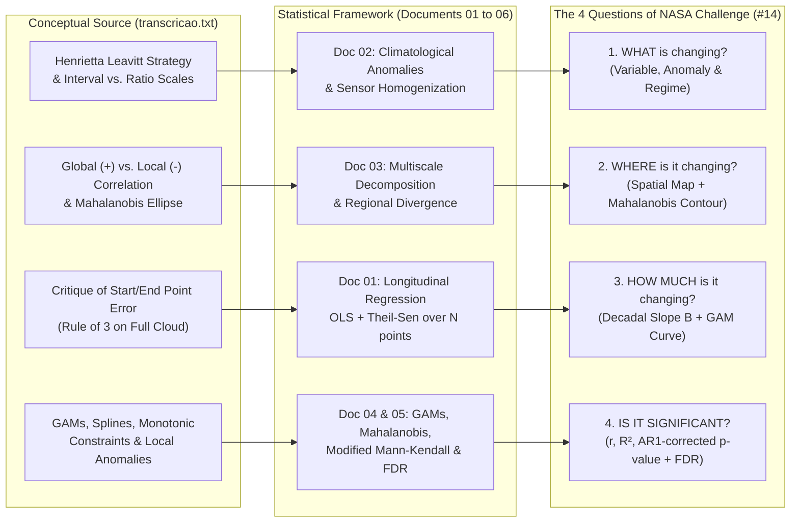

# General Index & Statistical Framework Architecture — *Be An Earth System Trend Detective!*

> **Purpose of This Directory (`knowledge_base_estatistica/`):**
> This set of documents constitutes the **mandatory knowledge base and statistical modeling protocol** for all AI agents and developers working on the NASA Space Apps Challenge **"Be An Earth System Trend Detective!"**.
>
> The content consolidated here extracts, formalizes, and translates into NASA climate data science the rigorous foundations of **Regression and Correlation** presented by Hindemburg Melão Jr. (in `transcricao.txt`), integrating them with the operational strategy of [`ESTRATEGIA_TREND_DETECTIVE.md`](../general_strategy/ESTRATEGIA_TREND_DETECTIVE.md) and state-of-the-art statistical climatology.

---

## 🧭 Mandatory Reading Map for AI Agents

When an AI agent is invoked during the hackathon to design the data backend (`DADOS-1`), statistical engine (`DADOS-2`), visualization (`PROD-1`/`PROD-2`), or scientific narrative (`NARR`), it **MUST** consult the documents below according to its task:

| Document | Technical & Conceptual Focus | Target Agents |
| :--- | :--- | :--- |
| **[`01_FUNDAMENTOS_E_ERROS_CLASSICOS_DE_REGRESSAO.md`](01_FUNDAMENTOS_E_ERROS_CLASSICOS_DE_REGRESSAO.md)** | The nature of regression as a "generalized rule of three over the entire point cloud." The **Primary Endpoint-vs-Start-Point Error** ($T_{\text{final}} - T_{\text{initial}}$), why 99.9% of traditional calculations fail by ignoring the intermediate trajectory, and the anatomy of $Y = A + BX$ parameters in physical variables. | `DADOS-2`, `NARR`, `PROD-2` |
| **[`02_ESCALAS_CONTROLE_DE_VARIAVEIS_E_ANOMALIAS.md`](02_ESCALAS_CONTROLE_DE_VARIAVEIS_E_ANOMALIAS.md)** | Scale typology (Ratio vs. Interval vs. Ordinal/Logarithmic). Why variables without an absolute zero or with a baseline offset require differential treatment. **Henrietta Leavitt's strategy** (controlling confounding variables in the Magellanic Clouds) applied to climate space-time: seasonality removal, climatological anomalies, and sensor discontinuity control (MODIS/VIIRS/GRACE). | `DADOS-1`, `DADOS-2` |
| **[`03_CORRELACAO_MULTIESCALA_E_DIVERGENCIA_ESPACIAL.md`](03_CORRELACAO_MULTIESCALA_E_DIVERGENCIA_ESPACIAL.md)** | Rigorous distinction between **Correlation** (degree of coupling/predictability, contour ellipse) and **Regression** (functional rate of change). The **Multiscale Paradox**: how two variables or regions exhibit positive long-term correlation and systematically negative short-term correlation (e.g., ENSO/El Niño vs. secular trend). Hierarchical taxonomy of methods (Pearson, Spearman, Kendall's $\tau$). | `DADOS-2`, `PROD-1`, `PROD-2`, `NARR` |
| **[`04_MODELAGEM_NAO_LINEAR_GAMS_E_CONSTRICOES_FISICAS.md`](04_MODELAGEM_NAO_LINEAR_GAMS_E_CONSTRICOES_FISICAS.md)** | When a straight line fails: physical dissipation, saturation, and tipping points. Use of **GAMs (Generalized Additive Models)**, *Splines*, and regressions with **monotonicity constraints** vs. unstable polynomials. Diagnosis of systematic local deviations (regime "bumps" or instrumental artifacts) via analysis of derivatives $f'(x)$ and $f''(x)$. | `DADOS-2`, `PROD-2` |
| **[`05_OUTLIERS_ROBUSTEZ_E_SIGNIFICANCIA_ESPACIAL.md`](05_OUTLIERS_ROBUSTEZ_E_SIGNIFICANCIA_ESPACIAL.md)** | Point-cloud geometry, contour ellipses, and **Mahalanobis Distance** for multivariate outlier detection. Robust regression (Theil-Sen, Huber, Tukey) vs. Ordinary Least Squares (OLS). State-of-the-art significance for NASA climate grids: serial autocorrelation (Hamed-Rao / Yue-Pilon) and spatial false-discovery control (Benjamini-Hochberg FDR). | `DADOS-2`, `PROD-1` |
| **[`06_GUIA_OPERACIONAL_PARA_AGENTES_DE_IA_NO_HACKATHON.md`](06_GUIA_OPERACIONAL_PARA_AGENTES_DE_IA_NO_HACKATHON.md)** | **Execution & Anti-Hallucination Protocol for AIs:** Golden rules ("Never do X, always do Y"), direct mathematical mapping of the **4 Detective Questions** (*What, Where, How Much, Significance*), and specification of state-of-the-art statistical fields for the JSON Data Contract. | **ALL AGENTS** (`COORD`, `DADOS-1/2`, `PROD-1/2`, `NARR`) |
| **[`07_ARQUITETURA_E_PROMPT_COPILOTO.md`](07_ARQUITETURA_E_PROMPT_COPILOTO.md)** | **Statistical Co-Pilot Architecture & Prompts (`F4 · P0 · MUST`):** Hybrid architecture (`fast LLM + deterministic heuristic fallback`), official System Prompts (PT/EN) locked to the 7 Statistical Invariants, compact serialization, and `POST /api/copilot` route contract. | `DADOS-2`, `PROD-2`, `NARR` |

---

## 🏗️ Transformation Flow: From Concept to NASA Product

---

## ⚡ Executive Summary of the Project's 5 Statistical Commandments

1. **Absolute Prohibition of $\Delta = Y_{\text{end}} - Y_{\text{start}}$:** Never compute a climate trend by subtracting the first year from the last year (or the mean of the first 5 years from the last 5 years). Every rate of change ("How much is it changing?") **must** emerge from fitting the entire point cloud.
2. **Isolation of Confounders Before Regression (Henrietta Leavitt Principle):** Just as Leavitt isolated stellar distance by observing only Cepheids in the Magellanic Clouds, never run regression on raw data contaminated by the annual seasonal cycle or satellite transitions. Extract the **climatological anomaly** first and audit structural breaks.
3. **Crystal-Clear Separation Between Slope ($B$) and Coupling ($r$):** A location can have a steep slope ($B$ large) with very low correlation/consistency ($r \approx 0$, cloud scattered by El Niño), or a moderate slope with very high predictability ($r \to 1$, narrow ellipse). The tool must display both.
4. **Multiscale Awareness (Global vs. Local in Time and Space):** Two variables (or two regions) may move together over 30 years (positive secular correlation) while opposing each other systematically over 6-to-24-month windows (negative local correlation). This is not an error — it is the physical signature of coupled oscillations.
5. **Beyond Rigid Lines and Blind Outliers:** Thermodynamic and environmental processes dissipate or saturate. Whenever physics demands it, complement the robust linear trend (Sen's Slope) with a flexible curve (**GAM / Spline**) to reveal acceleration, deceleration, or *local regime anomalies*, filtering *outliers* via **Mahalanobis Distance**.

---

## 🐍 Executable Implementation in the Repository (`DADOS-2` — Phase 2, `.venv` Scientific Stack)

> **Architectural Separation Rule (`data/api/` vs. `data/services/` vs. `backend/`):** All mathematical and statistical models reside **exclusively** in `backend/stats_engine.py`, and the Statistical Co-Pilot Chatbot interpretation in `backend/copilot_engine.py`. The `data/api/server.py` layer handles only HTTP routing (`/api/health`, `/api/catalog`, `/api/analyze`, `/api/copilot`, `/api/location/fetch`, `/api/compare`), and `data/services/comparison_service.py` handles fetch/cache orchestration and delegates 100% of statistical computation to `backend/stats_engine.py`.

| File | Technical Role |
| :--- | :--- |
| **[`backend/stats_engine.py`](../../backend/stats_engine.py)** | State-of-the-art statistical engine integrated with the `.venv` environment (`numpy`, `scipy`, `scikit-learn`, `statsmodels`, `pymannkendall` with deterministic pure-Python fallback), compliant with [`CONTRATO_DE_DADOS.md`](../../CONTRATO_DE_DADOS.md): NASA POWER cleaning (`-999`, `YYYY13`, `PRECTOTCORR`), spatial `nanmean` ($1 \le K \le 9$), monthly climatological anomaly with trimmed mean and intra-annual trend isolation, `z_scores` computation, OLS (`scipy.stats.linregress`) + decadal Theil-Sen (`scipy.stats.theilslopes` with 95% CI and `sen_fit`), GAM via `statsmodels` LOWESS + `scipy.interpolate.make_smoothing_spline` (GCV) + quadratic acceleration $B_2$, bivariate Mahalanobis outliers via `sklearn.covariance.MinCovDet` + MAD ($D_M > 2.5$), $\text{AR}(1)$-corrected significance (Santer's $N_{\text{effective}}$) + Hamed-Rao Modified Mann-Kendall (`pymannkendall.hamed_rao_modification_test`) + Benjamini-Hochberg FDR (`scipy.stats.false_discovery_control`, $q < 0.05$), and multiscale correlation decomposition ($r_{\text{global}}$, $r_{\text{detrended}}$, `long_term_p_value`, `short_term_p_value`). |
| **[`data/services/comparison_service.py`](../../data/services/comparison_service.py)** | Unified service layer (`POST /api/analyze` and `/api/compare`): delegates all statistics to [`backend/stats_engine.py`](../../backend/stats_engine.py) while preserving `data/` connectors and fully supporting all 42 catalog variables (`variable_meta` + joint FDR + Invariant #3 lock on interval scales). |
| **[`frontend/src/App.tsx`](../../frontend/src/App.tsx)** & **[`frontend/src/bench.css`](../../frontend/src/bench.css)** | Complete Phase 2 Scientific Workbench: free exploration on the interactive map integrated with Triple Normalization (Anomaly / Raw Data / Z-Score $\sigma$), scale toggle (Linear / Symlog), Time Series and $X \times Y$ Scatter plot with Mahalanobis contour ellipse ($D_M = 2.5$), independent layers (OLS, Theil-Sen, GAM, Mahalanobis), and collapsible panel for the **4 Detective Answers + Multiscale Paradox**. |
| **[`backend/test_stats_engine.py`](../../backend/test_stats_engine.py)** | Unit and integration test suite (`.venv/bin/python3 -m unittest discover -s backend -p "test_*.py" -v`) validating the 7 Statistical Invariants, the scientific stack, delegation in `data/services/comparison_service.py`, and compliance with Data Contract Flows A and B. |
| **[`backend/mock_analysis.json`](../../backend/mock_analysis.json)** & **[`frontend/public/data/mock_analysis.json`](../../frontend/public/data/mock_analysis.json)** | Complete `RegionAnalysisResponse` payloads (1981–2025, 540 months, including `linear_fit`, `sen_fit`, `gam_smooth_fit`, and `z_scores`) for online/offline validation. |
| **[`backend/copilot_engine.py`](../../backend/copilot_engine.py)** | Statistical Co-Pilot Chatbot Engine (`F4 · P0 · MUST`): PT/EN System Prompts with the 7 Invariants, compact serialization (`build_copilot_prompt`), Invariant #3 sanitizer for interval scales, deterministic heuristic synthesis of the 4 Detective Questions, and optional integration via `GEMINI_API_KEY`. |
| **[`backend/test_copilot_engine.py`](../../backend/test_copilot_engine.py)** | Unit test suite covering PT/EN prompts, `%` sanitization on `T2M_MAX`, specific Q&A, fallback without API key, and the `POST /api/copilot` endpoint in [`data/api/server.py`](../../data/api/server.py). |
