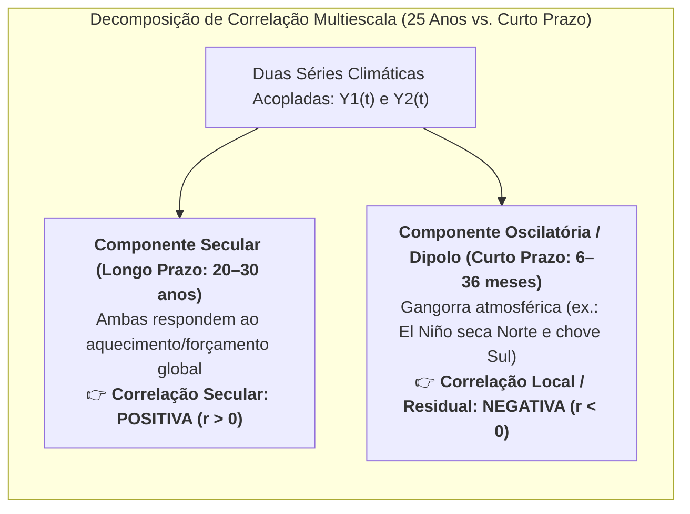

# 03. Correlação vs. Regressão, o Paradoxo Multiescala e a Divergência Espacial

> **Referência Base:** [`transcricao.txt`](file:///home/zrhyan/Principal/Computation/Space%20Apps/transcricao.txt) (Linhas 1, 3, 5 e 9) | **Aplicação:** Desafio NASA Space Apps *"Be An Earth System Trend Detective!"*
> **Objetivo para Agentes de IA:** Estabelecer a distinção matemática rigorosa entre Correlação e Regressão, dominar o fenômeno das **Correlações Multiescala (Globalmente Positivas e Localmente Negativas)** e estruturar o diferencial competitivo central do desafio: a **divergência espacial e temporal** entre regiões e variáveis do Sistema Terra.

---

## 1. A Distinção Fundamental: O Que Informa a Correlação vs. O Que Informa a Regressão

Muitos cientistas de dados tratam correlação e regressão como sinônimos ou usam apenas um deles. Em [`transcricao.txt`](file:///home/zrhyan/Principal/Computation/Space%20Apps/transcricao.txt#L5-L9), Hindemburg estabelece a distinção exata, geométrica e operacional que as nossas IAs devem implementar:

### 1.1 O Que é a Correlação ($r \in [-1, +1]$)
- **Definição Operacional:** A correlação mede **o quão bem a variável $X$ serve como preditor da variável $Y$** — isto é, a precisão, a confiabilidade e a estreiteza do acoplamento entre $X$ e $Y$.
- **Interpretação Geométrica (A Elipse de Contorno):**
  - Imagine a nuvem de pontos envolvida por uma **elipse de contorno** (definida, por exemplo, a $2{,}5$ desvios-padrão ou pela distância de Mahalanobis).
  - Quanto mais próximo de $+1$ ou $-1$ estiver o coeficiente de correlação ($|r| \to 1$), **mais estreita é a elipse** e mais colados os pontos estão sobre a reta/curva de regressão. Qualquer variação ínfima em $X$ reflete-se de forma determinística e previsível em $Y$ (ex.: na antropometria física, o comprimento do fêmur tem $r \ge 0{,}98$ com a estatura humana; no ENEM, a taxa de acertos agregada tem $r \approx 0{,}9999$ entre faixas).
  - Quanto mais próximo de $0$ estiver a correlação ($r \to 0$), **mais larga e arredondada (ou paralela ao eixo das abscissas)** fica a elipse: saber $X$ quase não reduz a incerteza sobre $Y$.

### 1.2 O Que é a Regressão ($\hat{Y} = A + BX$ ou $\hat{Y} = f(X)$)
- **Definição Operacional:** Enquanto a correlação mede a *dispersão relativa em torno da lei*, a regressão fornece **a própria lei funcional de transformação**:
  1. **A Inclinação ($B$):** Quantas unidades físicas $Y$ varia quando $X$ varia 1 unidade (ex.: *"para cada $1\text{ cm}$ a mais no perímetro ou no fêmur, acrescentam-se $4\text{ cm}$ na estatura"*; ou na NASA: *"para cada década, o aquífero perde $14{,}2\text{ cm}$ de coluna equivalente de água"*).
  2. **O Ponto Inicial / Altura ($A$):** O ajuste de nível onde essa taxa começa a operar.

### 1.3 Por Que o *Trend Detective* Precisa Mostrar AMBOS?
Observe como Correlação ($r$) e Inclinação de Regressão ($B$) respondem a perguntas **ortogonais** no desafio da NASA:

| Cenário Climático na NASA | Inclinação ($B$ — Regressão) | Correlação ($r$ — Elipse) | Diagnóstico do Detetive (`DADOS-2` / `NARR`) |
| :--- | :---: | :---: | :--- |
| **Aquecimento Oceânico Tropical Estável** | Moderada ($+0{,}15\,^\circ\text{C/década}$) | Altíssima ($r = 0{,}92$) | **Mudança lenta, porém implacável e altamente consistente:** quase não há ruído interanual; o sistema avança como um relógio. |
| **Precipitação em Região de Monção / El Niño** | Alta ($-45\text{ mm/década}$) | Baixa ($r = -0{,}22$) | **Mudança aparente alta, mas imersa em altíssima volatilidade:** a nuvem é extremamente espalhada; a seca recente pode ser flutuação decadal e exige cautela estatística. |
| **Depleção de Aquífero por Irrigação (GRACE)** | Forte ($-18\text{ cm/década}$) | Forte ($r = -0{,}88$) | **Tendência crítica e altamente significativa:** queda acelerada E elipse estreita confirmam perda estrutural contínua de água subterrânea. |

---

## 2. O Paradoxo das Correlações Multiescala: Globalmente Positiva vs. Localmente Negativa

Um dos *insights* mais valiosos de toda a transcrição ([`transcricao.txt`](file:///home/zrhyan/Principal/Computation/Space%20Apps/transcricao.txt#L3)) — que separa um cientista de dados sênior de análises superficiais — é o fenômeno das **correlações que mudam de sinal conforme a escala temporal (janela de observação)**:

> **O Fenômeno Multiescala (Hindemburg Melão Jr.):**
> *"Você tem uma correlação que é globalmente positiva, mas localmente ela pode ser sistematicamente negativa. Enquanto uma está subindo, a outra está caindo; depois, quando essa começa a subir, a outra começa a cair... Se você pega o histórico todo (15, 20 anos), ambas cresceram (correlação global positiva). Mas localmente, em períodos de poucos meses ou poucos anos, elas têm correlação sistematicamente negativa!"*

### 2.1 Como Isso Acontece Matematicamente?
Considere duas séries temporais $Y_1(t)$ e $Y_2(t)$ (por exemplo, temperatura ou precipitação em duas bacias hidrográficas distintas, ou duas variáveis medidas pela NASA):

$$\begin{aligned}
Y_1(t) &= A_1 + B_1 t + C \sin(\omega t) + \epsilon_1(t) \\
Y_2(t) &= A_2 + B_2 t - C \sin(\omega t) + \epsilon_2(t)
\end{aligned}$$

Onde $B_1 > 0$ e $B_2 > 0$ representam uma **tendência secular comum de longo prazo** (ex.: forçamento radiativo global de 25 anos), e o termo $\pm C \sin(\omega t)$ representa um **dipolo oscilatório de curto/médio prazo** em oposição de fase (ex.: El Niño–Oscilação Sul / ENSO, Dipolo do Atlântico ou Oscilação Ártica, com período de 1 a 5 anos):

1. **Na Escala Global (Longo Prazo, $\Delta t = 25\text{ anos}$):**
   - O crescimento secular $B_1 t$ e $B_2 t$ domina a variância total ($\text{Var}(Bt) \gg C^2/2$).
   - Como ambas subiram ao longo de 25 anos, a **correlação global no histórico completo é fortemente POSITIVA ($r_{\text{global}} > 0$)**!
2. **Na Escala Local (Curto Prazo, janelas de $6\text{ a }24\text{ meses}$ ou resíduos detrended):**
   - Dentro de uma janela curta, a tendência secular $B t$ é quase constante, e a dinâmica é dominada pela gangorra física $+C\sin(\omega t)$ vs. $-C\sin(\omega t)$.
   - Enquanto $Y_1$ sobe, $Y_2$ cai sistematicamente! Portanto, a **correlação local de curto prazo é fortemente NEGATIVA ($r_{\text{local}} < 0$)**!

### 2.2 O Impacto Direto no Desafio #14 da NASA ("Alta numa região, queda em outra")
Releia o enunciado oficial do desafio da NASA em [`ESTRATEGIA_TREND_DETECTIVE.md`](file:///home/zrhyan/Principal/Computation/Space%20Apps/general_strategy/ESTRATEGIA_TREND_DETECTIVE.md#L26):
> *"Variáveis do sistema Terra mudam ao longo do tempo, e **o mesmo processo pode produzir tendência de alta numa região e de queda em outra**."*

Com o conceito de Correlação Multiescala da transcrição, nossa equipe pode entregar uma análise que **nenhuma outra equipe no hackathon terá**:
When compararmos duas regiões (ou duas variáveis) no painel de Comparação Lado a Lado (`PROD-2`), não mostraremos apenas uma correlação ingênua única. Calcularemos **três métricas complementares**:
1. **Divergência de Tendência Secular ($B_{\text{Região 1}}$ vs. $B_{\text{Região 2}}$):** Uma região tem $B > 0$ e outra tem $B < 0$ no longo prazo? (Ex.: intensificação do ciclo hidrológico onde zonas úmidas ficam mais chuvosas e zonas subtropicais áridas ficam mais secas).
2. **Correlação Global Bruta ($r_{\text{longo prazo}}$):** Como as duas séries se relacionam considerando toda a janela histórica de 20+ anos.
3. **Correlação Residual de Curto Prazo ($r_{\text{detrended}}$ ou Janela Móvel):** Removendo a tendência de longo prazo ($e_i = Y_i - \hat{Y}_i$), qual é a correlação entre os resíduos interanuais?
   - Se $r_{\text{longo prazo}} > 0$ e $r_{\text{detrended}} < 0$ (ou vice-versa), a ferramenta exibe um **Alerta de Descoberta do Detetive (*Multiscale Paradox Detected*)**: explicando que, embora ambas as regiões sofram a mesma tendência de longo prazo, a curto prazo elas operam como uma gangorra climática (quando uma aquece/seca em anos de El Niño, a outra esfria/chove)!

---

## 3. Taxonomia das Correlações e Variáveis Compostas

Na transcrição ([`transcricao.txt`](file:///home/zrhyan/Principal/Computation/Space%20Apps/transcricao.txt#L1)), Hindemburg situa a família de métodos de correlação e regressão no mesmo nível taxonômico/hierárquico dos diferentes métodos de integração no Cálculo (Riemann, Lebesgue, Ito), destacando que escolher a variante certa para a estrutura do dado é essencial:

### 3.1 Quando Usar Cada Coeficiente de Correlação nos Dados da NASA (`DADOS-2`)

| Método | Fórmula / Natureza | Quando Utilizar no *Trend Detective* |
| :--- | :--- | :--- |
| **Correlação Linear de Pearson ($r$)** | Covariância normalizada pelos desvios-padrão em escala intervalar/razão. | Para avaliar o ajuste linear de anomalias contínuas bem comportadas (ex.: Anomalia de Temperatura GISTEMP/AIRS vs. Tempo). Sensível a *outliers*. |
| **Correlação de Postos de Spearman ($\rho$)** | Correlação de Pearson aplicada aos *ranks* (postos ordenados) dos dados. | Quando a relação entre a variável e o tempo (ou entre duas variáveis) é **monotônica mas não-linear** (ex.: crescimento exponencial ou logístico), ou em variáveis com assimetria forte. |
| **Tau de Kendall ($\tau$)** | Proporção de pares concordantes menos pares discordantes: $\tau = \frac{C - D}{\binom{n}{2}}$. | **Padrão-Ouro Climatológico:** É a base estatística direta do **Teste de Tendência de Mann-Kendall**. Robusto a *outliers*, não exige distribuição normal e mede diretamente a consistência monotônica da tendência temporal. |
| **Correlação Robusta (Biweight Midcorrelation / Tukey)** | Baseada na mediana e no desvio absoluto mediano (MAD), reduzindo o peso das caudas. | Quando a série de satélite possui picos extremos episódicos (ex.: anomalias de fogo, erupções, tempestades extremas) que distorceriam o $r$ de Pearson. |

---

## 4. Variáveis Compostas e Proxies: Como Estimar o Não-Observado

Outro ponto valioso extraído de [`transcricao.txt`](file:///home/zrhyan/Principal/Computation/Space%20Apps/transcricao.txt#L9) é o uso da regressão e correlação para construir **proxies e variáveis compostas**:
- **O Exemplo da Arqueologia e Medicina:** Quando não temos o esqueleto inteiro para medir a altura (nem mesmo o fêmur), mas temos o rádio, o úmero e a tíbia, combinamos essas várias partes conhecidas em uma **variável composta otimizada** por regressão múltipla para estimar a estatura com precisão superior a qualquer osso isolado. Da mesma forma, na medicina, mede-se um *proxy* fortementecorrelacionado para estimar a glicemia.
- **Aplicação Direta aos Satélites da NASA:**
  - Satélites **não medem diretamente** "seca ecológica" ou "estresse hídrico agrícola"; eles medem radiâncias espectrais e gravidade que servem como *proxies*:
    1. Temperatura de Superfície Terrestre (**MODIS/AIRS LST**) $\to$ *proxy* de demanda evaporativa e calor.
    2. Anomalia de Água Total Armazenada (**GRACE TWS**) ou Umidade do Solo (**SMAP**) $\to$ *proxy* de reserva hídrica profunda/superficial.
    3. Índice de Vegetação (**MODIS NDVI**) $\to$ *proxy* da resposta biológica da planta.
  - Se combinarmos essas variáveis (ou mostrarmos sua correlação cruzada), criamos um diagnóstico físico muito mais poderoso do que olhar para uma variável isolada.

---

## 5. Cuidado Epistemológico Crítico: Evitando Correlação Contaminada (Circularidade)

Na análise da matriz de correlações entre métodos de estimativa de QI histórico ([`transcricao.txt`](file:///home/zrhyan/Principal/Computation/Space%20Apps/transcricao.txt#L3)), Hindemburg faz um alerta metodológico exemplar de honestidade científica:
- Ao observar que a correlação entre o seu livro e o índice de Charles Murray deu $r = 0{,}91$ (muito acima das demais), ele imediatamente aponta: ***"Mas é uma correlação enviesada (contaminada), porque eu usei os coeficientes do Murray como parte do método de estimativa."***
- **A Regra de Ouro para os Agentes `DADOS-2` e `NARR` no Hackathon:**
  - **Jamais correlacione duas variáveis da NASA que compartilhem o mesmo modelo ou insumo matemático subjacente achando que são evidências independentes!**
  - *Exemplo de contaminação na NASA:* Se você correlacionar a Evapotranspiração Potencial derivada de um modelo de reanálise com a Temperatura do Ar do mesmo modelo, obterá $r > 0{,}95$ não por uma descoberta empírica, mas porque a equação do modelo calcula a evapotranspiração diretamente a partir da temperatura!
  - **Para validar descobertas cruzadas (Fase 5 — Investigação do Detetive):** Cruze sempre **instrumentos fisicamente independentes** (ex.: gravimetria por micro-ondas entre satélites do **GRACE** vs. espectrometria óptica do **MODIS** vs. sondagem infravermelha do **AIRS**). Quando dois sensores baseados em princípios físicos completamente distintos apontam para a mesma anomalia, a descoberta é **apodítica** (incontestável).
