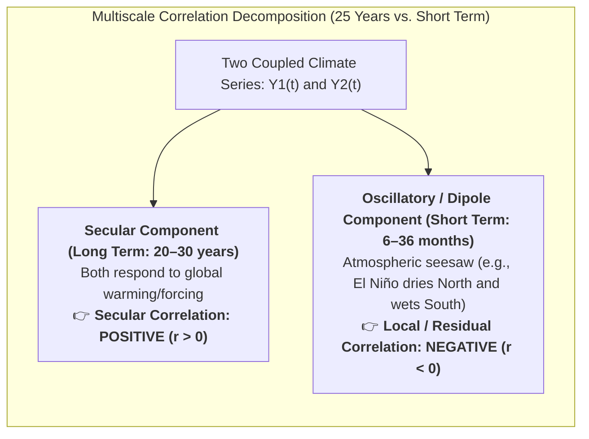

# 03. Correlation vs. Regression, the Multiscale Paradox, and Spatial Divergence

> **Base Reference:** `transcricao.txt` (Lines 1, 3, 5, and 9) | **Application:** NASA Space Apps Challenge *"Be An Earth System Trend Detective!"*
> **Goal for AI Agents:** Establish the rigorous mathematical distinction between Correlation and Regression, master the phenomenon of **Multiscale Correlations (Globally Positive and Locally Negative)**, and structure the challenge's core competitive differentiator: **spatial and temporal divergence** across Earth System regions and variables.

---

## 1. The Fundamental Distinction: What Correlation Tells You vs. What Regression Tells You

Many data scientists treat correlation and regression as synonyms or use only one of them. In `transcricao.txt` (Lines 5–9), Hindemburg establishes the exact geometric and operational distinction that our AI agents must implement:

### 1.1 What Correlation Is ($r \in [-1, +1]$)
- **Operational Definition:** Correlation measures **how well variable $X$ serves as a predictor of variable $Y$** — that is, the precision, reliability, and tightness of the coupling between $X$ and $Y$.
- **Geometric Interpretation (The Contour Ellipse):**
  - Picture the point cloud enclosed by a **contour ellipse** (defined, for example, at $2.5$ standard deviations or by Mahalanobis distance).
  - The closer the correlation coefficient is to $+1$ or $-1$ ($|r| \to 1$), **the narrower the ellipse** and the more tightly the points hug the regression line/curve. Any tiny change in $X$ reflects deterministically and predictably in $Y$ (e.g., in physical anthropometry, femur length has $r \ge 0.98$ with human stature; in Brazil's ENEM exam, aggregate hit rate has $r \approx 0.9999$ across score bands).
  - The closer correlation is to $0$ ($r \to 0$), **the wider and rounder (or parallel to the abscissa axis)** the ellipse becomes: knowing $X$ barely reduces uncertainty about $Y$.

### 1.2 What Regression Is ($\hat{Y} = A + BX$ or $\hat{Y} = f(X)$)
- **Operational Definition:** Whereas correlation measures *relative dispersion around the law*, regression provides **the functional law of transformation itself**:
  1. **The Slope ($B$):** How many physical units $Y$ changes when $X$ changes by 1 unit (e.g., *"for every additional $1\text{ cm}$ in perimeter or femur, $4\text{ cm}$ are added to stature"*; or at NASA: *"for each decade, the aquifer loses $14.2\text{ cm}$ of water equivalent thickness"*).
  2. **The Starting Point / Level ($A$):** The level offset where that rate begins to operate.

### 1.3 Why *Trend Detective* Must Show BOTH
Notice how Correlation ($r$) and Regression Slope ($B$) answer **orthogonal** questions in the NASA challenge:

| NASA Climate Scenario | Slope ($B$ — Regression) | Correlation ($r$ — Ellipse) | Detective Diagnosis (`DADOS-2` / `NARR`) |
| :--- | :---: | :---: | :--- |
| **Steady Tropical Ocean Warming** | Moderate ($+0.15\,^\circ\text{C/decade}$) | Very High ($r = 0.92$) | **Slow, yet relentless and highly consistent change:** almost no interannual noise; the system advances like clockwork. |
| **Precipitation in Monsoon / El Niño Region** | High ($-45\text{ mm/decade}$) | Low ($r = -0.22$) | **Large apparent change, but immersed in extreme volatility:** the cloud is widely scattered; recent drought may be decadal fluctuation and requires statistical caution. |
| **Irrigation-Driven Aquifer Depletion (GRACE)** | Strong ($-18\text{ cm/decade}$) | Strong ($r = -0.88$) | **Critical and highly significant trend:** accelerated drop AND narrow ellipse confirm continuous structural groundwater loss. |

---

## 2. The Multiscale Correlation Paradox: Globally Positive vs. Locally Negative

One of the most valuable *insights* in the entire transcript (`transcricao.txt`, Line 3) — separating a senior data scientist from superficial analyses — is the phenomenon of **correlations that flip sign depending on the time scale (observation window)**:

> **The Multiscale Phenomenon (Hindemburg Melão Jr.):**
> *"You have a correlation that is globally positive, yet locally it can be systematically negative. While one is rising, the other is falling; then, when the latter starts rising, the former starts falling... If you take the whole history (15, 20 years), both grew (positive global correlation). But locally, over periods of a few months or a few years, they have a systematically negative correlation!"*

### 2.1 How Does This Happen Mathematically?
Consider two time series $Y_1(t)$ and $Y_2(t)$ (for instance, temperature or precipitation in two distinct river basins, or two NASA-measured variables):

$$\begin{aligned}
Y_1(t) &= A_1 + B_1 t + C \sin(\omega t) + \epsilon_1(t) \\
Y_2(t) &= A_2 + B_2 t - C \sin(\omega t) + \epsilon_2(t)
\end{aligned}$$

Where $B_1 > 0$ and $B_2 > 0$ represent a **common long-term secular trend** (e.g., 25-year global radiative forcing), and the term $\pm C \sin(\omega t)$ represents a **short/medium-term oscillatory dipole** in phase opposition (e.g., El Niño–Southern Oscillation / ENSO, Atlantic Dipole, or Arctic Oscillation, with a 1-to-5-year period):

1. **On the Global Scale (Long Term, $\Delta t = 25\text{ years}$):**
   - Secular growth $B_1 t$ and $B_2 t$ dominates total variance ($\text{Var}(Bt) \gg C^2/2$).
   - Because both rose over 25 years, the **global correlation across the full history is strongly POSITIVE ($r_{\text{global}} > 0$)**!
2. **On the Local Scale (Short Term, $6\text{-to-}24\text{-month}$ windows or detrended residuals):**
   - Within a short window, the secular trend $B t$ is nearly constant, and dynamics are dominated by the physical seesaw $+C\sin(\omega t)$ vs. $-C\sin(\omega t)$.
   - While $Y_1$ rises, $Y_2$ systematically falls! Therefore, the **short-term local correlation is strongly NEGATIVE ($r_{\text{local}} < 0$)**!

### 2.2 Direct Impact on NASA Challenge #14 ("Up in One Region, Down in Another")
Reread the official NASA challenge statement in [`ESTRATEGIA_TREND_DETECTIVE.md`](../general_strategy/ESTRATEGIA_TREND_DETECTIVE.md#L26):
> *"Earth system variables change over time, and **the same process can produce an upward trend in one region and a downward trend in another**."*

With the Multiscale Correlation concept from the transcript, our team can deliver an analysis that **no other team in the hackathon will have**:
When comparing two regions (or two variables) in the Side-by-Side Comparison panel (`PROD-2`), we will not show merely a single naive correlation. We will compute **three complementary metrics**:
1. **Secular Trend Divergence ($B_{\text{Region 1}}$ vs. $B_{\text{Region 2}}$):** Does one region have $B > 0$ and the other $B < 0$ over the long term? (E.g., intensification of the hydrological cycle where wet zones get wetter and arid subtropical zones get drier).
2. **Raw Global Correlation ($r_{\text{long term}}$):** How the two series relate across the entire 20+ year historical window.
3. **Short-Term Residual Correlation ($r_{\text{detrended}}$ or Moving Window):** After removing the long-term trend ($e_i = Y_i - \hat{Y}_i$), what is the correlation between interannual residuals?
   - If $r_{\text{long term}} > 0$ and $r_{\text{detrended}} < 0$ (or vice versa), the tool displays a **Detective Discovery Alert (*Multiscale Paradox Detected*)**, explaining that although both regions share the same long-term trend, in the short term they operate as a climate seesaw (when one warms/dries during El Niño years, the other cools/wets)!

---

## 3. Taxonomy of Correlations and Composite Variables

In the transcript (`transcricao.txt`, Line 1), Hindemburg places the family of correlation and regression methods at the same taxonomic/hierarchical level as different integration methods in Calculus (Riemann, Lebesgue, Itô), emphasizing that choosing the right variant for the data structure is essential:

### 3.1 When to Use Each Correlation Coefficient on NASA Data (`DADOS-2`)

| Method | Formula / Nature | When to Use in *Trend Detective* |
| :--- | :--- | :--- |
| **Pearson Linear Correlation ($r$)** | Covariance normalized by standard deviations on interval/ratio scale. | To evaluate linear fit of well-behaved continuous anomalies (e.g., GISTEMP/AIRS Temperature Anomaly vs. Time). Sensitive to *outliers*. |
| **Spearman Rank Correlation ($\rho$)** | Pearson correlation applied to the *ranks* of the data. | When the relationship between variable and time (or between two variables) is **monotonic but nonlinear** (e.g., exponential or logistic growth), or in strongly skewed variables. |
| **Kendall's Tau ($\tau$)** | Proportion of concordant pairs minus discordant pairs: $\tau = \frac{C - D}{\binom{n}{2}}$. | **Climatological Gold Standard:** It is the direct statistical basis of the **Mann-Kendall Trend Test**. Robust to *outliers*, requires no normality assumption, and directly measures monotonic consistency of a time trend. |
| **Robust Correlation (Biweight Midcorrelation / Tukey)** | Based on median and median absolute deviation (MAD), downweighting tails. | When the satellite series has episodic extreme spikes (e.g., fire anomalies, eruptions, extreme storms) that would distort Pearson's $r$. |

---

## 4. Composite Variables and Proxies: How to Estimate the Unobserved

Another valuable point extracted from `transcricao.txt` (Line 9) is the use of regression and correlation to build **proxies and composite variables**:
- **The Archaeology and Medicine Example:** When we lack a full skeleton to measure stature (even missing the femur), yet have the radius, humerus, and tibia, we combine those known parts into an **optimized composite variable** via multiple regression to estimate stature more accurately than from any single bone alone. Similarly, in medicine, a strongly correlated *proxy* is measured to estimate blood glucose.
- **Direct Application to NASA Satellites:**
  - Satellites **do not directly measure** "ecological drought" or "agricultural water stress"; they measure spectral radiances and gravity that serve as *proxies*:
    1. Land Surface Temperature (**MODIS/AIRS LST**) $\to$ *proxy* for evaporative demand and heat.
    2. Total Water Storage Anomaly (**GRACE TWS**) or Soil Moisture (**SMAP**) $\to$ *proxy* for deep/surface water reserves.
    3. Vegetation Index (**MODIS NDVI**) $\to$ *proxy* for biological plant response.
  - By combining these variables (or showing their cross-correlation), we create a physical diagnosis far more powerful than looking at a single variable in isolation.

---

## 5. Critical Epistemological Caution: Avoiding Contaminated Correlation (Circularity)

When analyzing the correlation matrix among historical IQ estimation methods (`transcricao.txt`, Line 3), Hindemburg issues an exemplary methodological warning of scientific honesty:
- Upon noticing that the correlation between his book and Charles Murray's index came out to $r = 0.91$ (much higher than the others), he immediately points out: ***"But that is a biased (contaminated) correlation, because I used Murray's coefficients as part of the estimation method."***
- **The Golden Rule for `DADOS-2` and `NARR` Agents at the Hackathon:**
  - **Never correlate two NASA variables that share the same underlying model or mathematical input thinking they are independent evidence!**
  - *Example of contamination at NASA:* If you correlate Potential Evapotranspiration derived from a reanalysis model with Air Temperature from that same model, you will obtain $r > 0.95$ not from an empirical discovery, but because the model's equation computes evapotranspiration directly from temperature!
  - **To validate cross-variable discoveries (Phase 5 — Detective Investigation):** Always cross-check **physically independent instruments** (e.g., satellite-to-satellite microwave gravimetry from **GRACE** vs. optical spectrometry from **MODIS** vs. infrared sounding from **AIRS**). When two sensors based on completely distinct physical principles point to the same anomaly, the discovery is **apodictic** (incontestable).
