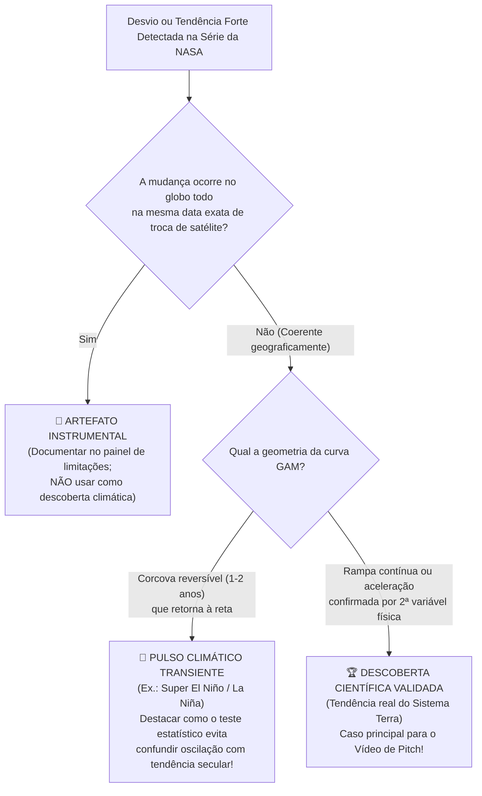

# 04. Modelagem Não-Linear, GAMs, Constrições Físicas e Diagnóstico de Anomalias

> **Referência Base:** [`transcricao.txt`](file:///home/zrhyan/Principal/Computation/Space%20Apps/transcricao.txt) (Linhas 1–5 e 9) | **Aplicação:** Desafio NASA Space Apps *"Be An Earth System Trend Detective!"*
> **Objetivo para Agentes de IA:** Ir além da regressão linear simples quando o fenômeno físico não é uma reta. Saber quando e como utilizar **GAMs (Generalized Additive Models)**, **Splines**, **Regressão com Constrição de Monotonicidade** e análise de derivadas ($f'(x), f''(x)$) para evitar erros físicos absurdos e diagnosticar anomalias locais de regime.

---

## 1. Quando a Reta Falha: Termodinâmica, Dissipação e Saturação Física

Embora a reta de regressão ($\hat{Y} = A + BX$) seja o resumo primário indispensável para responder rapidamente à taxa média de mudança ("Quanto muda por década?"), assumir que todo fenômeno natural evolui linearmente é um erro grave.

Em [`transcricao.txt`](file:///home/zrhyan/Principal/Computation/Space%20Apps/transcricao.txt#L3), Hindemburg analisa o experimento físico da **xícara de cerâmica com água sendo aquecida dentro de um forno de micro-ondas**:
- À medida que o tempo de aquecimento ($X$) aumenta, a temperatura da água e da xícara ($Y$) sobe.
- Porém, **não sobe em linha reta!** À medida que a água fica mais quente que o ar ao redor, ela passa a **perder calor para o meio ambiente** por irradiação e convecção a uma taxa cada vez maior (Lei do Resfriamento de Newton / Stefan-Boltzmann).
- Consequentemente, a curva de aquecimento **desacelera progressivamente** (concavidade para baixo, $f''(t) < 0$), tendendo a um equilíbrio térmico ou ao limite de mudança de fase ($100\,^\circ\text{C}$).

### 1.1 O Erro Clássico do Polinômio Livre (Fenômeno de Runge / Inversão Artificial)
No exemplo da xícara de água na transcrição, ajustaram um **polinômio comum de grau 3 sem constrição** aos pontos experimentais. O que aconteceu no final da curva?
- A curva polinomial começou a **cair nos últimos segundos**, sugerindo absurdamente que deixar a água mais tempo com o micro-ondas ligado faria a água **esfriar**!
- **A Crítica de Hindemburg:**
  > *"Essa aqui, por exemplo, o ideal, o correto aqui seria usar um polinômio ou modelo com a constrição de ser monotônico crescente (ou monotônico não-decrescente), porque aqui dá para perceber que ele está diminuindo, o que não faz sentido físico."*

### 1.2 O Equivalente nos Dados da Terra da NASA
Nos dados de satélites da NASA, diversos processos sofrem exatamente o mesmo efeito termodinâmico ou de saturação de fronteira:
1. **Balanço Radiativo e Temperatura da Superfície (MODIS/AIRS):** O aquecimento superficial aumenta a emissão de radiação infravermelha longa ($\propto T^4$) e a evaporação latente, gerando curvas com mudanças de regime.
2. **Derretimento de Gelo Marinho ou Glaciares (NSIDC / ICESat-2):** A extensão de gelo é limitada inferiormente por $0\text{ km}^2$; à medida que o gelo de verão se aproxima de zero em certas bacias árticas, a curva desacelera assintoticamente rumo a zero (jamais pode ficar negativa, como faria uma reta ou polinômio mal ajustado).
3. **Índice de Vegetação (NDVI / EVI do MODIS):** O NDVI satura opticamente em florestas densas próximo a $0{,}85\text{–}0{,}90$ e tem piso no solo nu/água.
4. **Emissões Acumuladas de $\text{CO}_2$ (OCO-2/3):** O acúmulo antropogênico nas últimas décadas seguiu uma curva monotônica crescente acelerada ($f'(t) > 0, f''(t) > 0$).

> [!WARNING]
> **REGRA DE MODELAGEM PARA `DADOS-2`:**
> Nunca utilize polinômios de grau elevado ($p \ge 3$) irrestritos (`np.polyfit(t, y, 3)`) para modelar ou extrapolar séries temporais climáticas! Polinômios livres oscilam violentamente nas bordas da série temporal (início e fim do período), criando falsas "reversões de tendência" nos anos mais recentes ($2023\text{–}2026$) que não existem na física.

---

## 2. O Estado da Arte em Flexibilidade: GAMs (Generalized Additive Models), Splines e Constrições Monotônicas

Em [`transcricao.txt`](file:///home/zrhyan/Principal/Computation/Space%20Apps/transcricao.txt#L1-L5), Hindemburg apresenta as ferramentas superiores para modelar relações não-lineares com fidelidade empírica e respeito às leis do domínio:

### 2.1 GAM (Generalized Additive Models) e Splines Penalizadas
Em vez de forçar uma única equação rígida global (como uma reta ou uma logística simétrica de 3 parâmetros), um **GAM** modela a esperança matemática de $Y$ como uma soma de funções suaves locais (*splines*):
$$\hat{Y}(t) = \beta_0 + f(t)$$
onde $f(t) = \sum_{k=1}^{K} b_k B_k(t)$ é construída por bases de *B-splines* ou *cubic splines* com uma penalidade de curvatura $\lambda \int [f''(t)]^2 dt$ que evita o *overfitting* ao ruído de curto prazo.

### 2.2 Como Distinguir uma Logística Pura de um GAM pela Análise das Derivadas
Na transcrição ([`transcricao.txt`](file:///home/zrhyan/Principal/Computation/Space%20Apps/transcricao.txt#L5)), o autor ensina um critério matemático refinado para inspecionar curvas não-lineares:
- Uma **curva logística clássica** (de 1 a 4 parâmetros) possui uma progressão estrita e simétrica/assimétrica única de suas derivadas: a inclinação $f'(x)$ cresce monotonicamente até um único ponto de inflexão ($f''(x) = 0$) e depois decresce monotonicamente até a assíntota.
- Já um **GAM (ou Spline com constrição monotônica)** é muito mais aderente ao dado real: ele pode permanecer **estritamente monotônico** ($f'(x) \ge 0$ em todo o domínio), mas **mudar a taxa de inclinação da reta tangente várias vezes** ao longo do espectro ($f''(x)$ alternando de sinal em múltiplos platôs e degraus de aceleração).
- **Por que isso é crucial para o *Trend Detective*?**
  - O aquecimento global ou a perda de água subterrânea em uma bacia **não acontece a uma velocidade constante** nem segue uma sigmoide perfeita de livro-texto: há décadas de platô (hiato aparente por La Niñas sucessivas ou aerossóis vulcânicos) seguidas por degraus de aceleração abrupta!
  - Sobrepor no gráfico da série temporal (`PROD-2`):
    1. A **Reta de Tendência Global Robusta (Theil-Sen / OLS)** — que responde *"Qual é a velocidade média na janela inteira?"*; e
    2. A **Curva Suavizada Não-Linear (GAM / LOESS / Spline Penalizada)** — que responde *"A tendência está acelerando, desacelerando ou mudou de regime nos últimos anos?"*
    entrega um nível de *insight* visual e científico digno de publicação de ponta.

### 2.3 Seleção de Modelos Funcionais Fisicamente Motivados
Conforme citado na transcrição ([`transcricao.txt`](file:///home/zrhyan/Principal/Computation/Space%20Apps/transcricao.txt#L3)), pacotes científicos em Python (como `scipy.optimize` / `scipy.stats`, `statsmodels`, `pygam`, `scikit-learn` com `IsotonicRegression` ou `SplineTransformer`) permitem testar famílias funcionais específicas quando há justificativa teórica:
- **Tendência Linear ($Y = A + Bt$):** Modelo padrão de primeira ordem para janelas de 15 a 30 anos.
- **Modelo Quadrático / Aceleração ($Y = A + B_1 t + B_2 t^2$):** Útil para testar formalmente a hipótese nula $H_0: B_2 = 0$ (isto é: *"a mudança climática está acelerando significativamente neste ponto?"*). Se $B_2$ for estatisticamente significativo ($p < 0{,}05$), há aceleração ($B_2 > 0$ em uma tendência de alta) ou desaceleração/saturação ($B_2 < 0$).
- **Regressão Monotônica / Isotônica ou Spline Monotônica:** Quando modelamos variáveis acumuladas (ex.: perda acumulada de massa glacial ou emissões acumuladas) onde a física exige $f'(x) \ge 0$ (ou $\le 0$).

---

## 3. Diagnóstico de Anomalias Estruturais ("Corcovas" de Regime) na Curva de Regressão

Um dos trechos mais brilhantes de [`transcricao.txt`](file:///home/zrhyan/Principal/Computation/Space%20Apps/transcricao.txt#L3-L5) é a investigação forense que Hindemburg realiza ao encontrar uma **"corcova" (anomalia não-monotônica)** na curva de regressão dos dados do ENEM (onde alunos de alta habilidade apresentavam subitamente um salto na taxa de erros de itens fáceis, voltando a cair nos níveis altíssimos).

Observe o **método científico de eliminação de hipóteses pela geometria da curva** que ele aplica — e que é exatamente o que um **"Detetive de Tendências do Sistema Terra" (`DADOS-2` e `NARR`)** deve fazer na **Fase 5 (Investigação e Descoberta)** do nosso hackathon:

### 3.1 O Método Forense de Eliminação de Hipóteses pela Forma da Anomalia
Quando uma série temporal da NASA apresenta um desvio local pronunciado (uma "corcova", salto ou inversão local em relação à tendência esperada), não aceite a primeira explicação superficial; teste se a **geometria do desvio** é compatível com a causa proposta:

| Hipótese Causal nos Dados da NASA | Assinatura Geométrica Esperada na Série Temporal | Como Confirmar ou Refutar (Protocolo `DADOS-1` / `DADOS-2`) |
| :--- | :--- | :--- |
| **Hipótese 1: Troca ou Degradação de Sensor / Satélite** (Artefato Técnico) | **Degrau Permanente (*Step Change*):** A série salta abruptamente numa data exata (ex.: entrada de novo satélite ou mudança de algoritmo) e permanece no novo patamar em todas as regiões simultaneamente. | Checar se a data da quebra coincide com transições instrumentais conhecidas (ex.: MODIS Terra vs. Aqua, hiato GRACE/GRACE-FO em 2017). Se aparecer no globo inteiro no mesmo mês, **é artefato de sensor — NÃO apresente como descoberta climática!** |
| **Hipótese 2: Oscilação Climática Cíclica / Evento Extremo Transiente** (Ex.: Super El Niño 2015–2016 ou Erupção de Hunga Tonga / Pinatubo) | **Corcova Localizada Reversível (*Bump / Pulse*):** Assim como a "corcova" analisada na transcrição, a curva sobe (ou desce) num intervalo estreito de 1 a 3 anos e **retorna à linha de base/tendência anterior** logo depois. | Inspecionar a largura temporal da corcova e cruzar com o índice ONI (El Niño). A regressão linear simples de curto prazo pode ser enganada por essa corcova se ela cair na ponta da série; a regressão robusta na série longa + GAM isola o pulso transiente da tendência estrutural. |
| **Hipótese 3: Mudança Real de Regime Físico / Antrópico** (Ex.: Desmatamento de Fronteira, Construção de Barragem, Colapso de Aquífero) | **Mudança de Inclinação Persistente (*Broken-Stick / Ramp*) ou Curva em S:** A variável tinha inclinação $B_1 \approx 0$ e, a partir de um ano $t^*$, passa a ter inclinação forte $B_2 \neq 0$ que **se prolonga e se intensifica** até o fim da série, restrita a uma região geográfica coerente. | Confirmar que (1) o efeito persiste até o final da série (não volta a cair), (2) é espacialmente localizado na bacia/bioma afetado (e não um erro global do satélite), e (3) outra variável física independente (ex.: temperatura LST + vegetação NDVI) confirma o fenômeno. **Isto é um Achado Ouro para o Pitch!** |

---

## 4. Implementação Prática e Leve para o Pipeline Python (`DADOS-2`)

Para que o cálculo pré-computado na **Fase 4** rode em poucos segundos para todas as regiões/grades sem travar o computador:
1. **Camada 1 (Em todos os pixels da grade — Mapa Global):**
   - Calcular a **Inclinação Linear ($B$)** (via OLS vetorizado e/ou Theil-Sen nas séries agregadas), o **Termo Quadrático de Aceleração ($B_2$)** (para saber onde a mudança está acelerando ou desacelerando) e a **Correlação ($r$ / $\tau$)**.
2. **Camada 2 (Nas Séries Temporais das Regiões Selecionadas / Clicadas):**
   - Além da reta $\hat{Y}_{\text{linear}}(t) = A + Bt$, pré-computar a **curva não-linear suave $\hat{Y}_{\text{smooth}}(t)$** usando um *Cubic Smoothing Spline* / *GAM* (via `scipy.interpolate.make_smoothing_spline` ou `statsmodels.nonparametric.smoothers_lowess.lowess`), salvando os pontos da curva no JSON do Contrato de Dados.
   - Assim, o frontend (`PROD-2`) desenha instantaneamente tanto a reta de tendência quanto a curva não-linear real sem precisar processar estatística pesada no navegador!
