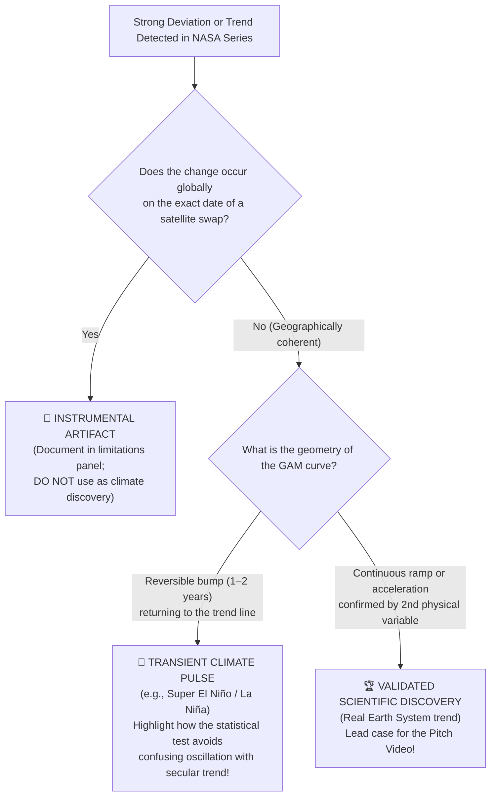

# 04. Nonlinear Modeling, GAMs, Physical Constraints, and Anomaly Diagnosis

> **Base Reference:** `transcricao.txt` (Lines 1–5 and 9) | **Application:** NASA Space Apps Challenge *"Be An Earth System Trend Detective!"*
> **Goal for AI Agents:** Go beyond simple linear regression when the physical phenomenon is not a straight line. Know when and how to use **GAMs (Generalized Additive Models)**, **Splines**, **Monotonicity-Constrained Regression**, and derivative analysis ($f'(x), f''(x)$) to avoid absurd physical errors and diagnose local regime anomalies.

---

## 1. When a Straight Line Fails: Thermodynamics, Dissipation, and Physical Saturation

Although the regression line ($\hat{Y} = A + BX$) is an indispensable primary summary for quickly answering the average rate of change ("How much is it changing per decade?"), assuming that every natural phenomenon evolves linearly is a serious error.

In `transcricao.txt` (Line 3), Hindemburg analyzes the physics experiment of a **ceramic mug of water being heated inside a microwave oven**:
- As heating time ($X$) increases, the temperature of the water and mug ($Y$) rises.
- However, **it does not rise in a straight line!** As the water becomes hotter than the surrounding air, it begins to **lose heat to the environment** through radiation and convection at an ever-higher rate (Newton's Law of Cooling / Stefan–Boltzmann).
- Consequently, the heating curve **progressively decelerates** (concave down, $f''(t) < 0$), approaching thermal equilibrium or the phase-change limit ($100\,^\circ\text{C}$).

### 1.1 The Classic Free-Polynomial Error (Runge Phenomenon / Artificial Reversal)
In the water-mug example from the transcript, an **unconstrained degree-3 polynomial** was fitted to the experimental points. What happened at the end of the curve?
- The polynomial curve started **dropping in the final seconds**, absurdly suggesting that leaving the water longer with the microwave on would make the water **cool down**!
- **Hindemburg's Critique:**
  > *"Here, for example, the ideal and correct approach would be to use a polynomial or model with a monotonically increasing (or monotonically non-decreasing) constraint, because here you can see it is decreasing, which makes no physical sense."*

### 1.2 The Equivalent in NASA Earth Data
In NASA satellite data, several processes experience the exact same thermodynamic or boundary-saturation effect:
1. **Radiative Budget and Surface Temperature (MODIS/AIRS):** Surface warming increases outgoing longwave infrared radiation ($\propto T^4$) and latent evaporation, producing curves with regime shifts.
2. **Sea Ice or Glacier Melting (NSIDC / ICESat-2):** Ice extent is bounded below by $0\text{ km}^2$; as summer ice approaches zero in certain Arctic basins, the curve asymptotically decelerates toward zero (it can never go negative, as a poorly fitted line or polynomial would).
3. **Vegetation Index (MODIS NDVI / EVI):** NDVI optically saturates in dense forests near $0.85\text{–}0.90$ and has a floor over bare soil/water.
4. **Cumulative $\text{CO}_2$ Emissions (OCO-2/3):** Anthropogenic accumulation over recent decades followed an accelerated monotonically increasing curve ($f'(t) > 0, f''(t) > 0$).

> [!WARNING]
> **MODELING RULE FOR `DADOS-2`:**
> Never use unconstrained high-degree polynomials ($p \ge 3$, `np.polyfit(t, y, 3)`) to model or extrapolate climate time series! Free polynomials oscillate violently at the boundaries of the time series (start and end of the period), creating false "trend reversals" in the most recent years ($2023\text{–}2026$) that do not exist in physics.

---

## 2. State-of-the-Art Flexibility: GAMs (Generalized Additive Models), Splines, and Monotonic Constraints

In `transcricao.txt` (Lines 1–5), Hindemburg presents superior tools for modeling nonlinear relationships with empirical fidelity and respect for domain laws:

### 2.1 GAM (Generalized Additive Models) and Penalized Splines
Instead of forcing a single rigid global equation (such as a straight line or a symmetric 3-parameter logistic curve), a **GAM** models the expected value of $Y$ as a sum of smooth local functions (*splines*):
$$\hat{Y}(t) = \beta_0 + f(t)$$
where $f(t) = \sum_{k=1}^{K} b_k B_k(t)$ is built from *B-spline* or *cubic spline* bases with a curvature penalty $\lambda \int [f''(t)]^2 dt$ that prevents *overfitting* to short-term noise.

### 2.2 How to Distinguish a Pure Logistic Curve from a GAM via Derivative Analysis
In the transcript (`transcricao.txt`, Line 5), the author teaches a refined mathematical criterion for inspecting nonlinear curves:
- A **classical logistic curve** (1 to 4 parameters) has a strict, single progression of its derivatives: slope $f'(x)$ increases monotonically up to a single inflection point ($f''(x) = 0$) and then decreases monotonically toward the asymptote.
- By contrast, a **GAM (or Monotonically Constrained Spline)** is far more faithful to real data: it can remain **strictly monotonic** ($f'(x) \ge 0$ across the domain) while **changing the tangent slope multiple times** across the spectrum ($f''(x)$ alternating sign across multiple plateaus and acceleration steps).
- **Why is this crucial for *Trend Detective*?**
  - Global warming or groundwater depletion in a basin **does not happen at a constant speed**, nor does it follow a textbook sigmoid: there are decades of apparent plateau (hiatuses driven by successive La Niñas or volcanic aerosols) followed by abrupt acceleration steps!
  - Overlaying on the time series chart (`PROD-2`):
    1. The **Robust Global Trend Line (Theil-Sen / OLS)** — answering *"What is the average speed over the entire window?"*; and
    2. The **Nonlinear Smoothed Curve (GAM / LOESS / Penalized Spline)** — answering *"Is the trend accelerating, decelerating, or shifting regime in recent years?"*
    delivers a level of visual and scientific *insight* worthy of top-tier publication.

### 2.3 Selection of Physically Motivated Functional Models
As noted in the transcript (`transcricao.txt`, Line 3), scientific Python packages (such as `scipy.optimize` / `scipy.stats`, `statsmodels`, `pygam`, `scikit-learn` with `IsotonicRegression` or `SplineTransformer`) allow testing specific functional families when theoretically justified:
- **Linear Trend ($Y = A + Bt$):** Default first-order model for 15-to-30-year windows.
- **Quadratic / Acceleration Model ($Y = A + B_1 t + B_2 t^2$):** Useful for formally testing the null hypothesis $H_0: B_2 = 0$ (i.e., *"is climate change accelerating significantly at this location?"*). If $B_2$ is statistically significant ($p < 0.05$), there is acceleration ($B_2 > 0$ on an upward trend) or deceleration/saturation ($B_2 < 0$).
- **Monotonic / Isotonic Regression or Monotonic Spline:** When modeling cumulative variables (e.g., cumulative glacier mass loss or cumulative emissions) where physics requires $f'(x) \ge 0$ (or $\le 0$).

---

## 3. Diagnosing Structural Anomalies ("Bumps" in Regime) on the Regression Curve

One of the brightest passages in `transcricao.txt` (Lines 3–5) is the forensic investigation Hindemburg conducts upon finding a **"bump" (non-monotonic anomaly)** in the regression curve of Brazil's ENEM exam data (where high-ability students suddenly showed a spike in error rates on easy items before dropping back down at the highest ability levels).

Observe the **scientific method of hypothesis elimination via curve geometry** he applies — which is exactly what an **"Earth System Trend Detective" (`DADOS-2` and `NARR`)** must do in **Phase 5 (Investigation and Discovery)** of our hackathon:

### 3.1 The Forensic Method of Eliminating Hypotheses via Anomaly Shape
When a NASA time series exhibits a pronounced local deviation (a "bump," jump, or local reversal relative to the expected trend), do not accept the first superficial explanation; test whether the **geometry of the deviation** is consistent with the proposed cause:

| Causal Hypothesis in NASA Data | Expected Geometric Signature in the Time Series | How to Confirm or Refute (`DADOS-1` / `DADOS-2` Protocol) |
| :--- | :--- | :--- |
| **Hypothesis 1: Sensor / Satellite Swap or Degradation** (Technical Artifact) | **Permanent Step (*Step Change*):** The series jumps abruptly on an exact date (e.g., new satellite launch or algorithm update) and stays at the new level across all regions simultaneously. | Check whether the break date coincides with known instrumental transitions (e.g., MODIS Terra vs. Aqua, GRACE/GRACE-FO gap in 2017). If it appears across the entire globe in the exact same month, **it is a sensor artifact — DO NOT present it as a climate discovery!** |
| **Hypothesis 2: Cyclic Climate Oscillation / Transient Extreme Event** (e.g., 2015–2016 Super El Niño or Hunga Tonga / Pinatubo Eruption) | **Reversible Localized Bump (*Bump / Pulse*):** Just like the "bump" analyzed in the transcript, the curve rises (or drops) over a narrow 1-to-3-year window and **returns to the prior baseline/trend** right afterward. | Inspect the temporal width of the bump and cross-check with the ONI (El Niño) index. Simple short-term linear regression can be fooled by this bump if it sits at the end of the series; robust regression over the long series + GAM isolates the transient pulse from the structural trend. |
| **Hypothesis 3: Real Physical / Anthropogenic Regime Shift** (e.g., Frontier Deforestation, Dam Construction, Aquifer Collapse) | **Persistent Slope Change (*Broken-Stick / Ramp*) or S-Curve:** The variable had slope $B_1 \approx 0$ and, starting in year $t^*$, acquires a strong slope $B_2 \neq 0$ that **persists and intensifies** through the end of the series, confined to a coherent geographic region. | Confirm that (1) the effect persists through the end of the series (does not bounce back), (2) it is spatially localized to the affected basin/biome (not a global satellite glitch), and (3) a second independent physical variable (e.g., LST temperature + NDVI vegetation) confirms the phenomenon. **This is a Gold Finding for the Pitch!** |

---

## 4. Practical and Lightweight Implementation for the Python Pipeline (`DADOS-2`)

So that pre-computed calculations in **Phase 4** run in just a few seconds across all regions/grids without freezing the machine:
1. **Layer 1 (Across all grid pixels — Global Map):**
   - Compute the **Linear Slope ($B$)** (via vectorized OLS and/or Theil-Sen on aggregated series), the **Quadratic Acceleration Term ($B_2$)** (to identify where change is accelerating or decelerating), and **Correlation ($r$ / $\tau$)**.
2. **Layer 2 (On Time Series of Selected / Clicked Regions):**
   - In addition to the line $\hat{Y}_{\text{linear}}(t) = A + Bt$, pre-compute the **smooth nonlinear curve $\hat{Y}_{\text{smooth}}(t)$** using a *Cubic Smoothing Spline* / *GAM* (via `scipy.interpolate.make_smoothing_spline` or `statsmodels.nonparametric.smoothers_lowess.lowess`), saving the curve points in the Data Contract JSON.
   - This lets the frontend (`PROD-2`) instantaneously draw both the trend line and the true nonlinear curve without running heavy statistics in the browser!
