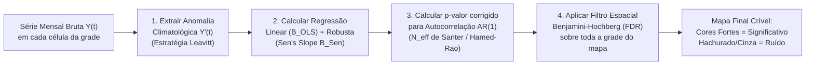

# 05. Outliers, Distância de Mahalanobis, Robustez e Significância Espacial

> **Referência Base:** [`transcricao.txt`](file:///home/zrhyan/Principal/Computation/Space%20Apps/transcricao.txt) (Linhas 1, 5 e 9) + [`ESTRATEGIA_TREND_DETECTIVE.md`](file:///home/zrhyan/Principal/Computation/Space%20Apps/general_strategy/ESTRATEGIA_TREND_DETECTIVE.md) (Seção 4 e Riscos #3, #6)
> **Objetivo para Agentes de IA:** Implementar o tratamento rigoroso de *outliers* bivariados/multivariados via **Elipse e Distância de Mahalanobis**, combinar estimadores robustos com Mínimos Quadrados, e aplicar o estado da arte em testes de **Significância Estatística Espacial** corrigidos para autocorrelação serial e múltiplos testes (FDR).

---

## 1. O Problema dos Outliers e a Elipse de Mahalanobis

Em [`transcricao.txt`](file:///home/zrhyan/Principal/Computation/Space%20Apps/transcricao.txt#L5), ao demonstrar como a correlação evolui de $r = 0{,}905$ para $r = 0{,}94$ e depois $r = 0{,}98$ após o tratamento de *outliers* e aumento de variáveis, Hindemburg esclarece um conceito geométrico crucial que quase todos os programadores erram:

### 1.1 O Que Realmente Define um Outlier em uma Regressão/Correlação?
- **O Erro Comum (Univariado):** Muitos desenvolvedores tentam filtrar *outliers* olhando apenas para o eixo $Y$ isoladamente (ex.: cortar valores onde $|Y - \bar{Y}| > 3\sigma_Y$).
- **A Verdade Geométrica (Bivariada/Multivariada):** Na transcrição, destaca-se que um *outlier* na regressão **não é um ponto extremo num único eixo**, mas sim um ponto **"muito destoante da nuvem de pontos, fora da elipse de contorno"**:
  - Um ponto pode ter um valor moderado em $X$ e moderado em $Y$, mas estar completamente fora da elipse estreita que une $X$ e $Y$ (ex.: os casos citados de William Herschel ou Brian Greene abaixo da elipse, ou Conde de Buffon acima da elipse).
  - Inversamente, um ponto no final de uma série temporal com forte tendência pode ter um valor altíssimo de $Y$, mas estar **perfeitamente em cima da reta de regressão** dentro da elipse! Cortá-lo por um filtro simples de $3\sigma_Y$ amputaria justamente o final da tendência real!

### 1.2 A Distância de Mahalanobis ($D_M$) e a Elipse de Contorno
Conforme mencionado explicitamente em [`transcricao.txt`](file:///home/zrhyan/Principal/Computation/Space%20Apps/transcricao.txt#L5), a métrica matemática correta para definir a borda elíptica de uma nuvem de pontos correlacionada é a **Distância de Mahalanobis**:

$$D_M(z_i) = \sqrt{(z_i - \mu)^T \Sigma^{-1} (z_i - \mu)}$$

Onde $z_i = (x_i, y_i)^T$ é o vetor de observação no ponto $i$, $\mu = (\bar{x}, \bar{y})^T$ é o centro de massa da nuvem e $\Sigma$ é a matriz de covariância amostral (preferencialmente estimada de forma robusta via *Minimum Covariance Determinant* — MCD, ou mediana/MAD).

- **Propriedade Fundamental:**
  - Enquanto a distância euclidiana desenha um **círculo** cego à inclinação e à correlação dos dados, a Distância de Mahalanobis desenha uma **elipse perfeitamente alinhada com o eixo principal da regressão** e cuja largura se estreita automaticamente à medida que $|r| \to 1$.
  - Sob normalidade bivariada, $D_M^2$ segue uma distribuição Qui-Quadrado com 2 graus de liberdade ($\chi^2_2$). Um limiar de $2{,}5\sigma$ a $3{,}0\sigma$ equivalentes identifica com precisão cirúrgica os pontos fora da elipse:
    - **Pontos muito abaixo da elipse ($\text{resíduo padronizado} \ll -2{,}5$):** Eventos de queda anômala abrupta (ex.: seca extrema de 1 mês ou falha de leitura fria de nuvem não filtrada no MODIS).
    - **Pontos muito acima da elipse ($\text{resíduo padronizado} \gg +2{,}5$):** Eventos de pico extremo (ex.: onda de calor recorde, queimada concentrada ou *spike* radiométrico).

### 1.3 Não confunda a Curva com uma Normal Gaussiana!
No final de [`transcricao.txt`](file:///home/zrhyan/Principal/Computation/Space%20Apps/transcricao.txt#L9), Hindemburg introduz um alerta severo sobre o erro sistemático de **confundir distribuições de caudas pesadas (leptocúrticas / Cauchy / Pareto / t-Student / Lévy) com a Distribuição Normal (Gaussiana)**:
- Em Ciências da Terra e Climatologia, extremos hidroclimáticos (chuvas torrenciais, incêndios florestais, anomalias de vento, descargas de rios) **não seguem uma distribuição normal gaussiana**; eles possuem **caudas pesadas (*fat tails*)** ou assimetria pronunciada (distribuições GEV, Gamma, Weibull, Log-Normal).
- **Consequência prática para o nosso código (`DADOS-2`):**
  1. Se assumirmos cegamente distribuição normal usando apenas média e desvio-padrão ordinário (OLS + teste $t$ paramétrico ingênuo) em variáveis com caudas pesadas, um único extremo climático real ou erro de sensor distorcerá a inclinação $B$ e o $p\text{-valor}$.
  2. Por isso, nossa arquitetura estatística deve operar em **Dupla Camada (Paramétrica + Não-Paramétrica Robusta)**.

---

## 2. Regressão Robusta vs. Regressão Clássica: O Protocolo de Dupla Validação

Em vez de escolher cegamente apenas um método ou descartar *outliers* no escuro, o estado da arte para o *Trend Detective* consiste em calcular e comparar:

1. **Estimador Clássico de Mínimos Quadrados (OLS) + Filtro de Mahalanobis:**
   - Calcula $B_{\text{OLS}}$, $r_{\text{Pearson}}$ e identifica os pontos com $D_M > \text{limiar}$ (ou resíduo studentizado $|e_i / \hat{\sigma}_e| > 2{,}5$).
   - **Importante na UI (`PROD-2`):** Não apague os *outliers* silenciosamente do gráfico! Destaque-os com um marcador especial na série temporal (ex.: círculo contornado em alerta) para que o usuário veja onde ocorreu um ano extremo (ex.: Super El Niño 2015/2016 ou Seca Histórica 2023/2024), mas mostre como a tendência é protegida contra eles.
2. **Estimador Robusto de Theil-Sen (*Sen's Slope*) + Teste de Mann-Kendall:**
   - O **Declive de Sen (*Sen's Slope*)** calcula a mediana das inclinações de todas as $\binom{n}{2}$ retas que passam por todos os pares de pontos $(t_i, y_i)$ e $(t_j, y_j)$:
     $$B_{\text{Sen}} = \text{mediana}_{1 \le i < j \le n} \left( \frac{y_j - y_i}{t_j - t_i} \right)$$
   - **Ponto de Ruptura (*Breakdown Point*) de $29{,}3\%$:** Até quase $30\%$ dos dados da NASA podem estar completamente corrompidos por nuvens ou extremos severos sem que $B_{\text{Sen}}$ seja distorcido!
   - Quando $B_{\text{OLS}}$ e $B_{\text{Sen}}$ concordam em sinal e magnitude, a confiança na tendência é máxima. Quando divergem fortemente, isso é um diagnóstico imediato de que a série é dominada por poucos eventos extremos nas pontas!

---

## 3. Estado da Arte em Significância Estatística: Respondendo "É Estatisticamente Significativo?"

A 4ª pergunta obrigatória do desafio da NASA é: ***"Are these variations statistically significant?"*** (*Essas variações são estatisticamente significativas?*).
Na maioria dos projetos de hackathon, os participantes apenas pegam o `pvalue` padrão do `scipy.stats.linregress(t, y)` e comparam com $0{,}05$. **Fazer apenas isso em dados climáticos espaciais da NASA comete dois erros graves** já identificados em [`ESTRATEGIA_TREND_DETECTIVE.md`](file:///home/zrhyan/Principal/Computation/Space%20Apps/general_strategy/ESTRATEGIA_TREND_DETECTIVE.md#L277) (Autocorrelação e Falsos Positivos em Massa).

Veja como nossa equipe resolverá ambos com rigor de estado da arte e baixíssimo custo computacional:

### 3.1 Erro Grave A: Autocorrelação Serial (Memória Climática $\text{AR}(1)$)
- **O Fenômeno:** Testes clássicos ($t\text{-test}$ de OLS ou Mann-Kendall original) assumem que as observações mensais são **independentes**. Porém, o clima tem inércia térmica e hídrica: se o oceano ou aquífero estava anomalamente quente/seco em março, ele continuará quente/seco em abril (autocorrelação de lag-1 positiva, $\rho_1 > 0$).
- **A Consequência:** Com $\rho_1 > 0$, o número real de graus de liberdade independentes ($N_{\text{efetivo}}$) é **muito menor** que o número de meses $N$. O teste ingênuo acha que tem $N = 240$ observações independentes quando na verdade tem o equivalente a $N_{\text{efetivo}} \approx 40$, gerando $p\text{-valores}$ artificialmente minúsculos e **falsos positivos de tendência**!
- **A Correção de Estado da Arte (Tamanho Amostral Efetivo de Santer et al. / Hamed & Rao):**
  1. **Para Regressão Linear ($t\text{-test}$ corrigido para $\text{AR}(1)$, método de Santer et al., 2000 — padrão do IPCC):**
     - Calcula-se a autocorrelação de lag-1 dos resíduos da regressão: $\rho_1 = \text{corr}(e_t, e_{t-1})$.
     - Ajusta-se o tamanho efetivo da amostra ($N_{\text{eff}}$):
       $$N_{\text{eff}} = N \cdot \frac{1 - \rho_1}{1 + \rho_1} \quad (\text{para } \rho_1 > 0)$$
     - O erro-padrão da inclinação $B$ é corrigido usando $N_{\text{eff}} - 2$ graus de liberdade em vez de $N - 2$:
       $$SE_{\text{corrigido}}(B) = SE_{\text{OLS}}(B) \cdot \sqrt{\frac{N - 2}{N_{\text{eff}} - 2}}$$
  2. **Para Mann-Kendall (Teste de Hamed & Rao, 1998):**
     - Disponível nativamente em Python via `pymannkendall.hamed_rao_modification_test(y)`, que corrige a variância da estatística $S$ de Kendall pela estrutura de autocorrelação da série.

### 3.2 Erro Grave B: Multiplicidade de Testes Espaciais (Falsos Positivos em Massa no Mapa)
- **O Fenômeno:** Conforme alertado no Risco #6 de [`ESTRATEGIA_TREND_DETECTIVE.md`](file:///home/zrhyan/Principal/Computation/Space%20Apps/general_strategy/ESTRATEGIA_TREND_DETECTIVE.md#L496), se o nosso mapa tem uma grade de, digamos, $2.000$ células espaciais e aplicarmos $p < 0{,}05$ individualmente em cada célula sob uma hipótese nula verdadeira (onde nada está mudando no planeta), $5\%$ de $2.000 = \mathbf{100}\text{ regiões}$ acenderão no mapa como "estatisticamente significativas" por puro acaso!
- **A Correção de Estado da Arte (Controle da Taxa de Falsas Descobertas — FDR de Benjamini-Hochberg, 1995):**
  - Em vez da correção de Bonferroni (que é excessivamente conservadora e apaga tendências reais), a climatologia moderna (Wilks, 2016) utiliza o procedimento **Benjamini-Hochberg (FDR)** sobre o conjunto de $M$ células do mapa:
    1. Ordenam-se os $M$ $p\text{-valores}$ (já corrigidos por autocorrelação) em ordem crescente: $p_{(1)} \le p_{(2)} \le \dots \le p_{(M)}$.
    2. Encontra-se o maior índice $k$ tal que:
       $$p_{(k)} \le \frac{k}{M} \cdot \alpha_{\text{FDR}} \quad (\text{com } \alpha_{\text{FDR}} = 0{,}05)$$
    3. Todas as células com $p_{(i)} \le p_{(k)}$ são declaradas **espacialmente significativas com controle de FDR**!
  - **Implementação em 1 linha de código Python (`scipy.stats.false_discovery_control(p_values, method='bh')`):** Já vem nativo no `scipy.stats` moderno e leva menos de 1 milissegundo para rodar em toda a grade!

---

## 4. Classificação Visual e Semântica da Significância para o Usuário (`PROD-1` / `PROD-2` / `NARR`)

Para responder à 4ª pergunta sem exigir que o usuário seja doutor em estatística, traduziremos os números rigorosos acima em **3 Níveis Claros de Evidência Científica**:

| Nível na Interface | Critério Matemático (`DADOS-2`) | Representação no Mapa (`PROD-1`) | Explicação Automática (`NARR` / `PROD-2`) |
| :--- | :--- | :--- | :--- |
| **🟢 Tendência Confirmada (Alta Confiança)** | $p_{\text{AR1}} < 0{,}01$, aprovado no filtro espacial **FDR ($q < 0{,}05$)**, e concordância de sinal entre $B_{\text{OLS}}$ e $B_{\text{Sen}}$. | Cor sólida vibrante (Azul/Vermelho pleno), contorno nítido. | *"Sim, altamente significativa ($p < 0{,}01$, validada contra memória climática e falsos positivos espaciais). A chance de essa tendência ser mero acaso ou ciclo curto é inferior a 1%."* |
| **🟡 Tendência Emergente / Moderada** | $0{,}01 \le p_{\text{AR1}} < 0{,}05$ (significativa localmente, ou na fronteira do FDR). | Cor intermediária com leve transparência. | *"Moderadamente significativa ($p < 0{,}05$). Há um sinal consistente de mudança, mas com variabilidade interanual importante."* |
| **⚪ Sem Tendência Significativa (Domínio de Ruído/Ciclo)** | $p_{\text{AR1}} \ge 0{,}05$ ou discordância entre estimador robusto e linear. | Desaturado / Cinza translúcido ou hachurado pontilhado (*stippling*). | *"Não significativa ($p = \dots$). As oscilações observadas neste período estão dentro da faixa de variabilidade natural ou ciclos como El Niño, não configurando tendência secular comprovada."* |
