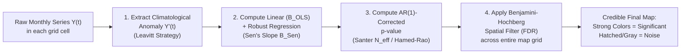

# 05. Outliers, Mahalanobis Distance, Robustness, and Spatial Significance

> **Base Reference:** `transcricao.txt` (Lines 1, 5, and 9) + [`ESTRATEGIA_TREND_DETECTIVE.md`](../general_strategy/ESTRATEGIA_TREND_DETECTIVE.md) (Section 4 and Risks #3, #6)
> **Goal for AI Agents:** Implement rigorous bivariate/multivariate *outlier* handling via **Mahalanobis Ellipse and Distance**, combine robust estimators with Ordinary Least Squares, and apply state-of-the-art **Spatial Statistical Significance** tests corrected for serial autocorrelation and multiple testing (FDR).

---

## 1. The Outlier Problem and the Mahalanobis Ellipse

In `transcricao.txt` (Line 5), when demonstrating how correlation improves from $r = 0.905$ to $r = 0.94$ and then $r = 0.98$ after *outlier* treatment and adding variables, Hindemburg clarifies a crucial geometric concept that almost all programmers get wrong:

### 1.1 What Truly Defines an Outlier in a Regression/Correlation?
- **The Common (Univariate) Error:** Many developers try to filter *outliers* by looking only at the $Y$-axis in isolation (e.g., cutting values where $|Y - \bar{Y}| > 3\sigma_Y$).
- **The Geometric Truth (Bivariate/Multivariate):** The transcript emphasizes that an *outlier* in regression **is not an extreme point along a single axis**, but rather a point **"far out of step with the point cloud, outside the contour ellipse"**:
  - A point may have a moderate value in $X$ and a moderate value in $Y$, yet lie completely outside the narrow ellipse linking $X$ and $Y$ (e.g., the cited cases of William Herschel or Brian Greene below the ellipse, or Comte de Buffon above the ellipse).
  - Conversely, a point at the end of a strongly trending time series may have a very high $Y$ value, yet sit **right on top of the regression line** inside the ellipse! Cutting it with a naive $3\sigma_Y$ filter would amputate the very end of the real trend!

### 1.2 Mahalanobis Distance ($D_M$) and the Contour Ellipse
As explicitly mentioned in `transcricao.txt` (Line 5), the proper mathematical metric for defining the elliptical boundary of a correlated point cloud is **Mahalanobis Distance**:

$$D_M(z_i) = \sqrt{(z_i - \mu)^T \Sigma^{-1} (z_i - \mu)}$$

Where $z_i = (x_i, y_i)^T$ is the observation vector at point $i$, $\mu = (\bar{x}, \bar{y})^T$ is the cloud's center of mass, and $\Sigma$ is the sample covariance matrix (preferably estimated robustly via *Minimum Covariance Determinant* — MCD, or median/MAD).

- **Fundamental Property:**
  - Whereas Euclidean distance draws a **circle** blind to slope and correlation, Mahalanobis Distance draws an **ellipse perfectly aligned with the principal regression axis**, whose width automatically narrows as $|r| \to 1$.
  - Under bivariate normality, $D_M^2$ follows a Chi-Squared distribution with 2 degrees of freedom ($\chi^2_2$). An equivalent threshold of $2.5\sigma$ to $3.0\sigma$ pinpoints points outside the ellipse with surgical precision:
    - **Points far below the ellipse ($\text{standardized residual} \ll -2.5$):** Abrupt anomalous drop events (e.g., 1-month extreme drought or unfiltered cold cloud-contamination reading in MODIS).
    - **Points far above the ellipse ($\text{standardized residual} \gg +2.5$):** Extreme spike events (e.g., record heatwave, concentrated wildfire, or radiometric *spike*).

### 1.3 Do Not Confuse the Curve with a Gaussian Normal!
At the end of `transcricao.txt` (Line 9), Hindemburg introduces a stern warning about the systematic error of **confusing heavy-tailed distributions (leptokurtic / Cauchy / Pareto / Student-$t$ / Lévy) with the Normal (Gaussian) Distribution**:
- In Earth Sciences and Climatology, hydroclimatic extremes (torrential rainfall, wildfires, wind anomalies, river discharges) **do not follow a Gaussian normal distribution**; they exhibit **heavy tails (*fat tails*)** or pronounced skewness (GEV, Gamma, Weibull, Log-Normal distributions).
- **Practical consequence for our code (`DADOS-2`):**
  1. If we blindly assume normality using only ordinary mean and standard deviation (OLS + naive parametric $t$-test) on heavy-tailed variables, a single real climate extreme or sensor glitch will distort slope $B$ and the $p\text{-value}$.
  2. Therefore, our statistical architecture must operate in **Dual Layer (Parametric + Robust Nonparametric)**.

---

## 2. Robust Regression vs. Classical Regression: The Dual-Validation Protocol

Rather than blindly picking a single method or silently discarding *outliers*, the state-of-the-art approach for *Trend Detective* is to compute and compare:

1. **Classical Ordinary Least Squares (OLS) + Mahalanobis Filter:**
   - Computes $B_{\text{OLS}}$, $r_{\text{Pearson}}$, and flags points with $D_M > \text{threshold}$ (or studentized residual $|e_i / \hat{\sigma}_e| > 2.5$).
   - **Important in the UI (`PROD-2`):** Do not silently delete *outliers* from the chart! Highlight them with a special marker on the time series (e.g., alert-outlined circle) so the user sees where an extreme year occurred (e.g., 2015/2016 Super El Niño or 2023/2024 Historic Drought), while showing how the trend is protected against them.
2. **Robust Theil-Sen Estimator (*Sen's Slope*) + Mann-Kendall Test:**
   - **Sen's Slope** computes the median of the slopes of all $\binom{n}{2}$ lines passing through every pair of points $(t_i, y_i)$ and $(t_j, y_j)$:
     $$B_{\text{Sen}} = \text{median}_{1 \le i < j \le n} \left( \frac{y_j - y_i}{t_j - t_i} \right)$$
   - **$29.3\%$ Breakdown Point:** Nearly $30\%$ of NASA data can be completely corrupted by clouds or severe extremes without distorting $B_{\text{Sen}}$!
   - When $B_{\text{OLS}}$ and $B_{\text{Sen}}$ agree in sign and magnitude, confidence in the trend is maximal. When they diverge sharply, that is an immediate diagnostic that the series is dominated by a few extreme events at the endpoints!

---

## 3. State of the Art in Statistical Significance: Answering "Is It Statistically Significant?"

The 4th mandatory question of the NASA challenge is: ***"Are these variations statistically significant?"***
In most hackathon projects, participants simply grab the default `pvalue` from `scipy.stats.linregress(t, y)` and compare it against $0.05$. **Doing only that on NASA spatial climate data commits two grave errors** already identified in [`ESTRATEGIA_TREND_DETECTIVE.md`](../general_strategy/ESTRATEGIA_TREND_DETECTIVE.md#L277) (Autocorrelation and Mass False Positives).

Here is how our team will solve both with state-of-the-art rigor and minimal computational cost:

### 3.1 Grave Error A: Serial Autocorrelation (Climate Memory $\text{AR}(1)$)
- **The Phenomenon:** Classical tests (OLS $t\text{-test}$ or original Mann-Kendall) assume that monthly observations are **independent**. However, climate has thermal and hydrological inertia: if the ocean or aquifer was anomalously warm/dry in March, it will remain warm/dry in April (positive lag-1 autocorrelation, $\rho_1 > 0$).
- **The Consequence:** With $\rho_1 > 0$, the true number of independent degrees of freedom ($N_{\text{effective}}$) is **much smaller** than the number of months $N$. The naive test thinks it has $N = 240$ independent observations when it really has the equivalent of $N_{\text{effective}} \approx 40$, producing artificially tiny $p\text{-values}$ and **false-positive trends**!
- **State-of-the-Art Correction (Effective Sample Size of Santer et al. / Hamed & Rao):**
  1. **For Linear Regression ($\text{AR}(1)$-corrected $t\text{-test}$, Santer et al., 2000 method — IPCC standard):**
     - Compute lag-1 autocorrelation of regression residuals: $\rho_1 = \text{corr}(e_t, e_{t-1})$.
     - Adjust effective sample size ($N_{\text{eff}}$):
       $$N_{\text{eff}} = N \cdot \frac{1 - \rho_1}{1 + \rho_1} \quad (\text{for } \rho_1 > 0)$$
     - The standard error of slope $B$ is corrected using $N_{\text{eff}} - 2$ degrees of freedom instead of $N - 2$:
       $$SE_{\text{corrected}}(B) = SE_{\text{OLS}}(B) \cdot \sqrt{\frac{N - 2}{N_{\text{eff}} - 2}}$$
  2. **For Mann-Kendall (Hamed & Rao Test, 1998):**
     - Natively available in Python via `pymannkendall.hamed_rao_modification_test(y)`, which adjusts the variance of Kendall's $S$ statistic for the series' autocorrelation structure.

### 3.2 Grave Error B: Spatial Multiple Testing (Mass False Positives on the Map)
- **The Phenomenon:** As warned in Risk #6 of [`ESTRATEGIA_TREND_DETECTIVE.md`](../general_strategy/ESTRATEGIA_TREND_DETECTIVE.md#L496), if our map has a grid of, say, $2,000$ spatial cells and we apply $p < 0.05$ individually to each cell under a true null hypothesis (where nothing is changing on the planet), $5\%$ of $2,000 = \mathbf{100}\text{ regions}$ will light up on the map as "statistically significant" by pure chance!
- **State-of-the-Art Correction (Benjamini-Hochberg False Discovery Rate — FDR Control, 1995):**
  - Instead of Bonferroni correction (which is overly conservative and erases real trends), modern climatology (Wilks, 2016) uses the **Benjamini-Hochberg (FDR)** procedure over the set of $M$ map cells:
    1. Sort the $M$ $p\text{-values}$ (already corrected for autocorrelation) in ascending order: $p_{(1)} \le p_{(2)} \le \dots \le p_{(M)}$.
    2. Find the largest index $k$ such that:
       $$p_{(k)} \le \frac{k}{M} \cdot \alpha_{\text{FDR}} \quad (\text{with } \alpha_{\text{FDR}} = 0.05)$$
    3. All cells with $p_{(i)} \le p_{(k)}$ are declared **spatially significant with FDR control**!
  - **1-line Python implementation (`scipy.stats.false_discovery_control(p_values, method='bh')`):** Built natively into modern `scipy.stats` and runs in under 1 millisecond across the entire grid!

---

## 4. Visual and Semantic Classification of Significance for the User (`PROD-1` / `PROD-2` / `NARR`)

To answer the 4th question without requiring the user to hold a PhD in statistics, we translate the rigorous numbers above into **3 Clear Tiers of Scientific Evidence**:

| UI Tier | Mathematical Criterion (`DADOS-2`) | Map Representation (`PROD-1`) | Automatic Explanation (`NARR` / `PROD-2`) |
| :--- | :--- | :--- | :--- |
| **🟢 Confirmed Trend (High Confidence)** | $p_{\text{AR1}} < 0.01$, passes spatial **FDR ($q < 0.05$)** filter, and sign agreement between $B_{\text{OLS}}$ and $B_{\text{Sen}}$. | Solid vibrant color (full Blue/Red), sharp contour. | *"Yes, highly significant ($p < 0.01$, validated against climate memory and spatial false positives). The chance that this trend is mere noise or a short cycle is under 1%."* |
| **🟡 Emerging / Moderate Trend** | $0.01 \le p_{\text{AR1}} < 0.05$ (locally significant, or at the FDR boundary). | Intermediate color with slight transparency. | *"Moderately significant ($p < 0.05$). There is a consistent signal of change, but with substantial interannual variability."* |
| **⚪ No Significant Trend (Noise/Cycle Domain)** | $p_{\text{AR1}} \ge 0.05$ or disagreement between robust and linear estimator. | Desaturated / Translucent gray or dotted hatching (*stippling*). | *"Not significant ($p = \dots$). Oscillations observed in this period fall within natural variability or cycles like El Niño, not establishing a proven secular trend."* |
