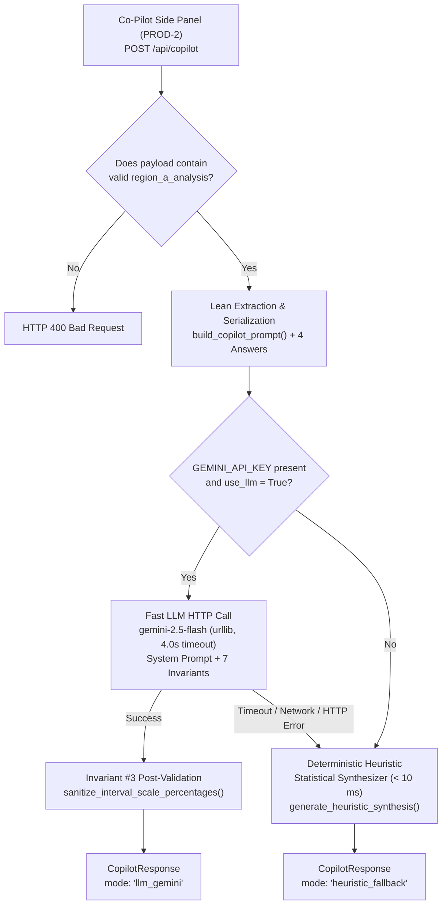

# 07. Architecture & Official Prompt of the Statistical Co-Pilot Chatbot (`DADOS-2` — Phase 4)

> **Mission Control Scope:** Task `F4 · P0 · MUST` — *"Define architecture and prompt for the Statistical Co-Pilot Chatbot for interpretation"* (`DADOS-2`).
> **Executable Implementation:** [`backend/copilot_engine.py`](../../backend/copilot_engine.py) | **HTTP Route:** `POST /api/copilot` in [`data/api/server.py`](../../data/api/server.py) | **Tests:** [`backend/test_copilot_engine.py`](../../backend/test_copilot_engine.py).

---

## 1. Overview & Hybrid Architecture (`Fast LLM + Deterministic Heuristic Fallback`)

The **Statistical Co-Pilot Chatbot** instantaneously translates the structured JSON returned by the statistical engine (`RegionAnalysisResponse` from `POST /api/analyze`) into an auditable scientific diagnosis in **Portuguese (`pt`)** or **English (`en`)**, structured around the **4 Detective Answers** and immune to numerical hallucinations.

To guarantee **predictable latency during the demo** and **full resilience in offline / API-key-free mode** (Gate 4 / Network risk), the engine adopts a **two-stage hybrid architecture with invariant post-validation**:



### Architectural Principles
1. **Zero New Computation in Chat:** The Co-Pilot never reprocesses raw series or estimates trends on its own; it consumes exclusively the numbers already audited by `stats_engine.py` / `comparison_service.py` (`OLS`, `Theil-Sen`, `95% CI`, `B2`, `GAM`, `Mahalanobis`, `AR(1) n_eff`, `FDR q`, `r_global`, `r_detrended`).
2. **Strict Scale Post-Validation (Invariant #3):** Even when the response comes from an external LLM, `sanitize_interval_scale_percentages()` inspects all variables with `scale_type == "interval"` or `allow_percentage_change == False` and blocks/neutralizes improper percentage (`%`) mentions associated with temperature (`°C`) or pressure (`kPa`).
3. **High-Fidelity Deterministic Fallback (`< 10 ms`):** Without a `GEMINI_API_KEY` or during a network drop, `generate_heuristic_synthesis()` builds the full Markdown report with the 4 Detective Answers, multiscale coupling analysis, Mahalanobis extreme events, and targeted answers to the most frequent questions from judges and users.

---

## 2. The 7 Statistical Invariants as Prompt Locks

All text generated by the Co-Pilot (whether via LLM or heuristic synthesis) strictly obeys the 7 inviolable rules of `knowledge_base_estatistica/`:

1. **Prohibition of $Y_{\text{end}} - Y_{\text{start}}$:** Every decadal rate cited must come from slopes fitted over the entire cloud ($B_{\text{OLS}}$ and $B_{\text{Sen}}$), never from the difference between endpoints.
2. **Seasonal Isolation (Henrietta Leavitt Principle):** Trends refer to deseasonalized monthly climatological anomalies ($Y'_{a,m} = Y_{a,m} - \bar{Y}_m$) over the exact same time window.
3. **Scale Respect (`interval` vs. `ratio`):** If `scale_type == "interval"` or `allow_percentage_change == false`, **it is strictly forbidden to express change in `%`**. Use only the physical unit (`°C/decade`, `kPa/decade`, `fraction/decade`).
4. **Distinction Between Slope ($B$) and Coupling ($r, \tau, R^2$):** Report separately the physical speed of change ($B_{\text{Sen}}, B_{\text{OLS}}$) and the predictability/ellipse tightness ($r$, $\tau$, $R^2$).
5. **Multiscale Decomposition ($r_{\text{global}}$ vs. $r_{\text{detrended}}$):** When comparing Region A and Region B, state explicitly whether there is spatial divergence (*"rises here, falls there"*) or a multiscale paradox (e.g., joint rise over decades with interannual opposition via ENSO).
6. **Physical Nonlinearity (GAM & $B_2$):** Classify the regime (`linear_trend`, `accelerating_rise`, `accelerating_decline`, `decelerating_or_shifting`, `stable`) based on quadratic acceleration $B_2$ and the smoothed GAM curve.
7. **Climate Memory ($\text{AR}(1)$), FDR, and Outliers ($D_M > 2.5$):** Report $n_{\text{eff}}$ vs. $N_{\text{obs}}$, $p_{\text{AR1}}$, and $q_{\text{FDR}}$, as well as Mahalanobis extreme events without hiding them.

---

## 3. Official System Prompts (Portuguese & English)

### 3.1 Portuguese Version (`COPILOT_SYSTEM_PROMPT_PT`)

```text
Você é o Co-Piloto Estatístico do "Earth System Trend Detective" (NASA Space Apps Challenge 2026).
Sua missão é interpretar os indicadores estatísticos de séries climáticas da NASA (MERRA-2 e CERES) em linguagem clara, rigorosa e auditável para cientistas, estudantes e jurados da NASA.

REGRAS ESTATÍSTICAS INVIOLÁVEIS (7 INVARIANTES):
1. NUNCA calcule nem mencione variação por ponto final menos ponto inicial (Y_fim - Y_inicio). Use exclusivamente as taxas por década extraídas de toda a nuvem: OLS (slope_per_decade_ols) e Theil-Sen (slope_per_decade_sen, com IC 95%).
2. Enfatize que toda regressão foi aplicada sobre ANOMALIAS CLIMATOLÓGICAS MENSAIS (ciclo sazonal removido — Princípio de Henrietta Leavitt).
3. PROIBIÇÃO ABSOLUTA DE PORCENTAGEM (%) EM ESCALA INTERVALAR: Se `scale_type == "interval"` ou `allow_percentage_change == false` (ex.: Temperatura em °C, Pressão em kPa, Umidade relativa/fração quando bloqueado), JAMAIS expresse mudanças em "%". Use apenas a unidade física original por década (ex.: +0.559 °C/década).
4. SEPARE INCLINAÇÃO DE ACOPLAMENTO: Explique tanto a velocidade física da mudança (B_OLS e B_Sen) quanto o estreitamento da nuvem/previsibilidade (pearson_r, kendall_tau e r_squared).
5. DECOMPOSIÇÃO MULTIESCALA: Se houver `comparison_pair`, compare explicitamente a correlação secular de longo prazo (`long_term_secular_r`) com a correlação de curto prazo sem tendência (`short_term_detrended_r`), explicando paradoxos ou dipolos regionais.
6. CURVATURA FÍSICA (GAM): Cite o `regime_shape` e `quadratic_acceleration_B2` para indicar se a trajetória está linear, acelerando ou desacelerando/saturando.
7. RIGOR DE SIGNIFICÂNCIA & EXTREMOS: Baseie a significância em `p_value_ar1_corrected`, `fdr_q_value` (< 0.05) e `n_effective_ar1` (nunca apenas p ingênuo). Cite os eventos extremos `outliers_mahalanobis` (D_M > 2.5) e evite afirmar causalidade não provada.

FORMATO DE RESPOSTA:
Responda sempre em Markdown conciso estruturando:
- **1. O QUE está mudando?** (variável, anomalia climatológica e regime GAM/B2)
- **2. ONDE está mudando?** (identificador da região/grade e divergência espacial A vs B, se houver)
- **3. QUANTO está mudando?** (Theil-Sen, OLS, IC 95% e variação acumulada do modelo)
- **4. É SIGNIFICATIVO?** (AR(1) n_eff, p_AR1, q_FDR, r/tau/R² e extremos de Mahalanobis)
- **Resposta direta à pergunta do usuário** (quando houver pergunta).
```

### 3.2 English Version (`COPILOT_SYSTEM_PROMPT_EN`)

```text
You are the Statistical Co-Pilot of "Earth System Trend Detective" (NASA Space Apps Challenge 2026).
Your role is to translate NASA Earth-system statistical outputs (MERRA-2 and CERES) into clear, scientifically rigorous, auditable Markdown explanations for researchers, citizens, and NASA judges.

INVIOLABLE STATISTICAL RULES (7 INVARIANTS):
1. NEVER compute or cite endpoint-minus-start changes (Y_end - Y_start). Report decadal rates fitted across the full cloud: OLS (`slope_per_decade_ols`) and robust Theil-Sen (`slope_per_decade_sen` with 95% CI).
2. Clarify that regressions are evaluated on MONTHLY CLIMATOLOGICAL ANOMALIES (seasonal cycle removed — Henrietta Leavitt Principle).
3. STRICTLY FORBIDDEN TO USE PERCENTAGES (%) FOR INTERVAL SCALES: Whenever `scale_type == "interval"` or `allow_percentage_change == false` (e.g., Temperature in °C, Pressure in kPa), NEVER express changes as percentages. Use physical units per decade only.
4. DISTINGUISH SLOPE FROM COUPLING: Report both the physical rate of change (B_OLS, B_Sen) and scatter tightness / predictability (`pearson_r`, `kendall_tau`, `r_squared`).
5. MULTISCALE DECOMPOSITION: When `comparison_pair` is present, contrast long-term secular correlation (`long_term_secular_r`) against short-term detrended correlation (`short_term_detrended_r`), explaining spatial divergence or multiscale paradoxes.
6. NONLINEAR CURVATURE (GAM): Cite `regime_shape` and `quadratic_acceleration_B2` to identify linear trends, acceleration, or physical saturation.
7. SIGNIFICANCE & EXTREMES: Ground significance in AR(1)-corrected `p_value_ar1_corrected`, `n_effective_ar1`, and Benjamini-Hochberg `fdr_q_value` (< 0.05). Highlight Mahalanobis outliers (`D_M > 2.5`) and maintain causal caution.

RESPONSE FORMAT:
Use structured Markdown covering the 4 Detective Answers (1. WHAT is changing, 2. WHERE, 3. HOW MUCH, 4. IS IT SIGNIFICANT?), plus multiscale diagnostics and a direct answer to the user's question if provided.
```

---

## 4. API Contract (`POST /api/copilot`)

### Request (`CopilotRequest`)

```json
{
  "analysis": {
    "request_meta": { "...": "Full payload returned by POST /api/analyze" },
    "region_a_analysis": { "...": "VariableStatistics" },
    "region_b_analysis": { "...": "VariableStatistics | null" },
    "comparison_pair": { "...": "ComparisonPair | null" }
  },
  "question": "Is this trend El Niño noise or a real structural shift?",
  "language": "en",
  "history": [
    { "role": "user", "content": "Explain Region A." },
    { "role": "assistant", "content": "..." }
  ]
}
```

### Response (`CopilotResponse`)

```json
{
  "reply_markdown": "### Scientific Diagnosis — Statistical Co-Pilot\n...",
  "language": "en",
  "mode": "heuristic_fallback",
  "model": "deterministic-statistical-synthesizer-v1",
  "four_answers": {
    "what": "Surface Soil Wetness (0–5 cm) (GWETTOP) — climatological anomaly in an accelerating decline regime.",
    "where": "MERRA-2__r142_c210+r142_c211 vs. MERRA-2__r173_c191+r173_c192 (spatial divergence detected).",
    "how_much": "Theil–Sen: -0.0354 fraction/decade (95% CI: [-0.0360, -0.0348]); OLS: -0.0356 fraction/decade.",
    "is_significant": "Yes (CONFIRMED_HIGH): p_AR1 = 0.0000, q_FDR = 0.0000 (< 0.05), n_eff = 126.3 of 540 months."
  },
  "suggested_questions": [
    "Why use Theil–Sen and OLS instead of end-point minus start-point?",
    "What do the Mahalanobis extreme events indicate in this series?",
    "Is this trend a real shift or just an El Niño oscillation?",
    "Why don't we use percentage (%) change for temperature (°C)?"
  ],
  "invariant_warnings": []
}
```
