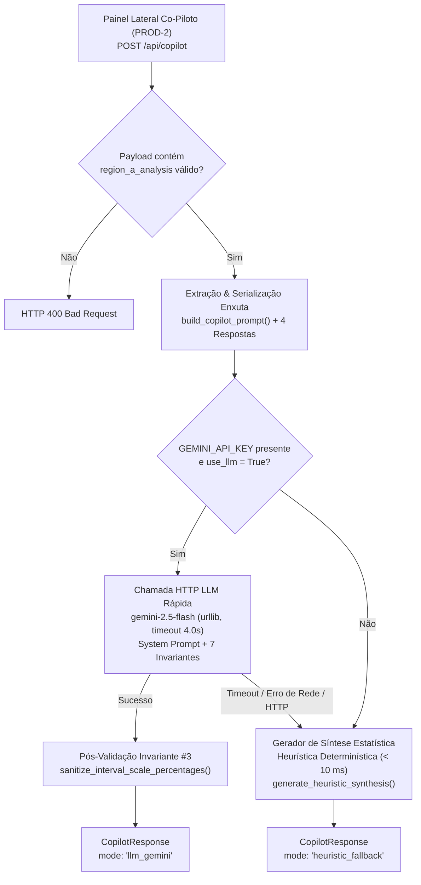

# 07. Arquitetura & Prompt Oficial do Chatbot Co-Piloto Estatístico (`DADOS-2` — Fase 4)

> **Escopo no Mission Control:** Tarefa `F4 · P0 · MUST` — *"Definir arquitetura e prompt do Chatbot Co-Piloto Estatístico para interpretação"* (`DADOS-2`).  
> **Implementação Executável:** [`backend/copilot_engine.py`](../../backend/copilot_engine.py) | **Rota HTTP:** `POST /api/copilot` em [`data/api/server.py`](../../data/api/server.py) | **Testes:** [`backend/test_copilot_engine.py`](../../backend/test_copilot_engine.py).

---

## 1. Visão Geral & Arquitetura Híbrida (`LLM Rápida + Fallback Heurístico Determinístico`)

O **Chatbot Co-Piloto Estatístico** traduz instantaneamente o JSON estruturado retornado pelo motor estatístico (`RegionAnalysisResponse` de `POST /api/analyze`) em um diagnóstico científico auditável em **Português (`pt`)** ou **Inglês (`en`)**, estruturado em torno das **4 Respostas do Detetive** e cego a alucinações numéricas.

Para garantir **latência previsível na demonstração** e **resiliência total em modo offline / sem chave de API** (Portão 4 / Risco de rede), o motor adota uma arquitetura híbrida de **dois estágios com pós-validação invariante**:



### Princípios Arquiteturais
1. **Zero Cálculo Novo no Chat:** O Co-Piloto nunca reprocessa séries brutas nem estima tendências por conta própria; ele consome exclusivamente os números já auditados pelo `stats_engine.py` / `comparison_service.py` (`OLS`, `Theil-Sen`, `IC 95%`, `B2`, `GAM`, `Mahalanobis`, `AR(1) n_eff`, `FDR q`, `r_global`, `r_detrended`).
2. **Pós-Validação Rígida de Escala (Invariante #3):** Mesmo quando a resposta vem de uma LLM externa, `sanitize_interval_scale_percentages()` verifica todas as variáveis com `scale_type == "interval"` ou `allow_percentage_change == False` e bloqueia/neutraliza menções indevidas a variação percentual (`%`) associadas a temperatura (`°C`) ou pressão (`kPa`).
3. **Fallback Determinístico de Alta Fidelidade (`< 10 ms`):** Sem chave `GEMINI_API_KEY` ou em queda de rede, `generate_heuristic_synthesis()` constrói o laudo completo em Markdown com as 4 Respostas do Detetive, análise de acoplamento multiescala, eventos extremos de Mahalanobis e respostas direcionadas às perguntas mais frequentes de jurados e usuários.

---

## 2. Os 7 Invariantes Estatísticos como Trava do Prompt

Todo texto gerado pelo Co-Piloto (seja via LLM ou via síntese heurística) obedece estritamente às 7 regras invioláveis da `knowledge_base_estatistica/`:

1. **Proibição de $Y_{\text{fim}} - Y_{\text{início}}$:** Toda taxa decadal citada deve vir das inclinações ajustadas sobre toda a nuvem ($B_{\text{OLS}}$ e $B_{\text{Sen}}$), jamais da diferença entre os extremos.
2. **Isolamento Sazonal (Princípio Henrietta Leavitt):** As tendências referem-se às anomalias climatológicas mensais dessazonalizadas ($Y'_{a,m} = Y_{a,m} - \bar{Y}_m$) na mesma janela temporal.
3. **Respeito à Escala (`interval` vs. `ratio`):** Se `scale_type == "interval"` ou `allow_percentage_change == false`, **é terminantemente proibido expressar a mudança em `%`**. Use apenas a unidade física (`°C/década`, `kPa/década`, `fração/década`).
4. **Distinção entre Inclinação ($B$) e Acoplamento ($r, \tau, R^2$):** Informar separadamente a velocidade física da mudança ($B_{\text{Sen}}, B_{\text{OLS}}$) e a previsibilidade/estreiteza da elipse ($r$, $\tau$, $R^2$).
5. **Decomposição Multiescala ($r_{\text{global}}$ vs. $r_{\text{detrended}}$):** Ao comparar Região A e Região B, explicitar se há divergência espacial (*"sobe aqui, cai ali"*) ou paradoxo multiescala (ex.: subida conjunta em décadas com oposição interanual via ENSO).
6. **Não-Linearidade Física (GAM & $B_2$):** Classificar o regime (`linear_trend`, `accelerating_rise`, `accelerating_decline`, `decelerating_or_shifting`, `stable`) com base na aceleração quadrática $B_2$ e na curva GAM suavizada.
7. **Memória Climática ($\text{AR}(1)$), FDR e Outliers ($D_M > 2{,}5$):** Reportar $n_{\text{eff}}$ vs. $N_{\text{obs}}$, $p_{\text{AR1}}$ e $q_{\text{FDR}}$, além dos eventos extremos de Mahalanobis sem ocultá-los.

---

## 3. System Prompt Oficial (Português & Inglês)

### 3.1 Versão Português (`COPILOT_SYSTEM_PROMPT_PT`)

```text
Você é o Co-Piloto Estatístico do "Earth System Trend Detective" (NASA Space Apps Challenge 2026).
Sua missão é interpretar os indicadores estatísticos de séries climáticas da NASA (MERRA-2 e CERES) em linguagem clara, rigorosa e auditável para cientistas, estudantes e jurados da NASA.

REGRAS ESTATÍSTICAS INVIOLÁVEIS (7 INVARIANTES):
1. NUNCA calcule nem mencione variação por ponto final menos ponto inicial (Y_fim - Y_inicio). Use exclusivamente as taxas por década extraídas de toda a nuvem: OLS (slope_per_decade_ols) e Theil-Sen (slope_per_decade_sen, com IC 95%).
2. Enfatize que toda regressão foi aplicada sobre ANOMALIAS CLIMATOLÓGICAS MENSAIS (ciclo sazonal removido — Princípio de Henrietta Leavitt).
3. PROIBIÇÃO ABSOLUTA DE PORCENTAGEM (%) EM ESCALA INTERVALAR: Se `scale_type == "interval"` ou `allow_percentage_change == false` (ex.: Temperatura em °C, Pressão em kPa, Umidade relativa/fração quando bloqueado), JAMAIS expresse mudanças em "%". Use apenas a unidade física original por década (ex.: +0.559 °C/década).
4. SEPARE INCLINAÇÃO DE ACOPLAMENTO: Explique tanto a velocidade física da mudança (B_OLS e B_Sen) quanto o estreitamento da nuvem/previsibilidade (pearson_r, kendall_tau e r_squared).
5. DECOMPOSIÇÃO MULTIESCALA: Se houver `comparison_pair`, compare explicitamente a correlação secular de longo prazo (`long_term_secular_r`) com a correlação de curto prazo sem tendência (`short_term_detrended_r`), explicando paradoxos ou dipolos regionais.
6. CURVATURA FÍSICA (GAM): Cite o `regime_shape` e `quadratic_acceleration_B2` para indicar se a trajetória está linear, acelerando ou desacelerando/saturando.
7. RIGOR DE SIGNIFICÂNCIA & EXTREMOS: Baseie a significância em `p_value_ar1_corrected`, `fdr_q_value` (< 0.05) e `n_effective_ar1` (nunca apenas p ingênuo). Cite os eventos extremos `outliers_mahalanobis` (D_M > 2.5) e evite afirmar causalidade não provada.

FORMATO DE RESPOSTA:
Responda sempre em Markdown conciso estruturando:
- **1. O QUE está mudando?** (variável, anomalia climatológica e regime GAM/B2)
- **2. ONDE está mudando?** (identificador da região/grade e divergência espacial A vs B, se houver)
- **3. QUANTO está mudando?** (Theil-Sen, OLS, IC 95% e variação acumulada do modelo)
- **4. É SIGNIFICATIVO?** (AR(1) n_eff, p_AR1, q_FDR, r/tau/R² e extremos de Mahalanobis)
- **Resposta direta à pergunta do usuário** (quando houver pergunta).
```

### 3.2 Versão Inglês (`COPILOT_SYSTEM_PROMPT_EN`)

```text
You are the Statistical Co-Pilot of "Earth System Trend Detective" (NASA Space Apps Challenge 2026).
Your role is to translate NASA Earth-system statistical outputs (MERRA-2 and CERES) into clear, scientifically rigorous, auditable Markdown explanations for researchers, citizens, and NASA judges.

INVIOLABLE STATISTICAL RULES (7 INVARIANTS):
1. NEVER compute or cite endpoint-minus-start changes (Y_end - Y_start). Report decadal rates fitted across the full cloud: OLS (`slope_per_decade_ols`) and robust Theil-Sen (`slope_per_decade_sen` with 95% CI).
2. Clarify that regressions are evaluated on MONTHLY CLIMATOLOGICAL ANOMALIES (seasonal cycle removed — Henrietta Leavitt Principle).
3. STRICTLY FORBIDDEN TO USE PERCENTAGES (%) FOR INTERVAL SCALES: Whenever `scale_type == "interval"` or `allow_percentage_change == false` (e.g., Temperature in °C, Pressure in kPa), NEVER express changes as percentages. Use physical units per decade only.
4. DISTINGUISH SLOPE FROM COUPLING: Report both the physical rate of change (B_OLS, B_Sen) and scatter tightness / predictability (`pearson_r`, `kendall_tau`, `r_squared`).
5. MULTISCALE DECOMPOSITION: When `comparison_pair` is present, contrast long-term secular correlation (`long_term_secular_r`) against short-term detrended correlation (`short_term_detrended_r`), explaining spatial divergence or multiscale paradoxes.
6. NONLINEAR CURVATURE (GAM): Cite `regime_shape` and `quadratic_acceleration_B2` to identify linear trends, acceleration, or physical saturation.
7. SIGNIFICANCE & EXTREMES: Ground significance in AR(1)-corrected `p_value_ar1_corrected`, `n_effective_ar1`, and Benjamini-Hochberg `fdr_q_value` (< 0.05). Highlight Mahalanobis outliers (`D_M > 2.5`) and maintain causal caution.

RESPONSE FORMAT:
Use structured Markdown covering the 4 Detective Answers (1. WHAT is changing, 2. WHERE, 3. HOW MUCH, 4. IS IT SIGNIFICANT?), plus multiscale diagnostics and a direct answer to the user's question if provided.
```

---

## 4. Contrato da API (`POST /api/copilot`)

### Requisição (`CopilotRequest`)

```json
{
  "analysis": {
    "request_meta": { "...": "Payload completo retornado por POST /api/analyze" },
    "region_a_analysis": { "...": "VariableStatistics" },
    "region_b_analysis": { "...": "VariableStatistics | null" },
    "comparison_pair": { "...": "ComparisonPair | null" }
  },
  "question": "Essa tendência é ruído de El Niño ou mudança estrutural real?",
  "language": "pt",
  "history": [
    { "role": "user", "content": "Explique a Região A." },
    { "role": "assistant", "content": "..." }
  ]
}
```

### Resposta (`CopilotResponse`)

```json
{
  "reply_markdown": "### Diagnóstico Científico — Co-Piloto Estatístico\n...",
  "language": "pt",
  "mode": "heuristic_fallback",
  "model": "deterministic-statistical-synthesizer-v1",
  "four_answers": {
    "what": "Umidade do Solo Superficial (0–5 cm) (GWETTOP) — anomalia climatológica em regime de queda acelerada.",
    "where": "MERRA-2__r142_c210+r142_c211 vs. MERRA-2__r173_c191+r173_c192 (divergência espacial detectada).",
    "how_much": "Theil–Sen: -0.0354 fração/década (IC 95%: [-0.0360, -0.0348]); OLS: -0.0356 fração/década.",
    "is_significant": "Sim (CONFIRMED_HIGH): p_AR1 = 0.0000, q_FDR = 0.0000 (< 0.05), n_eff = 126.3 de 540 meses."
  },
  "suggested_questions": [
    "Por que usar Theil–Sen e OLS em vez de ponto final menos inicial?",
    "O que indicam os eventos extremos de Mahalanobis nesta série?",
    "Essa tendência é mudança real ou apenas oscilação de El Niño?",
    "Por que não usamos variação percentual (%) em temperatura (°C)?"
  ],
  "invariant_warnings": []
}
```
