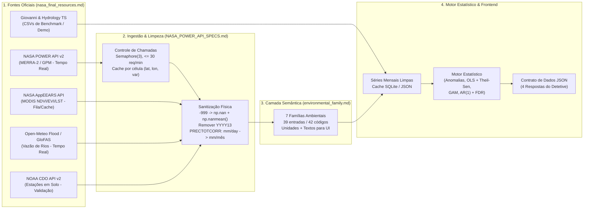

# 00. Índice Geral & Arquitetura de Dados — *Be An Earth System Trend Detective!*

> **Propósito deste Diretório (`context/knowledge_data/`):**
> Este arquivo é o **Ponto de Entrada Único (Índice de Dados)** para a camada de Engenharia de Dados, APIs oficiais e Catálogo de Variáveis Ambientais do projeto **Earth System Trend Detective** (NASA Space Apps 2026).
>
> **Protocolo de Leitura Seletiva:** Sempre que um agente de IA for trabalhar na parte de dados (`DADOS-1`, `DADOS-2`), seletores/unidades de interface (`PROD-1`, `PROD-2`) ou contexto investigativo (`NARR`), deve começar por este índice e abrir **apenas** os arquivos e intervalos de linhas necessários.
>
> **Documentos Relacionados:** [`00_MASTER_CONTEXT_AND_ROUTER.md`](file:///home/felipe-martins/dev/repository/earth-system-detective-fliflop-34/00_MASTER_CONTEXT_AND_ROUTER.md) (roteador geral) | [`00_INDICE_E_ARQUITETURA_ESTATISTICA.md`](file:///home/felipe-martins/dev/repository/earth-system-detective-fliflop-34/context/knowledge_base_estatistica/00_INDICE_E_ARQUITETURA_ESTATISTICA.md) (camada estatística).

---

## 🧭 Roteador Rápido por Tarefa: "Qual Dúvida de Dados Você Precisa Resolver Agora?"

| Se a sua dúvida ou tarefa de dados atual é... | Leia APENAS este arquivo e intervalo de linhas |
| :--- | :--- |
| **Qual API usar para cada tipo de dado** (tempo real vs. fila/cache vs. validação) e por que **não** baixar/recortar arquivos `.hdf`/`.nc4` ao vivo | 👉 [`nasa_final_resources.md#L7-L20`](file:///home/felipe-martins/dev/repository/earth-system-detective-fliflop-34/context/knowledge_data/nasa_final_resources.md#L7-L20) |
| **Quais combinações de variáveis e perguntas investigativas sugerir por bioma** (Área Urbana, Floresta/Agro, Bacia Hidrográfica, Semiárido) | 👉 [`nasa_final_resources.md#L23-L33`](file:///home/felipe-martins/dev/repository/earth-system-detective-fliflop-34/context/knowledge_data/nasa_final_resources.md#L23-L33) |
| **Qual é o pipeline de 4 etapas do backend Python** (padronização mensal, sazonalidade com Mann-Kendall, Sen's Slope $\times 120$, cache em disco/SQLite) | 👉 [`nasa_final_resources.md#L36-L50`](file:///home/felipe-martins/dev/repository/earth-system-detective-fliflop-34/context/knowledge_data/nasa_final_resources.md#L36-L50) |
| **Como tratar máscara oceânica (`-999` em `GWETTOP`/`GWETROOT`), chave anual `YYYY13` e conversão de `PRECTOTCORR` (`mm/day` $\to$ `mm/mês`)** | 👉 [`NASA_POWER_API_SPECS.md#L7-L22`](file:///home/felipe-martins/dev/repository/earth-system-detective-fliflop-34/context/knowledge_data/NASA_POWER_API_SPECS.md#L7-L22) |
| **Quando usar `/point` vs. `/regional`, limites de bbox (`2°×2°` a `10°×10°`), grade MERRA-2 ($0{,}5^\circ \times 0{,}625^\circ$), rate limits (`30 req/min`, `Semaphore(3)`), células adjacentes ($K \le 9$) e JSON vs. Parquet** | 👉 [`NASA_POWER_API_SPECS.md#L25-L54`](file:///home/felipe-martins/dev/repository/earth-system-detective-fliflop-34/context/knowledge_data/NASA_POWER_API_SPECS.md#L25-L54) |
| **Família 1 — Temperatura e Calor** (`T2M`, `T2M_MAX`, `T2M_MIN`, `T2M_RANGE`, `TS`, `LST_Day_CMG`, `LST_Night_CMG`, `T2MDEW`) | 👉 [`environmental_family.md#L7-L20`](file:///home/felipe-martins/dev/repository/earth-system-detective-fliflop-34/context/knowledge_data/environmental_family.md#L7-L20) |
| **Família 2 — Chuva e Umidade Atmosférica** (`PRECTOTCORR`, `GPM_3IMERGM`, `RH2M`, `QV2M`, `TQV`) | 👉 [`environmental_family.md#L23-L33`](file:///home/felipe-martins/dev/repository/earth-system-detective-fliflop-34/context/knowledge_data/environmental_family.md#L23-L33) |
| **Família 3 — Solo, Seca Agrícola e Evapotranspiração** (`GWETTOP`, `GWETROOT`, `GWETPROF`, `Evap_tavg`, `Qs_acc`) | 👉 [`environmental_family.md#L36-L47`](file:///home/felipe-martins/dev/repository/earth-system-detective-fliflop-34/context/knowledge_data/environmental_family.md#L36-L47) |
| **Família 4 — Rios, Vazão e Bacias Hidrográficas** (`river_discharge`, `river_discharge_mean`, `river_discharge_max`, `river_discharge_min`) | 👉 [`environmental_family.md#L50-L59`](file:///home/felipe-martins/dev/repository/earth-system-detective-fliflop-34/context/knowledge_data/environmental_family.md#L50-L59) |
| **Família 5 — Vegetação, Florestas e Uso da Terra** (`_1_km_monthly_NDVI`, `_1_km_monthly_EVI`, `Lai_500m`, `ALLSKY_SRF_ALB`) | 👉 [`environmental_family.md#L62-L71`](file:///home/felipe-martins/dev/repository/earth-system-detective-fliflop-34/context/knowledge_data/environmental_family.md#L62-L71) |
| **Família 6 — Radiação Solar, Nuvens, Ventos e Atmosfera** (`ALLSKY_SFC_SW_DWN`, `CLRSKY_SFC_SW_DWN`, `ALLSKY_SFC_LW_DWN`, `CLOUD_AMT`, `WS2M`/`WS10M`, `WS50M`, `PS`, `AOD_550`) | 👉 [`environmental_family.md#L74-L87`](file:///home/felipe-martins/dev/repository/earth-system-detective-fliflop-34/context/knowledge_data/environmental_family.md#L74-L87) |
| **Família 7 — Estações Meteorológicas em Solo / NOAA CDO** (`PRCP`, `TAVG`, `TMAX`/`TMIN`, `SNOW`/`SNWD`, `AWND`) | 👉 [`environmental_family.md#L90-L99`](file:///home/felipe-martins/dev/repository/earth-system-detective-fliflop-34/context/knowledge_data/environmental_family.md#L90-L99) |

---

## 📚 Catálogo Detalhado dos Documentos de `context/knowledge_data/`

| Documento | Tamanho | Foco Técnico e Conteúdo Coberto | Agentes-Alvo |
| :--- | :---: | :--- | :--- |
| **[`nasa_final_resources.md`](file:///home/felipe-martins/dev/repository/earth-system-detective-fliflop-34/context/knowledge_data/nasa_final_resources.md)** | 50 linhas (~5,8 KB) | **Arquitetura de Fontes e Pipeline Backend:** • **Seção 1 (`#L7-L20`):** Matriz das 5 fontes oficiais (**NASA POWER**, **NASA AppEEARS**, **Open-Meteo Flood/GloFAS**, **NOAA CDO v2**, **Giovanni & Hydrology TS**) + decisão de escopo contra recorte ao vivo de `.hdf`/`.nc4`. • **Seção 2 (`#L23-L33`):** Camada de descoberta guiada por bioma (Urbano, Floresta/Cerrado/Agro, Bacia/Rio, Árido/Semiárido). • **Seção 3 (`#L36-L50`):** Pipeline de 4 etapas (padronização mensal + `-999` $\to$ `NaN`, sazonalidade, Sen's Slope $\times 120$, cache em disco/SQLite). | `DADOS-1`, `DADOS-2`, `NARR` |
| **[`NASA_POWER_API_SPECS.md`](file:///home/felipe-martins/dev/repository/earth-system-detective-fliflop-34/context/knowledge_data/NASA_POWER_API_SPECS.md)** | 54 linhas (~5,1 KB) | **Especificações Validadas da NASA POWER API v2:** • **Seção 1 (`#L7-L12`):** Máscara oceânica (`-999` em `GWETTOP`/`GWETROOT` $\to$ `np.nan` + `np.nanmean()`). • **Seção 2 (`#L15-L22`):** Filtro obrigatório de `YYYY13` e conversão de `PRECTOTCORR` (`mm/day` $\to$ `mm/mês` via `calendar.monthrange`). • **Seção 3 (`#L25-L35`):** Comparativo `/point` (até 20 vars, ~0,8–1,8s) vs. `/regional` (1 var, bbox `2°×2°` a `10°×10°`, ~1,5–3,5s) e grade MERRA-2 ($0{,}5^\circ \times 0{,}625^\circ$). • **Seção 4 (`#L38-L48`):** Rate limit (`30 req/min`), concorrência (`asyncio.Semaphore(3)` + backoff), composição flexível de células ($K \le 9$) e cache por célula `(lat, lon, var)`. • **Seção 5 (`#L51-L54`):** Avaliação Parquet vs. JSON (manter fluxo JSON direto). | `DADOS-1`, `PROD-1` |
| **[`environmental_family.md`](file:///home/felipe-martins/dev/repository/earth-system-detective-fliflop-34/context/knowledge_data/environmental_family.md)** | 99 linhas (~11,1 KB) | **Catálogo Completo de Variáveis na Interface (39 linhas / 42 códigos em 7 Famílias):** • **Família 1 (`#L7-L20`):** Temperatura e Calor (8 entradas). • **Família 2 (`#L23-L33`):** Chuva e Umidade Atmosférica (5 entradas). • **Família 3 (`#L36-L47`):** Solo, Seca Agrícola e Evapotranspiração (5 entradas). • **Família 4 (`#L50-L59`):** Rios, Vazão e Bacias Hidrográficas (4 entradas). • **Família 5 (`#L62-L71`):** Vegetação, Florestas e Uso da Terra (4 entradas). • **Família 6 (`#L74-L87`):** Radiação Solar, Nuvens, Ventos e Atmosfera (8 entradas). • **Família 7 (`#L90-L99`):** Estações Meteorológicas em Solo / NOAA CDO (5 entradas). Inclui código exato da API, modo (`Tempo Real`, `Fila / Cache`, `Validação / Demo`), unidade física e texto explicativo para UI. | `PROD-1`, `PROD-2`, `DADOS-1`, `NARR` |

---

## 🏗️ Fluxo de Arquitetura de Dados (Da Fonte Bruta ao Contrato JSON)

---

## ⚡ Resumo Executivo das 5 Regras Invioláveis de Engenharia de Dados (`DADOS-1`)

1. **Tratamento Rigoroso de Máscara Oceânica (`-999` $\to$ `NaN`):** A NASA POWER API usa `-999` como sentinela (inclusive para células oceânicas de `GWETTOP` e `GWETROOT` do MERRA-2 Land). Nunca transforme `-999` em zero (pois `0` é valor físico real em chuva/umidade); substitua por `np.nan` e use `np.nanmean()` nas agregações espaciais.
2. **Filtro de `YYYY13` e Conversão de `PRECTOTCORR`:** Descarte obrigatoriamente a chave anual `YYYY13` das séries mensais da NASA POWER antes de qualquer cálculo. Para `PRECTOTCORR` (comunidade `AG`), lembre-se que a API retorna taxa média diária (`mm/day`): multiplique por `calendar.monthrange(ano, mes)[1]` para obter o volume acumulado em `mm/mês`.
3. **Estratégia `/point` vs. `/regional`, Concorrência e Cache por Célula:** Na grade MERRA-2 ($0{,}5^\circ \times 0{,}625^\circ$), uma composição $3\times 3$ mede $1{,}5^\circ \times 1{,}875^\circ$ (abaixo do mínimo de `2°×2°` do endpoint `/regional`, que aceita apenas 1 parâmetro por chamada e no máximo `10°×10°` síncrono). Para composições livres de $K \le 9$ células adjacentes, prefira `/point` (até 20 parâmetros) com **`asyncio.Semaphore(3)`**, respeitando **30 req/min** e cache individual por `(lat, lon, var)`.
4. **Proibição de Recorte Dinâmico de NetCDF/HDF em Tempo Real:** Nunca faça download nem recorte dinâmico de arquivos pesados `.hdf` ou `.nc4` (via `earthaccess`/Harmony) durante a navegação interativa do usuário. Use APIs JSON/CSV leves (POWER, GloFAS, NOAA) ou CSVs pré-processados em cache para AppEEARS/GLDAS/Giovanni.
5. **Fluxo Direto JSON $\to$ JSON (Sem Parquet Intermediário no Fluxo Principal):** Como a NASA POWER entrega JSON e o Frontend consome o Contrato de Dados em JSON para séries mensais leves (~530 pontos por célula), mantenha o pipeline direto com cache em disco/SQLite sem introduzir conversão desnecessária para Parquet. *(Nota de integração: o cálculo estatístico final sobre as séries limpas deve respeitar os 7 Invariantes Estatísticos definidos em [`00_MASTER_CONTEXT_AND_ROUTER.md#L52-L63`](file:///home/felipe-martins/dev/repository/earth-system-detective-fliflop-34/00_MASTER_CONTEXT_AND_ROUTER.md#L52-L63)).*
