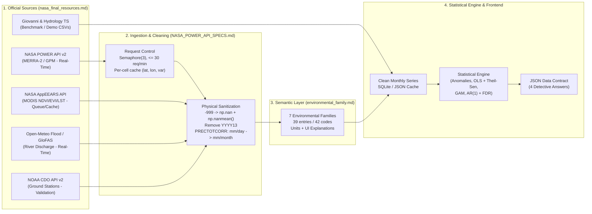

# 00. General Index & Data Architecture — *Be An Earth System Trend Detective!*

> **Purpose of This Directory (`context/knowledge_data/`):**
> This file is the **Single Entry Point (Data Index)** for the Data Engineering layer, official APIs, and Environmental Variable Catalog of **Earth System Trend Detective** (NASA Space Apps 2026).
>
> **Selective Reading Protocol:** Whenever an AI agent works on data (`DADOS-1`, `DADOS-2`), UI selectors/units (`PROD-1`, `PROD-2`), or investigative context (`NARR`), start with this index and open **only** the required files and line ranges.
>
> **Continuous Update Rule:** Whenever something essential in the data layer changes or is created (new `.md` files in `context/knowledge_data/`, ingestion/processing scripts, endpoints, variables, or API rules), immediately update this index (line-range router, catalog, diagram, or rules) and sync the essential summary in [`00_MASTER_CONTEXT_AND_ROUTER.md`](../../00_MASTER_CONTEXT_AND_ROUTER.md).
>
> **Related Documents:** [`00_MASTER_CONTEXT_AND_ROUTER.md`](../../00_MASTER_CONTEXT_AND_ROUTER.md) (general router) | [`00_INDICE_E_ARQUITETURA_ESTATISTICA.md`](../knowledge_base_estatistica/00_INDICE_E_ARQUITETURA_ESTATISTICA.md) (statistical layer).

---

## 🧭 Quick Task Router: "Which Data Question Do You Need to Solve Right Now?"

| If your current data question or task is... | Read ONLY this file and line range |
| :--- | :--- |
| **Which API to use for each data type** (real-time vs. queue/cache vs. validation) and why **not** to download/subset `.hdf`/`.nc4` files live | 👉 [`nasa_final_resources.md#L7-L20`](nasa_final_resources.md#L7-L20) |
| **Which variable combinations and investigative questions to suggest per biome** (Urban Area, Forest/Agri, Watershed, Semi-arid) | 👉 [`nasa_final_resources.md#L23-L33`](nasa_final_resources.md#L23-L33) |
| **What the 4-step Python backend pipeline is** (monthly standardization, Seasonal Mann-Kendall, Sen's Slope $\times 120$, disk/SQLite cache) | 👉 [`nasa_final_resources.md#L36-L50`](nasa_final_resources.md#L36-L50) |
| **How to handle ocean mask (`-999` in `GWETTOP`/`GWETROOT`), annual `YYYY13` key, and `PRECTOTCORR` conversion (`mm/day` $\to$ `mm/month`)** | 👉 [`NASA_POWER_API_SPECS.md#L7-L22`](NASA_POWER_API_SPECS.md#L7-L22) |
| **When to use `/point` vs. `/regional`, bbox limits (`2°×2°` to `10°×10°`), MERRA-2 grid ($0.5^\circ \times 0.625^\circ$), rate limits (`30 req/min`, `Semaphore(3)`), adjacent cells ($K \le 9$), and JSON vs. Parquet** | 👉 [`NASA_POWER_API_SPECS.md#L25-L54`](NASA_POWER_API_SPECS.md#L25-L54) |
| **Family 1 — Temperature and Heat** (`T2M`, `T2M_MAX`, `T2M_MIN`, `T2M_RANGE`, `TS`, `LST_Day_CMG`, `LST_Night_CMG`, `T2MDEW`) | 👉 [`environmental_family.md#L7-L20`](environmental_family.md#L7-L20) |
| **Family 2 — Rainfall and Atmospheric Moisture** (`PRECTOTCORR`, `GPM_3IMERGM`, `RH2M`, `QV2M`, `TQV`) | 👉 [`environmental_family.md#L23-L33`](environmental_family.md#L23-L33) |
| **Family 3 — Soil, Agricultural Drought, and Evapotranspiration** (`GWETTOP`, `GWETROOT`, `GWETPROF`, `Evap_tavg`, `Qs_acc`) | 👉 [`environmental_family.md#L36-L47`](environmental_family.md#L36-L47) |
| **Family 4 — Rivers, Discharge, and Watersheds** (`river_discharge`, `river_discharge_mean`, `river_discharge_max`, `river_discharge_min`) | 👉 [`environmental_family.md#L50-L59`](environmental_family.md#L50-L59) |
| **Family 5 — Vegetation, Forests, and Land Cover** (`_1_km_monthly_NDVI`, `_1_km_monthly_EVI`, `Lai_500m`, `ALLSKY_SRF_ALB`) | 👉 [`environmental_family.md#L62-L71`](environmental_family.md#L62-L71) |
| **Family 6 — Solar Radiation, Clouds, Winds, and Atmosphere** (`ALLSKY_SFC_SW_DWN`, `CLRSKY_SFC_SW_DWN`, `ALLSKY_SFC_LW_DWN`, `CLOUD_AMT`, `WS2M`/`WS10M`, `WS50M`, `PS`, `AOD_550`) | 👉 [`environmental_family.md#L74-L87`](environmental_family.md#L74-L87) |
| **Family 7 — Ground Weather Stations / NOAA CDO** (`PRCP`, `TAVG`, `TMAX`/`TMIN`, `SNOW`/`SNWD`, `AWND`) | 👉 [`environmental_family.md#L90-L99`](environmental_family.md#L90-L99) |
| **Which of the 5 APIs require registration/tokens** (`NOAA_CDO_TOKEN`, Earthdata Login) and where to fill credentials (`data/.env`) | 👉 [`data/.env.example`](../../data/.env.example) + [`data/README.md`](../../data/README.md) |
| **Modular Data Backend architecture (`data/`), Python catalog (42 variables), A vs. B contract (`POST /api/analyze` 100% compatible with [`CONTRATO_DE_DADOS.md`](../../CONTRATO_DE_DADOS.md)), and REST API** | 👉 [`data/README.md`](../../data/README.md) + [`data/api/server.py`](../../data/api/server.py) |

---

## 📚 Detailed Catalog of `context/knowledge_data/` Documents

| Document | Size | Technical Focus and Covered Content | Target Agents |
| :--- | :---: | :--- | :--- |
| **[`nasa_final_resources.md`](nasa_final_resources.md)** | 50 lines (~5.8 KB) | **Source Architecture and Backend Pipeline:** • **Section 1 (`#L7-L20`):** Matrix of the 5 official sources (**NASA POWER**, **NASA AppEEARS**, **Open-Meteo Flood/GloFAS**, **NOAA CDO v2**, **Giovanni & Hydrology TS**) + scope decision against live `.hdf`/`.nc4` subsetting. • **Section 2 (`#L23-L33`):** Biome-guided discovery layer (Urban, Forest/Cerrado/Agri, Basin/River, Arid/Semi-arid). • **Section 3 (`#L36-L50`):** 4-step pipeline (monthly standardization + `-999` $\to$ `NaN`, seasonality, Sen's Slope $\times 120$, disk/SQLite cache). | `DADOS-1`, `DADOS-2`, `NARR` |
| **[`NASA_POWER_API_SPECS.md`](NASA_POWER_API_SPECS.md)** | 54 lines (~5.1 KB) | **Validated NASA POWER API v2 Specifications:** • **Section 1 (`#L7-L12`):** Ocean mask (`-999` in `GWETTOP`/`GWETROOT` $\to$ `np.nan` + `np.nanmean()`). • **Section 2 (`#L15-L22`):** Mandatory `YYYY13` filter and `PRECTOTCORR` conversion (`mm/day` $\to$ `mm/month` via `calendar.monthrange`). • **Section 3 (`#L25-L35`):** Comparison of `/point` (up to 20 vars, ~0.8–1.8s) vs. `/regional` (1 var, bbox `2°×2°` to `10°×10°`, ~1.5–3.5s) and MERRA-2 grid ($0.5^\circ \times 0.625^\circ$). • **Section 4 (`#L38-L48`):** Rate limit (`30 req/min`), concurrency (`asyncio.Semaphore(3)` + backoff), flexible cell composition ($K \le 9$), and per-cell `(lat, lon, var)` cache. • **Section 5 (`#L51-L54`):** Parquet vs. JSON evaluation (keep direct JSON flow). | `DADOS-1`, `PROD-1` |
| **[`environmental_family.md`](environmental_family.md)** | 99 lines (~11.1 KB) | **Complete UI Variable Catalog (39 rows / 42 codes across 7 Families):** • **Family 1 (`#L7-L20`):** Temperature and Heat (8 entries). • **Family 2 (`#L23-L33`):** Rainfall and Atmospheric Moisture (5 entries). • **Family 3 (`#L36-L47`):** Soil, Agricultural Drought, and Evapotranspiration (5 entries). • **Family 4 (`#L50-L59`):** Rivers, Discharge, and Watersheds (4 entries). • **Family 5 (`#L62-L71`):** Vegetation, Forests, and Land Cover (4 entries). • **Family 6 (`#L74-L87`):** Solar Radiation, Clouds, Winds, and Atmosphere (8 entries). • **Family 7 (`#L90-L99`):** Ground Weather Stations / NOAA CDO (5 entries). Includes exact API code, mode (`Real-Time`, `Queue / Cache`, `Validation / Demo`), physical unit, and UI explanation text. | `PROD-1`, `PROD-2`, `DADOS-1`, `NARR` |
| **[`data/README.md`](../../data/README.md)** + **Modular `data/` package** (`catalog/`, `models/`, `cache/`, `connectors/`, `services/`, [`api/server.py`](../../data/api/server.py)) + **[`data/.env.example`](../../data/.env.example)** | Architectural guide + 6 stdlib Python subpackages + `.env` template | **Modular Data and Climate Comparison Backend (7 Families / 42 Variables + Frontend Contract):** • Automatic catalog-driven routing ([`environmental_catalog.py`](../../data/catalog/environmental_catalog.py)) and `1 → N` variable contracts ([`contracts.py`](../../data/models/contracts.py)). • Credentials for all 5 APIs centralized in `data/.env` (from [`data/.env.example`](../../data/.env.example), git-ignored). • Disk JSON cache (`data/cache/storage/`), automatic 10-year loop on NOAA CDO with `GHCND -> monthly` fallback for `SNWD` ([`noaa_cdo.py`](../../data/connectors/noaa_cdo.py)), CMR/AppEEARS resolution (`LAADS` + `GES_DISC`), multi-variable batching in [`ingestion_service.py`](../../data/services/ingestion_service.py), and statistical engine aligned with [`CONTRATO_DE_DADOS.md`](../../CONTRATO_DE_DADOS.md) in [`comparison_service.py`](../../data/services/comparison_service.py). • REST endpoints (`GET /api/health`, `GET /api/catalog`, **`POST /api/analyze`**, `POST /api/location/fetch`, `POST /api/compare`) compatible with `frontend/src/services/regionDataAdapter.ts`. | `DADOS-1`, `DADOS-2`, `PROD-1`, `STAT-1` |

---

## 🏗️ Data Architecture Flow (From Raw Source to JSON Contract)

---

## ⚡ Executive Summary of the Inviolable Data Engineering Rules (`DADOS-1`)

1. **Strict Ocean Mask Handling (`-999` $\to$ `NaN`):** The NASA POWER API uses `-999` as a fill value (including ocean cells for MERRA-2 Land `GWETTOP` and `GWETROOT`). Never convert `-999` to zero (since `0` is a valid physical value for rain/moisture); replace with `np.nan` and use `np.nanmean()` in spatial aggregations.
2. **`YYYY13` Filter and `PRECTOTCORR` Conversion:** Mandatory removal of the `YYYY13` annual key from NASA POWER monthly series before any computation. For `PRECTOTCORR` (`AG` community), remember the API returns daily mean rate (`mm/day`): multiply by `calendar.monthrange(year, month)[1]` to obtain monthly totals in `mm/month`.
3. **`/point` vs. `/regional` Strategy, Concurrency, and Per-Cell Cache:** On the MERRA-2 grid ($0.5^\circ \times 0.625^\circ$), a $3\times 3$ composition measures $1.5^\circ \times 1.875^\circ$ (below the `2°×2°` minimum of `/regional`, which accepts only 1 parameter per call and at most `10°×10°` synchronously). For free compositions of $K \le 9$ adjacent cells, prefer `/point` (up to 20 parameters) with **`asyncio.Semaphore(3)`**, respecting **30 req/min** and individual caching per `(lat, lon, var)`.
4. **Prohibition of Live NetCDF/HDF Subsetting:** Never download or dynamically subset heavy `.hdf` or `.nc4` files (via `earthaccess`/Harmony) during interactive user navigation. Use lightweight JSON/CSV APIs (POWER, GloFAS, NOAA) or pre-cached CSVs for AppEEARS/GLDAS/Giovanni.
5. **Direct JSON $\to$ JSON Flow (No Intermediate Parquet in Main Flow):** Since NASA POWER delivers JSON and the Frontend consumes the JSON Data Contract for lightweight monthly series (~530 points per cell), keep the direct pipeline with disk/SQLite cache without introducing unnecessary Parquet conversion. *(Integration note: final statistical computation over clean series must obey the 7 Statistical Invariants defined in [`00_MASTER_CONTEXT_AND_ROUTER.md`](../../00_MASTER_CONTEXT_AND_ROUTER.md)).*
6. **1 Variable per Location Selection (`Location A` vs. `Location B`):** In the main product flow, selecting **Location A** pulls **1 single variable** (`var_a`) for A's cells; selecting **Location B** pulls **1 single variable** (`var_b`) for B's cells (even across distinct APIs, e.g., NASA POWER vs. Open-Meteo GloFAS), aligning the common monthly intersection `[t_0, t_f]` before comparing trends and correlations ($r_{\text{global}}$ and $r_{\text{detrended}}$).
7. **Registration & Validation Status of the 5 APIs (All Live-Validated `OK` on `2026-11-14` via `data/.env`):** **Open without registration:** NASA POWER API v2 and Open-Meteo Flood API (GloFAS). **Free registration & authenticated in `data/.env`:** NOAA CDO API v2 (`NOAA_CDO_TOKEN`), NASA AppEEARS (`/api/login` + `/api/task` HTTP `200` with `EARTHDATA_USERNAME`/`EARTHDATA_PASSWORD`), and NASA Giovanni / GES DISC (portal HTTP `200` + authenticated CMR `GLDAS_NOAH025_M` HTTP `200` with `EARTHDATA_TOKEN`; *note:* the legacy GES DISC Hydrology Data Rods `timeseries.cgi` endpoint redirects `301` to a post-2025-10-31 transition notice).
8. **Layered Modular Architecture in `data/` (Extensible from 1 to N Variables & 100% Frontend-Compatible):** The official implementation lives in [`data/catalog/`](../../data/catalog/environmental_catalog.py), [`data/models/`](../../data/models/contracts.py), [`data/cache/`](../../data/cache/store.py), [`data/connectors/`](../../data/connectors/base.py) (including automatic 10-year chunk loop with `GHCND -> monthly` fallback for `SNWD` in [`noaa_cdo.py`](../../data/connectors/noaa_cdo.py) and live CMR `granules.json` / `LAADS` lookup in [`nasa_giovanni.py`](../../data/connectors/nasa_giovanni.py) and [`nasa_appeears.py`](../../data/connectors/nasa_appeears.py)), [`data/services/`](../../data/services/ingestion_service.py) (`analyze_regions_contract` in [`comparison_service.py`](../../data/services/comparison_service.py#L699-L825)), and [`data/api/`](../../data/api/server.py), documented in [`data/README.md`](../../data/README.md) with credentials configurable via [`data/.env.example`](../../data/.env.example) (REST server `POST /api/analyze` + `POST /api/compare` via `python3 -m data.api.server --port 8000`).
